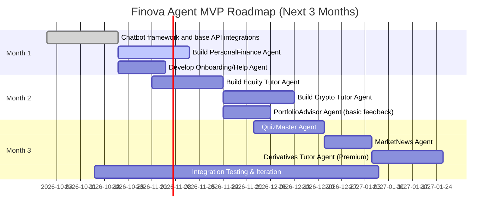
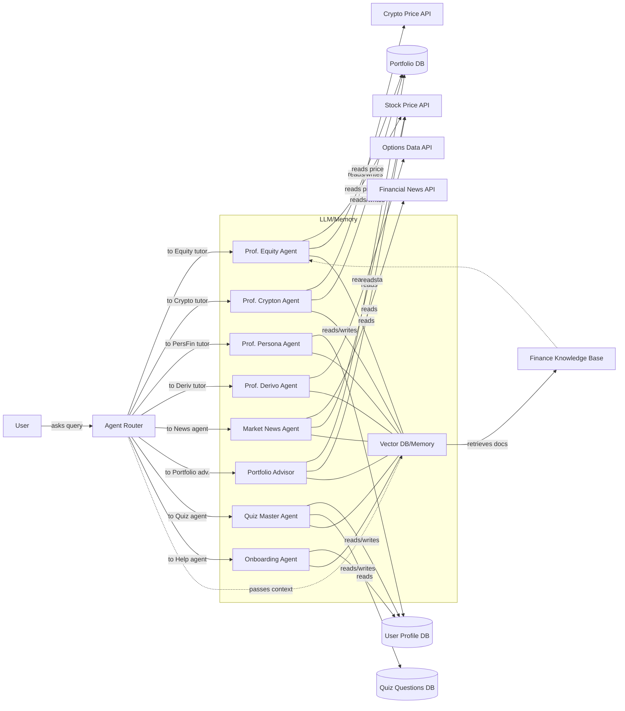

# Executive Summary  
Finova (Quantnova) aims to become a leading **AI-powered financial tutor platform**. It will deploy multiple specialized AI agents (“tutors”) to guide users through learning finance concepts, practicing on a simulated market, and solving challenges. Each agent has a distinct role (e.g. stocks tutor, crypto tutor, budgeting tutor, quiz master, etc.) and accesses the user’s data (progress, portfolio, preferences) plus real-time market/news data. An **orchestration layer** routes user queries to the right agent persona, and agents may collaborate via shared memory and APIs. We recommend a **tiered agent architecture** with a central router, specialized tutors, fallback assistants, and vector-database memory. We also outline the data/AI infrastructure (LLM APIs, RAG for knowledge retrieval, rate limits, monitoring, etc.) and provide a 3-month MVP roadmap.  

Key findings & recommendations: 
- **Agent Roles:** Identify ~8 core tutor agents (Equity, Crypto, PersonalFinance, Derivatives, MarketNews, PortfolioAdvisor, QuizMaster, Onboarding). Each has clear purpose, required inputs (user profile, market APIs, content DB), and example dialogues.  
- **Personalization:** Use agent “personas” and memory to tailor content. For example, “Prof. Equity” uses user’s portfolio and quiz history to adapt lessons. Persona-driven AI agents significantly improve engagement and credibility.  
- **Memory & RAG:** Implement a **tiered memory** (LLM context + external vector store) to retain user data, with RAG to ground factual content. Finova agents should retrieve finance lessons/definitions to avoid hallucinations, and store key user facts for personalized tutoring.  
- **Safeguards:** Explicit disclaimers (“educational only”), compliance (GDPR data deletion), bias mitigation.  
- **Metrics:** Track usage (sessions, messages), engagement (time, quiz scores), learning gains (pre/post quiz), and satisfaction (surveys).  
- **MVP Plan:** Phase development over 3 months, building the core chat framework and highest-impact agents (Personal Finance, Equity tutor, Onboarding first), then adding others (Crypto, Portfolio, quizzes, etc.). Gantt chart below.  

By using a **multi-agent orchestration** with specialized tutors and strong personalization, Finova can stand out from generic chatbots and scale to a market-leading educational tool.  

## Agent Types (Roles)  

1. **Equity Tutor (Prof. Equity)** – *Purpose:* Teach stock market concepts (stocks, ETFs, diversification).  
   - **Capabilities:** Explain terms, analyze charts, answer FAQs, ask guiding questions.  
   - **Example Intents:** “What is an ETF?”, “How do stock indices work?”, “Is Apple stock a good buy?”.  
   - **Conversation Flow:** User asks a stock-related question → Prof. Equity responds with a clear, level-appropriate explanation → asks follow-up to check understanding → suggests a mini-quiz or example.  
   - **Data Inputs:** Real-time stock data (price API), user portfolio holdings, glossary of finance terms.  
   - **Personalization:** Learner’s current knowledge (tracked via past Q&A and quiz results), their portfolio composition (holds Apple, etc.), risk tolerance.  
   - **Safety/Ethics:** Always include a disclaimer (“for educational purposes, not investment advice”), avoid specific trade recommendations or guarantees.  
   - **LLM Prompt Design:** System prompt like “You are Prof. Equity, a friendly stock market tutor. Explain in simple terms and adapt to the user’s level of knowledge.” Provide user profile (e.g. “Novice investor”) and relevant context.  
   - **Memory Needs:** *Short-term:* keep current conversation context. *Long-term:* store user’s asked topics, misconceptions, progress in equities.  
   - **Integrations:** Stock API (e.g. Alpha Vantage), Portfolio DB, Wikipedia/Investopedia APIs for definitions.  
   - **UI Pattern:** Chat interface with inline charts (clickable to ask “why?”), tooltips on financial terms, modal quizzes.  
   - **Effectiveness Metrics:** Improvement in stock-quiz scores, time spent conversing with Equity agent, number of follow-up questions asked by user.  
   - **Complexity:** **Medium** (needs domain data integration and dynamic explanation).  

2. **Crypto Tutor (Prof. Crypton)** – *Purpose:* Teach cryptocurrency and blockchain basics.  
   - **Capabilities:** Explain blockchain, tokens, wallets, market volatility.  
   - **Intents:** “How does blockchain work?”, “Why do crypto prices swing so much?”, “What is DeFi?”.  
   - **Flow:** Similar Q&A flow as Equity, but referencing blockchain examples. May illustrate with recent crypto news or user’s crypto portfolio.  
   - **Data:** Crypto price feeds (CoinGecko API), blockchain news, glossary.  
   - **Personalization:** Prior crypto knowledge, user’s crypto holdings, risk profile.  
   - **Safety:** Clarify risks and regulatory cautions. No investment advice.  
   - **Prompt:** “You are Prof. Crypton, a crypto expert. Explain blockchain and crypto safely.”  
   - **Memory:** Store crypto topics user struggled with, interests (Bitcoin vs altcoins).  
   - **Integration:** Crypto price API, news API, Portfolio DB.  
   - **UI:** Chat + simple animations (e.g. coin flip animations for volatility).  
   - **Metrics:** Quiz improvement on blockchain topics, engagement.  
   - **Complexity:** **Medium** (requires up-to-date crypto data).  

3. **Personal Finance Tutor (Prof. Persona)** – *Purpose:* Teach budgeting, saving, credit scores, financial planning.  
   - **Capabilities:** Explain budgeting methods, calculators, savings plans, debt management.  
   - **Intents:** “How do I create a monthly budget?”, “What affects my credit score?”, “Should I save or invest my bonus?”.  
   - **Flow:** Gathers some user info (income bracket?), explains concept (e.g. 50/30/20 rule), suggests action item.  
   - **Data:** User profile (age, income range, goals), basic budget templates, curated finance tips.  
   - **Personalization:** Tailor advice to user’s goals (first home, education, etc.), spending habits (if known).  
   - **Safety:** Avoid personal data leaks, assure privacy. Do not handle actual transactions.  
   - **Prompt:** “You are Prof. Persona, a friendly personal finance coach helping people save and budget.”  
   - **Memory:** Track user goals, recurring questions (e.g. if user often asks about loans).  
   - **Integration:** Might connect to budgeting tools (or mock them), user account info.  
   - **UI:** Chat + interactive budget planner UI/modal.  
   - **Metrics:** Usage of budgeting tools, completion of “financial health check” quizzes, user-reported financial confidence.  
   - **Complexity:** **Medium** (wide topic scope, but less data-intensive).  

4. **Derivatives Tutor (Prof. Derivo, Premium)** – *Purpose:* Advanced lessons on options, futures, derivatives.  
   - **Capabilities:** Explain options payoff charts, hedging strategies, risk metrics.  
   - **Intents:** “Explain a call option payoff graph”, “How to hedge a stock with futures?”, “What is implied volatility?”.  
   - **Flow:** Presents a scenario (e.g. stock up 10%), explains derivative usage step-by-step, asks verification questions.  
   - **Data:** Derivative pricing API (e.g. Yahoo Options), theoretical formulas, charts.  
   - **Personalization:** Based on user’s advanced level, only accessible to Premium users.  
   - **Safety:** Explicitly repeat “educational purposes only,” as derivatives carry high risk.  
   - **Prompt:** “You are Prof. Derivo, a careful instructor in complex financial derivatives.”  
   - **Memory:** Track which derivative topics user mastered.  
   - **Integration:** Options data API, possibly Monte Carlo simulation engines.  
   - **UI:** Chat + interactive payoff diagram tool.  
   - **Metrics:** Success on derivative quizzes, request rate from Premium users.  
   - **Complexity:** **High** (complex concepts and data).  

5. **Market News / Trends Agent** – *Purpose:* Keep users informed of relevant market events.  
   - **Capabilities:** Summarize daily market headlines, highlight major movers, explain context of news.  
   - **Intents:** “What’s the big news in markets today?”, “How did my portfolio stocks do?”, “Explain this headline”.  
   - **Flow:** On demand or push updates: Agent fetches latest news (API), filters by user’s interests, then explains significance.  
   - **Data:** Financial news APIs (e.g. NewsAPI, Finnews), stock indices.  
   - **Personalization:** Focus on sectors or tickers user follows, local market concerns.  
   - **Safety:** Filter out sensational or unverified news. Cite sources.  
   - **Prompt:** “You are MarketNewsAgent: factual, concise, and contextual summaries of financial news.”  
   - **Memory:** Could note topics user reads often.  
   - **Integration:** NewsAPI, web scraper of major finance sites, trending stock API.  
   - **UI:** News feed panel, chat snippets. Maybe daily notification cards.  
   - **Metrics:** Click-throughs on news cards, time reading news, user queries for explanations.  
   - **Complexity:** **Medium** (real-time data, filtering needed).  

6. **Portfolio Advisor Agent** – *Purpose:* Analyze and advise on user’s simulated portfolio.  
   - **Capabilities:** Calculate portfolio metrics (diversification, risk), simulate changes, suggest rebalancing.  
   - **Intents:** “Is my portfolio diversified?”, “What if I add $X of stock Y?”, “How can I reduce risk?”.  
   - **Flow:** Retrieves current holdings, calculates simple analytics (allocations), communicates in simple terms (e.g. pie charts + chat).  
   - **Data:** User’s portfolio database, current prices, risk models (e.g. beta, Sharpe).  
   - **Personalization:** Knows user’s risk profile and goals, investment timeline.  
   - **Safety:** Reiterate that this is simulated practice, not actual advisory. No actual trading instructions.  
   - **Prompt:** “You are PortfolioAdvisor, helping the user understand portfolio balance and risk.”  
   - **Memory:** Keep history of portfolio changes, past advice given.  
   - **Integration:** Portfolio DB, market price API, simple financial calculation library.  
   - **UI:** Portfolio dashboard with highlighting + chat panel for discussion.  
   - **Metrics:** Use of rebalancing suggestions, changes in simulated portfolio diversity, user trust (feedback).  
   - **Complexity:** **High** (needs financial calculations and DB integration).  

7. **Quiz/Challenge Agent** – *Purpose:* Engage users with interactive quizzes and gamified challenges.  
   - **Capabilities:** Generate questions on demand, grade answers, adapt difficulty.  
   - **Intents:** “Give me a quiz on stocks”, “Daily challenge please”, “I want a new finance challenge”.  
   - **Flow:** Presents question(s), validates user answer, provides feedback/explanation, awards XP.  
   - **Data:** Question bank or LLM-generated questions, user’s past performance.  
   - **Personalization:** Adjust question topics based on weakest areas; track streaks.  
   - **Safety:** Ensure questions are educational (no personal data, no trick questions).  
   - **Prompt:** “You are QuizMaster: create and evaluate finance quiz questions appropriate to the user’s level.”  
   - **Memory:** Store user’s quiz scores, strengths/weaknesses.  
   - **Integration:** Link to reward system (XP, badges).  
   - **UI:** Quiz interface or chat Q&A with options.  
   - **Metrics:** Quiz completion rate, accuracy, user progression through quiz levels.  
   - **Complexity:** **Medium** (question generation moderate, scoring logic).  

8. **Onboarding / Help Agent** – *Purpose:* Guide new users through the app and answer usage questions.  
   - **Capabilities:** Tutorial walkthroughs, answer FAQs about the interface, explain app currency, etc.  
   - **Intents:** “How do I start trading?”, “What is Yarp?”, “Where do I see my XP?”.  
   - **Flow:** Recognizes new user, triggers guided tour, answers navigation queries, or resets context if user confused.  
   - **Data:** App manual, UI element descriptions, previous onboarding steps.  
   - **Personalization:** Remembers which tutorial steps user completed, customizes next prompts.  
   - **Safety:** Simple clarifications; no sensitive info.  
   - **Prompt:** “You are OnboardingGuide, a friendly assistant helping new users navigate Finova.”  
   - **Memory:** Mark completed onboarding tasks, skipped features.  
   - **Integration:** App’s UI state, help documentation database.  
   - **UI:** Pop-up tutorials, help chatbot sidebar.  
   - **Metrics:** Time to first trade, number of help queries, drop-off during onboarding.  
   - **Complexity:** **Low-Medium** (depends on number of features to explain).  

## Agent Orchestration & Architecture  

- **Router/Orchestrator:** A central component (could be a simple intent-classifier or LLM) that parses user queries and directs them to the appropriate agent persona. For example, a query containing stock symbols goes to Equity Tutor, a budget question to Persona. This can be a separate “Routing Agent” or built into the chat interface. Fixed persona profiles and coordination patterns (as suggested by Arbore et al.) help manage this multi-agent workflow.  
- **Persona-Based Prompts:** Each agent has a distinct system prompt setting its “role” (e.g., “Prof. Equity”) which shapes tone and expertise. Research shows that **persona-conditioned prompts** improve engagement and perceived credibility.  
- **Fallback & Escalation:** If the router is unsure, route to a general “Finova Assistant” agent that can either clarify user intent or provide generic help. If an agent cannot answer, it should politely say so and possibly hand off to another agent or recommend learning resources.  
- **Multi-Agent Collaboration:** Some queries may span topics (e.g. user asks “How does market news affect my portfolio?”). The orchestrator might collaborate, e.g. MarketNewsAgent gathers context, then PortfolioAgent explains the impact. Agents share information through a controlled context.  
- **Memory & Knowledge:** Implement a **vector-store (e.g. Pinecone)** to hold embeddings of: (a) vetted financial content (definitions, news summaries) for RAG, and (b) user-specific data (profile, past chat logs). This forms the **persistent memory**. At each query, agents use LLM to retrieve relevant memory/facts (per Crux Digits, RAG fetches knowledge from docs, memory retains user data). We adopt the “tiered memory” pattern: a small in-memory context + external DB. For example, the Equity Tutor can pull the user’s last mistaken concepts from memory to avoid repetition.  
- **Data Integrations:** Agents will call finance APIs as needed. Examples: stock/crypto price APIs, news feeds, credit score simulators, etc. The system handles authentication/quotas. Ensure *caching* where possible (e.g. cache market data for 30s).  
- **Ethics & Safety:** All agents must obey an ethical layer: refuse illegal queries, sanitize inputs, and maintain user privacy. For example, *do not* propagate user’s personal financial data to the LLM without anonymization. Agents should clearly **never** give actual investment advice – explicitly frame all suggestions as learning or hypothetical. Implement content filters (no abuse, no explicit content).  
- **Monitoring & Rate Limits:** Log all agent interactions for QA and compliance. Set per-user rate limits on API calls (e.g. 5 tutor chats/minute) to control costs. Instrument metrics (response times, error rates). Possibly use an observability tool for LLM (see Maxim AI Agents observability) to detect degradation.  

## Tooling & Infrastructure  

- **LLM API:** Use a reliable model (GPT-4/GPT-4o, Claude 3, or Gemini) via API. Consider fine-tuning or prompt engineering per agent. Use OpenAI’s function-call feature or similar to enforce structure (for quiz answers, calculations).  
- **Prompt Design:** Use system messages that define each agent’s role, examples of good answers, and constraints. Include user profile info (e.g. “User is a college student, intermediate level”). Chain-of-thought or few-shot examples can help agents simulate a tutor style.  
- **Vector Database & RAG:** Implement RAG by indexing curated finance tutorials, news archives, and FAQs. Upon user question, retrieve top relevant docs to augment the LLM prompt. This improves accuracy and avoids hallucination. For memory, store embeddings of user’s past conversations, flagged misunderstandings, and long-term learning objectives. LangChain or Pinecone can manage this.  
- **Agent SDKs/Frameworks:** Use an agent orchestration framework (LangChain Agents, LlamaIndex, or commercial like NeuronsLab, Kore.ai) that supports multi-agent workflows. These support memory, retrieval, and tools integration out of box.  
- **Databases:** MongoDB for user data and portfolio. Timeseries DB for caching market prices. Redis for session state and simple caching. Use an embeddings store (vector DB).  
- **Analytics & Monitoring:** Implement tracking for agent metrics (below). Use tools like Prometheus or API logging for usage and error monitoring. Build dashboards (e.g. Grafana) for key metrics.  
- **Security/Privacy:** Host in a secure environment (Vercel/AWS/etc). Ensure all user data (especially memory) is GDPR/CCPA-compliant. Provide user controls to erase their data on request.  

## MVP Prioritization (3-Month Roadmap)  

We suggest a phased rollout, focusing first on core functionality and high-impact agents. The **timeline** below outlines tasks by month:  

- **Month 1:** Establish core chat framework, user management, and integrate market data APIs. Launch **Personal Finance Agent** and **Onboarding Agent** to give immediate value (broad audience, increases retention).  
- **Month 2:** Add domain experts: **Equity Tutor** and **Crypto Tutor** (high user interest areas). Also a simple **Portfolio Advisor** (focus on balancing assets, no deep analytics yet).  
- **Month 3:** Introduce **Gamification** with the QuizMaster (fun engagement) and **News Agent** (real-world context). Finally, build the advanced **Derivatives Tutor** as a premium offering. Meanwhile refine memory, personalization, and test extensively.  

This roadmap ensures users see early success (basic tutoring and tasks) and gradually expands.  

## Agent Comparison  

| Agent Type           | Purpose / Key Role                                | Core Capabilities                        | Integration                | Complexity  |
|----------------------|----------------------------------------------------|------------------------------------------|----------------------------|-------------|
| **Equity Tutor**     | Teach stocks, trading concepts                     | Explain stock terms; analyze charts; answer stock market Qs | Stock price APIs, Portfolio DB, Finance content DB | Medium-High |
| **Crypto Tutor**     | Explain blockchain and cryptocurrencies            | Clarify blockchain, tokens; volatility Q&A | Crypto price APIs, NewsAPI | Medium      |
| **Personal Finance** | Budgeting, saving, credit, financial planning      | Budget planning; expense analysis; saving tips | User profile DB, Budget templates | Medium      |
| **Derivatives Tutor**| Advanced options/futures education (premium)       | Option payoff, hedging strategies         | Options data API, Simulation tools | High        |
| **Market News Agent**| Summarize and explain financial news               | News aggregation; trending analysis       | News API, Market API       | Medium      |
| **Portfolio Advisor**| Analyze user’s simulated portfolio                 | Compute allocation, risk metrics; suggest diversification | Portfolio DB, Market API | High        |
| **Quiz/Challenge**   | Generate quizzes, challenges to reinforce learning | Adaptive question generation; grading     | Question DB, User Progress DB | Medium      |
| **Onboarding/Help**  | Guide users through app features                   | Walk-through steps; FAQs; tooltips       | App documentation, Tutorial scripts | Low-Medium |

Each agent’s **strengths/weaknesses**: Domain tutors (Equity/Crypto) offer deep expertise but need rich data; PersonalFinance covers broad appeal but less technical. MarketNews and PortfolioAdvisor add real-world context but require careful data handling. The **QuizMaster** boosts engagement but must balance difficulty. Onboarding improves retention but has limited scope. 

## Entity/Agent Relationship Diagram  

This diagram illustrates users interacting via a **Router** that assigns queries to each specialized agent. Agents pull data from APIs and a shared memory store (vector DB), and respond back to the user. The **LLM** for each agent uses its persona prompt and relevant context (user data, retrieved docs) to generate answers.

## Recommendations & Challenges  

- **Personalization is crucial:** As Arbore et al. note, on-demand persona and context adaptation make agents more effective. Finova should dynamically adjust tutor depth and style based on user history.  
- **Content grounding:** Use RAG for facts. A recent study showed RAG chatbots greatly reduce hallucinations in educational settings. Finova’s agents should query a finance knowledge base (encyclopedia entries, curated lessons) when answering factual questions.  
- **Memory design:** Follow a tiered memory approach. E.g., keep the latest conversation in the LLM context, archive summaries of past sessions (user’s profile, misconceptions) in a vector DB. For example, if a user repeatedly misses a concept, the Equity Tutor can recall this long-term memory and revisit the topic.  
- **Ethical/Safety constraints:** Agents must clearly state limitations and avoid advice. Since user profile memory may contain personal data, implement strict privacy controls (e.g. GDPR deletion). Maintain a “forgetting” mechanism so that a user can erase their memory footprint on request.  
- **Scalability:** Start with a few robust agents, then refine. Monitor each agent’s effectiveness (user ratings, quiz improvements) and retire or improve underperforming ones. Over time, expand with new agents (e.g. fixed income tutor, tax tutor) using the same framework.  

By following this multi-agent, persona-driven approach with solid infrastructure and ethical guardrails, Finova will deliver a **highly personalized, engaging fintech learning experience**. 

