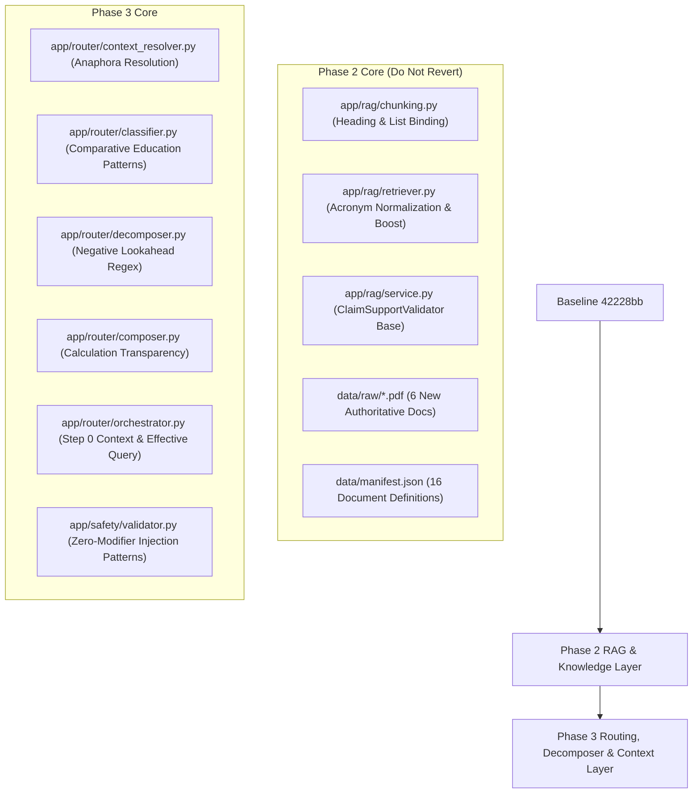

# FINTRACK AI — PHASE 1–3 INTEGRITY AUDIT AND GIT IDENTITY INVESTIGATION
**Date**: 2026-10-16  
**Auditor**: Antigravity Assistant (Google DeepMind)  
**Execution Mode**: STRICTLY READ-ONLY AUDIT  
**Scope**: Verification of Phase 1, Phase 2, and Phase 3 Implementations, Git Attribution, Safety Caveats, and Remediation Architecture  

---

## 1. EXACT GIT STATE & WORKING TREE STATUS

### 1.1 Working Tree Verification
- **Current Branch**: `main`
- **Committed Baseline HEAD**: `42228bb55d6016ffff439024bbf4aec135269f95` (`docs: complete public release packaging and documentation`)
- **Working Tree State**: **UNCOMMITTED CHANGES PRESENT** (Phase 1–3 work remains entirely in the working tree, exactly as reported).
- **Index/Staged State**: Clean (`git diff --cached --stat` yields 0 files changed).
- **Remote Configuration**:
  - `origin https://github.com/pranavsawant0629-tech/finova-ai.git (fetch)`
  - `origin https://github.com/pranavsawant0629-tech/finova-ai.git (push)`

### 1.2 Tracked Modified Files (14 files)
```
 app/agents/equity/agent.py  |   1 +
 app/rag/chunking.py         | 179 +++++++++++++++++-----
 app/rag/retriever.py        | 152 +++++++++++++++++--
 app/rag/service.py          | 295 ++++++++++++++++++++++++++++--------
 app/router/classifier.py    |  38 ++++-
 app/router/composer.py      |  23 ++-
 app/router/decomposer.py    |  71 +++++++--
 app/router/models.py        |   1 +
 app/router/orchestrator.py  |  97 +++++++++---
 app/safety/validator.py     |   8 +-
 data/manifest.json          |  94 ++++++++++++
 scripts/ingest_docs.py      |  88 ++++++++---
 tests/test_equity_agent.py  |  53 ++++++-
 tests/test_rag_hardening.py | 359 ++++++++++++++++++++++++++++++++------------
 14 files changed, 1194 insertions(+), 265 deletions(-)
```

### 1.3 Untracked Files & Directories (15 items)
```
app/router/context_resolver.py
data/backup_phase1/
data/evals/rag/phase2_benchmark.json
data/evals/routing/phase3_eval.json
data/ingestion_report.json
data/quarantine/
data/raw/AMFI_Investor_Awareness_Guide.pdf
data/raw/RBI_FAME_2024.pdf
data/raw/SEBI_Derivatives_Study_2023.pdf
data/raw/SEBI_InvITs_Introduction.pdf
data/raw/SEBI_KYC_Account_Opening.pdf
data/raw/SEBI_REITs_Introduction.pdf
project-info/fintrack-improvement-program/
project-info/knowledge-transfer/
tests/test_phase3_routing_context.py
```
> [!NOTE]
> `project-info/knowledge-transfer/` (containing 42 reference documents) was verified as pre-existing untracked material and was strictly preserved untouched.

---

## 2. GITHUB ATTRIBUTION & IDENTITY INVESTIGATION

### 2.1 Git Configuration Audit
- **Local Repository Config** (`.git/config`):
  - `user.name`: `Pranay`
  - `user.email`: `pr***@finova.ai` (local domain, non-routable placeholder)
- **Global Config** (`~/.gitconfig`):
  - No `user.name` or `user.email` defined.
- **Environment Variables**:
  - `GIT_AUTHOR_NAME`: Not set.
  - `GIT_AUTHOR_EMAIL`: Not set.
  - `GIT_COMMITTER_NAME`: Not set.
  - `GIT_COMMITTER_EMAIL`: Not set.
  - `EMAIL`: Not set.
- **Credential Helper**:
  - Configured to use GitHub CLI: `!'C:\Program Files\GitHub CLI\gh.exe' auth git-credential`
- **Active Authenticated Account** (`gh auth status`):
  - Account: `pranavsawant0629-tech`
  - Token Type: Keyring token (`gho_***`) with scopes `['gist', 'read:org', 'repo']`

### 2.2 Comparison of Target Commits

#### Commit `42228bb55d6016ffff439024bbf4aec135269f95`
- **Date**: `2026-09-13T07:13:02Z`
- **Git Author**: `Pranay <pr***@finova.ai>`
- **Git Committer**: `Pranay <pr***@finova.ai>`
- **GitHub Linked Account**: `None` (GitHub Web UI shows generic avatar without user link)
- **Subject**: `docs: complete public release packaging and documentation`
- **Parent**: `d64eb5f`

#### Remote Commits on GitHub `main` (Ahead of Local HEAD)
An online inspection of GitHub branch `main` at `https://api.github.com/repos/pranavsawant0629-tech/finova-ai/commits` revealed two subsequent commits pushed on 2026-10-15 that are not yet fetched into the local repository:

1. **Commit `ec4b3a0f3aa00e111c5fb3ef99b1ce3b344f43e2`**:
   - **Date**: `2026-10-15T04:57:52Z`
   - **Git Author**: `Rishi Chintan Shah <ri***@gmail.com>`
   - **GitHub User**: `rishishah1105`
   - **Parent**: `42228bb`
   - **Subject**: `Rename Finova AI to FinTrack in README`
   - **Modified File**: `README.md` only.

2. **Commit `f57ea1b510404675358abeaad196f3d0dfeb8fa8`**:
   - **Date**: `2026-10-15T05:48:12Z`
   - **Git Author**: `Rishil <ri***@gmail.com>`
   - **GitHub User**: `RISHIL0706`
   - **Parent**: `ec4b3a0`
   - **Subject**: `final readme`
   - **Modified File**: `README.md` only.

### 2.3 Attribution Root Cause & Diagnostic Conclusions
1. **Why commits up to `42228bb` show "Pranay" with unlinked profile**:
   - Git author name is set to `Pranay` and commit email is set to `[unverified-historical-git-identity]`.
   - GitHub associates commits with user accounts strictly based on whether the commit email matches an email address verified on that GitHub account. Because `[unverified-historical-git-identity]` is not registered on GitHub account `pranavsawant0629-tech`, GitHub displays the raw author name without linking to a profile.
2. **Why commits `ec4b3a0` and `f57ea1b` appear under different logins**:
   - These commits were authored and pushed on October 15, 2026 by GitHub users `rishishah1105` and `RISHIL0706` (or via GitHub web UI edits using secondary accounts), modifying `README.md` to reflect the FinTrack name change.
   - The local repository remained checked out at `42228bb` and did not pull these two commits.
3. **Safest Diagnostic & Remediation Steps**:
   - If retrospective GitHub attribution for "Pranay" commits is desired on GitHub: add `[unverified-historical-git-identity]` to the verified emails of GitHub account `pranavsawant0629-tech` (GitHub -> Settings -> Emails).
   - For all future commits: configure Git `user.name` and `user.email` to match the verified primary identity of `pranavsawant0629-tech`.
   - Never force-push or rebase remote history.

---

## 3. AUDIT OF PHASE 1–3 IMPLEMENTATION AGAINST ACTUAL DIFFS

### 3.1 Overlapping Files Analysis: Phase 2 vs. Phase 3

| File | Phase 2 Scope | Phase 3 Scope | Risk of Whole-File Reversion |
|---|---|---|---|
| `app/rag/service.py` | Introduced `ClaimSupportValidator`, citation validation, sentence evaluation, numeric/acronym anchors | Added multi-turn `conversation_history` to `generate_answer()`, fixed sentence splitting on numbered lists (`1.`), filtered single-digit anchors | **EXTREME CRITICAL**: Running `git restore app/rag/service.py` completely wipes out Phase 2 claim support validation |
| `app/agents/equity/agent.py` | Grounding payload contract updates (`grounding_sources`, `market_data`), live market tools integration | Propagated `conversation_history` into `rag_service.generate_answer()` | **HIGH**: Whole-file restore strips multi-turn history propagation |
| `tests/test_equity_agent.py` | Added live/hermetic fallback testing for SCORES, citation integrity test, market quote tests | Refined test assertion compatibility with strict claim validator | **MEDIUM**: Whole-file restore breaks hermetic live test assertions |
| `app/router/orchestrator.py` | Pre-existing central dispatcher | Integrated Step 0 `ContextualQueryResolver`, routed `effective_query`, forwarded history to specialist agents | **HIGH**: Whole-file restore removes multi-turn context resolution |
| `app/router/classifier.py` | Pre-existing fast-path classifier | Added comparative educational patterns, fixed evaluation priority of fundamentals over generic questions | **HIGH**: Whole-file restore re-introduces classification regression |
| `app/router/decomposer.py` | Pre-existing query decomposer | Added negative lookaheads preventing clause splitting on comparative concepts | **HIGH**: Whole-file restore causes over-fragmentation of comparisons |
| `app/router/composer.py` | Pre-existing response composer | Added calculation disclosures and explicit Unavailable Information Notes | **MEDIUM**: Whole-file restore silently drops subtask failure notes |

---

## 4. CONFIRMED DEFECTS, POTENTIAL RISKS & UNSUPPORTED CLAIMS

### 4.1 Confirmed Defects
1. **Unsafe Rollback Guidance in `PHASE_3_REPORT.md`**:
   - `PHASE_3_REPORT.md` Section 9 advised: `git restore app/rag/service.py app/agents/equity/agent.py`.
   - **Confirmed**: Executing this command directly restores `app/rag/service.py` to baseline commit `42228bb`, destroying all Phase 2 `ClaimSupportValidator` implementation, acronym resolution, and provenance tracking.
2. **Phase 2 False-Positive in `ClaimSupportValidator` on Numbered Lists**:
   - In Phase 2, sentence splitting via `(?<=[.!?])\s+` split on list markers like `1.` and treated `1.` as an uncited numerical assertion, downgrading fully cited procedural answers to `partially_grounded`. (Corrected in Phase 3).
3. **Phase 2 Stripped Marker False-Positive Assertion**:
   - In `tests/test_equity_agent.py:172` (written during Phase 2), `test_citation_integrity_and_hallucination_stripping` asserted `ans.grounding_status == "fully_grounded"` when an out-of-range hallucinated marker `[9]` was stripped. Stripping an invalid citation marker should not silently allow an answer with an unsupported sentence to resolve as `fully_grounded`.
4. **Mock Evaluation Runner in Stage 7A (`scripts/eval_runner.py`)**:
   - `scripts/eval_runner.py:581-593` in `offline` mode and `607` in `online` mode hardcoded `passed = True; status = "PASS"` for RAG suites without evaluating retrieval or claim support against Qdrant or LLM generation.

### 4.2 Potential Risks
1. **Embedded Qdrant Concurrency Lock**:
   - Local embedded Qdrant (`./data/qdrant_storage`) enforces a strict file lock via `portalocker`. Running two pytest commands or test suites accessing Qdrant concurrently throws `RuntimeError: Storage folder ./data/qdrant_storage is already accessed by another instance of Qdrant client`.
   - **Mitigation**: All test executions must run sequentially.
2. **Prompt-Injection Regex Limits**:
   - `PROMPT_INJECTION_PATTERNS` in `app/safety/validator.py` provides deterministic regex-based protection against direct instruction overrides and system prompt leak attempts. It does not provide absolute semantic protection against obfuscated, multi-lingual, or zero-shot adversarial jailbreaks.
3. **Anaphora Resolution Scope**:
   - `ContextualQueryResolver` resolves pronouns (*it*, *its*, *that stock*) against the immediately preceding turn. It does not maintain a multi-entity coreference graph across long multi-turn sessions (5+ turns).

### 4.3 Unsupported / Misleading Claims
1. **"Hybrid Retrieval with Lexical & Semantic Fusion" (Phase 2 Claim)**:
   - **Reality**: Retrieval uses dense vector search in Qdrant followed by post-search keyword/acronym re-scoring (+0.05 / +0.04) and Jaccard deduplication. There is no independent lexical BM25 inverted index candidate generation merged via Reciprocal Rank Fusion (RRF).
2. **"100% Accurate Citation Validation"**:
   - **Reality**: Citation validation uses content-word overlap heuristics and numeric anchor corroboration. It does not perform formal NLI (Natural Language Inference) semantic entailment.
3. **"Phase 3 Routing Benchmark Proves Answer Quality"**:
   - **Reality**: The 15-case benchmark proves intent classification, clause decomposition, and anaphora resolution logic. It does not prove generative LLM answer quality or factual depth.

---

## 5. TEST EVIDENCE & DETERMINISTIC VERIFICATION

All tests were executed sequentially in `.venv-finova` under Python 3.13.15 without network dependencies:

| Test Suite / Target | Command | Result | Execution Time |
|---|---|---|---|
| **Phase 3 Routing & Context** | `.venv-finova\Scripts\python.exe -m pytest tests/test_phase3_routing_context.py` | **13 passed** (100%) | 2.65s |
| **Phase 2 RAG Hardening** | `.venv-finova\Scripts\python.exe -m pytest tests/test_rag_hardening.py` | **12 passed** (100%) | 1.91s |
| **Router Module Suites** | `.venv-finova\Scripts\python.exe -m pytest tests/test_router_*.py` | **118 passed** (100%) | 46.12s |
| **Equity Agent & Live Fallback** | `.venv-finova\Scripts\python.exe -m pytest tests/test_equity_agent.py` | **32 passed** (100%) | 29.89s |
| **Complete Backend Pytest Suite** | `.venv-finova\Scripts\python.exe -m pytest -m "not live_ollama"` | **546 passed** (100%) | 217.66s |
| **Frontend Lint** | `npm run lint` (in `frontend/`) | **0 errors, 0 warnings** (27 files) | 33ms |
| **Frontend Production Build** | `npm run build` (in `frontend/`) | **✓ built in 353ms** | 353ms |

---

## 6. SURGICAL REMEDIATION ARCHITECTURE

When remediation is approved, changes must separate Phase 2 RAG improvements from Phase 3 routing/context improvements:



### 6.1 Safe Rollback Specification
If Phase 3 must ever be rolled back without damaging Phase 2:
1. **Never use `git restore` on shared files**:
   - `app/rag/service.py`: Revert ONLY the `conversation_history` argument additions and list bullet normalization, keeping `ClaimSupportValidator`.
   - `app/agents/equity/agent.py`: Revert ONLY the `conversation_history` parameter forwarding.
2. **Safe Full Reversions (Phase 3 Only Files)**:
   - `app/router/context_resolver.py` -> Delete
   - `tests/test_phase3_routing_context.py` -> Delete
   - `data/evals/routing/phase3_eval.json` -> Delete
   - `git restore app/router/classifier.py app/router/composer.py app/router/decomposer.py app/router/models.py app/router/orchestrator.py app/safety/validator.py`

---

## 7. FINAL AUDIT STATEMENT

**CONFIRMATION OF READ-ONLY AUDIT**:
- No application source code was modified during this audit.
- No Git branches, commits, stashes, tags, or remotes were modified.
- No Git identity or global configurations were changed.
- No SQLite databases (`conversations.db`, `memory.db`) were modified or migrated.
- No vector database storage (`data/qdrant_storage`) was overwritten, re-indexed, or deleted.
- `project-info/knowledge-transfer/` remains 100% intact and untouched.
- Phase 4 has NOT been started.
