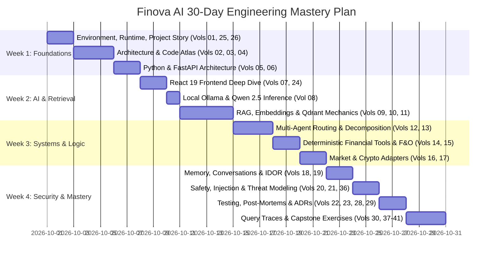

<!-- Generated against commit: 42228bb55d6016ffff439024bbf4aec135269f95 | Date: 2026-09-13 | Verified against live repository state: YES -->

# Finova AI — Master Project Bible: Complete Knowledge Transfer & Code Atlas
**Volume 0: Master Index, Syllabus, Glossary, and Study Curriculum**  
**Target Release**: Phase 13 Release Candidate (`d64eb5f1b932231a8b72c3d3f59bd5378e880118`) / Packaging (`42228bb55d6016ffff439024bbf4aec135269f95`)  
**Repository State**: Clean working tree | 525 automated backend pytest cases passing | Frontend build & Oxlint 0 warnings/0 errors  
**Hardware & Runtime Baseline**: Windows 11 | Python 3.13.15 | Node.js v18+ | Ollama (`qwen2.5:7b-instruct`) | NVIDIA RTX 4050 Laptop GPU (6 GB VRAM)

---

## 1. Mission & Scope of the Master Project Bible

This document suite serves as the definitive, university-level engineering textbook, architectural handoff, and code atlas for **Finova AI**. 

Finova AI was constructed through an iterative, phase-by-phase development lifecycle spanning Phase 0 through Phase 13. During development, complex design challenges, bug discoveries, and architectural hardening decisions were shaped both by direct local experimentation and an external review auditing process. 

The goal of this Master Bible is **not** to present an idealized retrospective. Its goal is **complete technical demystification**:
1. To explain every single layer, directory, file, class, method, data schema, and configuration parameter in the project.
2. To provide first-principles engineering explanations of why components were designed the way they were, what alternatives existed, why alternatives were rejected, and what trade-offs were accepted.
3. To walk through the real debugging history: what broke, how it was caught, what the underlying root cause was, and how regression tests were constructed to permanently seal the defect.
4. To establish a self-contained learning curriculum enabling an engineer to transition from foundational programming to complete code ownership of Finova AI.

---

## 2. Epistemological Ground Rules & Source Priority

To ensure historical and technical integrity, all documentation adheres to strict truthfulness guidelines:

### 2.1 The Three-Tier Evidence Classification
Every factual statement, rationale, or historical claim is categorized into one of three epistemic states:
- **[FACT]**: Directly verifiable from the current source code, git commit history (`git log`), passing test suites, official evaluation benchmarks (`reports/`), or recorded project documents (`project-info/`).
- **[INFERENCE]**: A rigorous technical deduction reconstructed from architectural patterns, code diffs, or standard engineering constraints where the exact design transcript was not written down.
- **[UNKNOWN]**: The exact historical reasoning or conversational discovery path is unrecorded in the local repository. Specifically, design reviews and bug discoveries that originated in external AI auditing sessions without local commit transcripts are explicitly flagged as `[UNKNOWN — External Review Discovery]` rather than reconstructed with fabricated narratives.

### 2.2 Source Priority Hierarchy
When project artifacts or older design plans appear to conflict with the active implementation, the following priority order is strictly enforced:
1. **Current Repository Source Code** (The ground truth of what actually runs).
2. **Current Automated Tests & Test Outputs** (The verified behavioral contracts).
3. **Git History & Commit Messages** (The chronological sequence of code transitions).
4. **Project Documentation & Historical Reports** (`project-info/`, `reports/`, `docs/`).
5. **Recorded External Review Excerpts** (Audit notes provided by the user).
6. **Previous AI-Generated Summaries**.
7. **Technical Inference**.

*Rule*: Older design plans (such as Phase 0 projections) never override what is running in `app/` or `frontend/`. Where the current implementation diverges from an early plan, the divergence is documented and explained.

### 2.3 Implementation Status Taxonomy
Every feature, tool, model, or conceptual capability mentioned across this textbook is labeled with an explicit implementation status:
- **[IMPLEMENTED]**: Fully operational in the codebase, integrated into the execution path, and covered by automated tests.
- **[PARTIALLY IMPLEMENTED]**: Scaffolded, interface defined, or mocked, but not fully active across all execution paths.
- **[PLANNED / DEFERRED]**: Explicitly scheduled for future roadmap phases (e.g., TradeWise integration, crypto RAG, voice/vision).
- **[REJECTED]**: Evaluated during development but explicitly rejected due to latency, safety, cost, or reliability concerns.
- **[REMOVED]**: Implemented in an earlier phase but subsequently removed or refactored out.
- **[UNKNOWN]**: Status cannot be deduced from the available repository state.

---

## 3. Master Table of Contents & 41-Chapter Syllabus

The knowledge transfer is structured into 41 numbered markdown volumes within `project-info/knowledge-transfer/`, organized across 7 staged review batches:

```text
project-info/knowledge-transfer/
├── 00_MASTER_INDEX.md                 <-- You are here (Batch 1)
├── 01_PROJECT_STORY.md                <-- Complete Chronological Story: Phase 0 to 13 (Batch 1)
├── 02_ARCHITECTURE.md                 <-- Full System Architecture & Data Flow (Batch 1)
├── 03_REPOSITORY_ATLAS.md             <-- Exhaustive Directory & File-by-File Catalog (Batch 1)
├── 04_CODE_ATLAS.md                   <-- Method-by-Method Code Walkthrough & Line Explanations (Batch 2)
├── 05_PYTHON.md                       <-- Complete Python Language Deep Dive (Batch 2)
├── 06_FASTAPI_BACKEND.md              <-- FastAPI Architecture & Endpoint Specifications (Batch 2)
├── 07_REACT_TYPESCRIPT.md             <-- Frontend Component Hierarchy & State Machine (Batch 2)
├── 08_LLM_OLLAMA_QWEN.md              <-- Local Inference, Prompt Assembly & Context Windows (Batch 2)
├── 09_RAG.md                          <-- Vector Retrieval, Chunking, Provenance & Guardrails (Batch 3)
├── 10_DATA_LINEAGE.md                 <-- Official Source Documents & Information Lifecycle (Batch 3)
├── 11_EMBEDDINGS_QDRANT.md            <-- FastEmbed, BGE-Small Benchmark & Vector Math (Batch 3)
├── 12_AGENTS.md                       <-- The 9 Specialized Domain Agents & Personas (Batch 3)
├── 13_ROUTER.md                       <-- Multi-Intent Classification & Query Decomposition (Batch 3)
├── 14_DETERMINISTIC_TOOLS.md          <-- Mathematical Specifications of Financial Calculators (Batch 3)
├── 15_DERIVATIVES.md                  <-- F&O Payoff Engine, Breakeven Math & Greeks (Batch 3)
├── 16_MARKET_DATA.md                  <-- NSE Clock, Holiday Calendars, Adapters & TTL Caching (Batch 3)
├── 17_CRYPTO.md                       <-- CoinGecko Provider, Asset Analytics & Risk Framing (Batch 3)
├── 18_MEMORY.md                       <-- User Identity, SQLite Store, PII Filtering & Purge (Batch 4)
├── 19_CONVERSATIONS.md                <-- Chat Session Store, Bounded History & IDOR Safety (Batch 4)
├── 20_SAFETY_SECURITY.md              <-- Secondary Regex Validators, RIA Blocks & Guardrails (Batch 4)
├── 21_PROMPT_INJECTION.md             <-- Direct/Indirect Jailbreak Defense & Adversarial Red-Teaming (Batch 4)
├── 22_TESTING.md                      <-- 525-Test Hierarchy, Fixtures, Mocks & Regression Gates (Batch 4)
├── 23_PHASE_7_HARDENING.md            <-- The 72-Case Offline Benchmark & Defect Remediation (Batch 4)
├── 24_UI_EVOLUTION.md                 <-- Design Systems, Marigold Field Palette & Micro-Interactions (Batch 4)
├── 25_LOCAL_ENVIRONMENT.md            <-- Windows PowerShell, CP1252 Fixes & Unified Runner (Batch 5)
├── 26_COMMAND_HANDBOOK.md             <-- Operational Command Manual for Development & Testing (Batch 5)
├── 27_GIT_HISTORY.md                  <-- 32-Commit Trajectory from Baseline to Remote Push (Batch 5)
├── 28_MISTAKES_FAILURES_DEBUGGING.md  <-- Post-Mortems of Bugs, Root Causes & Fixes (Batch 5)
├── 29_ARCHITECTURAL_DECISIONS.md      <-- Architectural Decision Records (ADR 01 to ADR 22) (Batch 5)
├── 30_QUERY_TRACES.md                 <-- End-to-End Traces of 10 Representative Financial Queries (Batch 5)
├── 31_API_REFERENCE.md                <-- Exhaustive REST API Endpoint Catalog (Batch 6)
├── 32_DATA_SCHEMAS.md                 <-- Pydantic Models, TypeScript Interfaces & DB Tables (Batch 6)
├── 33_PERFORMANCE.md                  <-- Latency Profiles, Memory Footprint & GPU Saturation (Batch 6)
├── 34_FAILURE_SCENARIOS.md            <-- Resilience Matrix: Ollama Outage, DB Locks, Provider Failures (Batch 6)
├── 35_ALTERNATIVES.md                 <-- Evaluation of Rejected Technologies (LangChain, Chroma, OpenAI) (Batch 6)
├── 36_THREAT_MODEL.md                 <-- Attack Vectors, Asset Boundaries & Security Posture (Batch 6)
├── 37_LEARNING_CURRICULUM.md          <-- 17-Level Guided Curriculum from Novice to Architect (Batch 7)
├── 38_KNOWLEDGE_CHECK.md              <-- Comprehensive Question Bank & 50 Invariant Exam (Batch 7)
├── 39_INTERVIEW_PREP.md               <-- System Design & Technical Interview Walkthroughs (Batch 7)
├── 40_CODE_OWNERSHIP_EXERCISES.md     <-- 10 Hands-on Extension Labs for Mastery (Batch 7)
└── 41_FINAL_MENTAL_MODEL.md           <-- The Unified Architectural Philosophy of Finova AI (Batch 7)
```

---

## 4. Staged Delivery Roadmap

| Batch | Included Volumes | Core Focus | Status |
| :---: | :--- | :--- | :---: |
| **Batch 1** | Volumes 00, 01, 02, 03 | Master Index, Project History (Phases 0–13), System Architecture, Repository Atlas | **IN PROGRESS** |
| **Batch 2** | Volumes 04, 05, 06, 07, 08 | Code-by-Code Deep Dive, Python Fundamentals, FastAPI Backend, React 19 Frontend, Ollama/Qwen | PENDING REVIEW |
| **Batch 3** | Volumes 09, 10, 11, 12, 13, 14, 15, 16, 17 | RAG Pipeline, Data Lineage, Qdrant/BGE, Domain Agents, Router, Math Tools, Derivatives, Market/Crypto | PENDING REVIEW |
| **Batch 4** | Volumes 18, 19, 20, 21, 22, 23, 24 | SQLite Memory, Conversations, Safety Validator, Injection Defense, Pytest Suite, Hardening, UI Polish | PENDING REVIEW |
| **Batch 5** | Volumes 25, 26, 27, 28, 29, 30 | Windows Runtime, Command Handbook, Git History, Post-Mortems, ADR Log, 10 Query Traces | PENDING REVIEW |
| **Batch 6** | Volumes 31, 32, 33, 34, 35, 36 | API Reference, Data Schemas, Latency/Performance, Failure Scenarios, Alternatives, Threat Model | PENDING REVIEW |
| **Batch 7** | Volumes 37, 38, 39, 40, 41 | 17-Level Curriculum, Knowledge Check Exam, Interview Prep, Code Exercises, Final Mental Model | PENDING REVIEW |

---

## 5. Master Glossary of Technical and Financial Terms

This glossary defines key domain and systems terminology used throughout Finova AI.

| Term | Simple Definition | Technical Definition | Finova-Specific Meaning | First Volume |
| :--- | :--- | :--- | :--- | :---: |
| **RAG** | Searching documents to answer questions accurately. | Retrieval-Augmented Generation: retrieving semantically similar text vectors to constrain LLM generation. | Grounding educational responses strictly in official SEBI/NISM PDFs via Qdrant vector retrieval. | Vol 01 |
| **Deterministic Tool** | A calculation that always gives the exact same correct math answer without guessing. | A pure, deterministic algorithm that computes outputs using explicit mathematical formulas without probabilistic models. | Python functions in `app/tools/` for SIP, budgeting, options payoffs, and Greeks that bypass LLMs. | Vol 01 |
| **Vector Embedding** | Turning text into a list of numbers that capture its meaning. | A high-dimensional dense numerical vector produced by a neural language model where semantic proximity maps to cosine distance. | 384-dimensional dense vectors generated locally via FastEmbed (`BAAI/bge-small-en-v1.5`). | Vol 01 |
| **Cosine Similarity** | Measuring how closely two vectors point in the same direction. | The dot product of two normalized vectors: $\cos(\theta) = \frac{\mathbf{u} \cdot \mathbf{v}}{\|\mathbf{u}\| \|\mathbf{v}\|}$. | Score metric in Qdrant; chunks scoring $\ge 0.65$ are admitted into LLM context; $< 0.65$ triggers ungrounded fallback. | Vol 02 |
| **Black-Scholes Model** | A mathematical formula used to calculate theoretical option prices. | A partial differential equation model calculating European option pricing and risk sensitivities (Greeks). | Closed-form analytical Python functions in `app/tools/derivatives/greeks.py` computing $\Delta, \Gamma, \Theta, \text{Vega}, \rho$. | Vol 02 |
| **Delta ($\Delta$)** | How much an option price moves when the underlying stock moves ₹1. | The first partial derivative of option price with respect to underlying asset price: $\frac{\partial V}{\partial S}$. | Computed analytically in `app/tools/derivatives/greeks.py` bounded in $[0, 1]$ for calls and $[-1, 0]$ for puts. | Vol 15 |
| **Gamma ($\Gamma$)** | How fast the Delta changes as the stock moves. | The second partial derivative of option price with respect to underlying asset price: $\frac{\partial^2 V}{\partial S^2}$. | Sensitivity metric indicating the convexity of option payoff curves. | Vol 15 |
| **Theta ($\Theta$)** | How much option value decays each day due to time passing. | The first partial derivative of option price with respect to time to expiry: $\frac{\partial V}{\partial t}$. | Daily time decay metric in `greeks.py`, expressed per calendar day. | Vol 15 |
| **Vega** | How much option price changes when market volatility moves 1%. | The first partial derivative of option price with respect to implied volatility: $\frac{\partial V}{\partial \sigma}$. | Volatility risk metric in `greeks.py`, showing sensitivity to volatility shifts. | Vol 15 |
| **SIP** | Investing a fixed sum of money at regular monthly intervals. | Systematic Investment Plan: periodic cash flows invested into mutual fund units benefiting from rupee cost averaging. | Deterministic compounding calculator in `app/tools/calc/compounding.py` evaluating future value. | Vol 01 |
| **50-30-20 Rule** | A budgeting rule: 50% needs, 30% wants, 20% savings/investments. | A proportional allocation budgeting heuristic partitioning net income into fixed needs, discretionary wants, and savings. | Calculation tool in `app/tools/calc/budget.py` providing exact rupee allocations based on user net income. | Vol 01 |
| **Emergency Fund** | Money saved to cover 3 to 6 months of essential living expenses. | A highly liquid capital reserve sized to cover essential monthly living expenditures during unexpected disruptions. | Sizing tool in `app/tools/calc/emergency_fund.py` parameterized by monthly burn rate and stability tier. | Vol 01 |
| **Payoff Diagram** | A graph showing the profit or loss of an option trade at different prices. | A piecewise linear or non-linear terminal profit/loss function plotted against underlying spot price at expiration. | Rendered interactively in `PayoffTableCard.tsx` from arrays generated by `app/tools/derivatives/payoff.py`. | Vol 02 |
| **Breakeven Price** | The stock price where a trade neither makes nor loses money. | The underlying spot price at expiry at which net terminal profit equals zero ($P_{\text{net}} = 0$). | Exact strike and premium calculation in `payoff.py` (e.g., Call: $K + P$; Put: $K - P$). | Vol 02 |
| **Fast-Path Router** | Quickly checking simple keywords before running slower AI analysis. | A sub-millisecond regex and token-based classifier that identifies user domain intent without LLM latency. | `app/router/classifier.py` matching regex patterns and polysemic terms in $<1\text{ms}$. | Vol 02 |
| **Decomposition** | Splitting a complicated multi-part question into separate smaller tasks. | Breaking down a multi-intent query into orthogonal, domain-isolated subtasks with individual execution contexts. | `app/router/decomposer.py` splitting compound queries into isolated domain tasks. | Vol 02 |
| **Domain Immutability** | A conversation started in one subject stays locked to that subject. | A architectural invariant ensuring that a conversation session retains its domain tag and cannot be hijacked across domains. | Phase 10 architectural pattern where sessions in `Equity Tutor` enforce `domain_context='equity'`. | Vol 01 |
| **PII Scrubbing** | Removing private identity details like PAN or Aadhaar before saving. | Deterministic sanitization of Personally Identifiable Information using strict regular expressions and validation rules. | `app/memory/validator.py` rejecting PAN, Aadhaar, phone numbers, and bank details from `data/memory.db`. | Vol 01 |
| **IDOR** | A security bug where one user can see or delete another user's data. | Insecure Direct Object Reference: accessing backend objects using untrusted client-supplied identifiers without authorization. | Prevented in `app/api/conversations.py` by requiring explicit user ownership validation before accessing data. | Vol 02 |
| **Ollama** | A software tool that lets you run modern open-source AI models on your own PC. | A local inference execution daemon providing unified REST APIs for running quantized GGUF LLMs with GPU offloading. | Host runtime at `http://127.0.0.1:11434` serving `qwen2.5:7b-instruct` on an NVIDIA RTX 4050 GPU. | Vol 01 |
| **Qwen 2.5 7B** | The specific open-source AI model used by Finova AI. | Alibaba Cloud's 7-billion-parameter instruction-tuned dense autoregressive transformer model. | The local generation engine used for pedagogical synthesis, natural language explanations, and quiz questions. | Vol 01 |
| **Qdrant** | A specialized database designed to search through text embeddings. | An open-source, vector similarity search engine written in Rust supporting HNSW indexing and payload filtering. | Local vector storage engine initialized in embedded mode pointing to `data/qdrant_storage/`. | Vol 01 |
| **FastEmbed** | A fast, lightweight Python library for generating text embeddings locally. | A lightweight, memory-efficient Python embedding client utilizing ONNX Runtime without PyTorch overhead. | The embedding execution engine in `app/rag/embeddings.py` generating 384-dimensional vectors. | Vol 01 |
| **RIA** | Registered Investment Adviser: a licensed professional legally allowed to give investment advice. | A legal fiduciary entity registered under SEBI (Investment Advisers) Regulations, 2013 authorized to give advice. | Key safety boundary: Finova AI is strictly educational and blocks all attempts to impersonate or solicit RIA advice. | Vol 01 |
| **Prompt Injection** | Tricking an AI into ignoring its rules by hiding secret commands in the prompt. | An adversarial attack technique where malicious user input hijacks the system prompt or overrides safety constraints. | Intercepted deterministically by `app/safety/validator.py` and `app/router/safety.py` without LLM invocation. | Vol 01 |
| **Grounding Status** | A tag showing whether an answer is backed by real official documents. | A tri-state provenance indicator (`fully_grounded`, `partially_grounded`, `ungrounded`) reflecting citation rigor. | Emitted by `app/rag/service.py` and displayed as a colored badge (`GroundingBadge.tsx`) in the frontend. | Vol 02 |
| **NSE Market Clock** | Software logic that checks if the Indian stock market is currently open or closed. | A deterministic temporal service tracking Indian Standard Time (IST), market sessions, and holiday schedules. | `app/tools/market/clock.py` referencing official NSE trading hours (09:15–15:30 IST) and holiday JSON tables. | Vol 02 |
| **Stale-Data Fallback** | Showing recent saved data with a warning when live market feeds fail. | A fault-tolerant caching strategy serving the last known valid quote with explicit timestamp freshness indicators. | `app/tools/market/cache.py` preserving last-traded prices during third-party provider timeouts or outages. | Vol 02 |
| **Oxlint** | A fast code analysis tool for JavaScript and TypeScript. | A high-performance linter for JavaScript/TypeScript written in Rust that executes rules rapidly. | The frontend linting engine (`npm run lint`) verifying TypeScript and React invariants with zero errors. | Vol 01 |

---

## 6. How to Study This Master Bible

To master Finova AI from first principles, avoid reading passively. Treat this textbook as a working engineering laboratory:

### Step 1: Read with Active Code Cross-Referencing
Every chapter references exact file paths and class names. While reading a section, keep the corresponding file open in your editor:
- When reading **Volume 06 (FastAPI)**, keep [app/main.py](file:///c:/Users/prana/OneDrive/Desktop/finova-ai/app/main.py) and [app/api/chat.py](file:///c:/Users/prana/OneDrive/Desktop/finova-ai/app/api/chat.py) open.
- When reading **Volume 14 (Deterministic Tools)**, keep [app/tools/calc/compounding.py](file:///c:/Users/prana/OneDrive/Desktop/finova-ai/app/tools/calc/compounding.py) open.
- When reading **Volume 20 (Safety)**, keep [app/safety/validator.py](file:///c:/Users/prana/OneDrive/Desktop/finova-ai/app/safety/validator.py) open.

### Step 2: Execute the Corresponding Verification Commands
Do not merely accept that a subsystem works. Execute its tests directly in PowerShell:
```powershell
# Run the specific test file referenced in the chapter
.venv-finova\Scripts\python.exe -m pytest tests/test_finance_calc.py -v
.venv-finova\Scripts\python.exe -m pytest tests/test_router_classifier.py -v
.venv-finova\Scripts\python.exe -m pytest tests/test_red_team_safety.py -v
```

### Step 3: Inspect Database Tables Directly
Verify the local persistence models using standard Python interactive sessions:
```powershell
.venv-finova\Scripts\python.exe -c "import sqlite3; conn = sqlite3.connect('data/conversations.db'); print(conn.execute('SELECT count(*) FROM conversations').fetchone())"
```

### Step 4: Answer the Chapter Checkpoints
At the conclusion of each volume, self-test against the failure modes and edge cases documented in that chapter. If you cannot explain *why* a specific try/except block exists, review the post-mortem in Volume 28.

---

## 7. The 30-Day Finova Mastery Plan

This structured plan guides an engineer through complete mastery of the codebase in 30 days:



- **Days 1–3**: Foundations (Volumes 01, 02, 25, 26). Master the chronological story, local runner, and execution pipeline.
- **Days 4–7**: Repository & Code Atlas (Volumes 03, 04, 05). Study every directory, Python syntax pattern, and file role.
- **Days 8–10**: Web & Gateway (Volumes 06, 07, 24). Trace FastAPI route mounting, CORS middleware, and React 19 component cards.
- **Days 11–14**: Local AI & RAG (Volumes 08, 09, 10, 11). Understand Qwen 2.5 inference, BGE-small embeddings, and Qdrant vector retrieval.
- **Days 15–18**: Routing & Mathematics (Volumes 12, 13, 14, 15). Study query decomposition, Black-Scholes Greeks, SIP formulas, and options payoffs.
- **Days 19–21**: Live Feeds & Providers (Volumes 16, 17). Understand NSE clocks, yfinance fallbacks, CoinGecko integrations, and TTL caches.
- **Days 22–24**: Persistence & Safety (Volumes 18, 19, 20, 21). Deep dive into SQLite schemas, PII validation, prompt injection defense, and IDOR prevention.
- **Days 25–27**: Quality & Hardening (Volumes 22, 23, 28, 29). Study the 525-test suite, Phase 7 hardening scorecard, bug post-mortems, and ADR log.
- **Days 28–30**: Synthesis & Capstone (Volumes 30, 31–36, 37–41). Walk through the 10 real query traces, answer the 50 Invariant Exam, and complete code ownership labs.

---

## 8. Top 100 Things to Understand About Finova AI

Before an engineer can claim complete mastery of Finova AI, they must be able to explain each of these 100 architectural, operational, and financial invariants:

### Part A: Philosophy & Architecture (1–20)
1. Why Finova AI is built around an LLM rather than training an LLM from scratch.
2. Why financial arithmetic is never delegated to the probabilistic LLM.
3. Why SEBI and NISM publications are the only Tier-1 educational grounding sources admitted into the vector corpus.
4. Why TradeWise website materials were explicitly classified as non-authoritative.
5. The role of the central orchestrator (`CentralOrchestrator`) in coordinating multi-agent subtasks.
6. The difference between single-intent fast-path routing and multi-intent decomposition.
7. Why the architecture uses hand-written Python routing rather than heavy graph frameworks (e.g., LangGraph).
8. Why Finova AI chose a zero-cloud, local-first deployment philosophy.
9. How the system operates under ₹0 infrastructure cost constraints using local open-source models.
10. The role of the FastAPI application factory and route mounting in `app/main.py`.
11. Why CORS middleware is explicitly configured for `http://localhost:5173` and `http://127.0.0.1:5173`.
12. Why Uvicorn is executed with `--reload` in development and how worker processes function.
13. How the Vite dev server proxies API calls and renders React 19 JSX components.
14. The structure of the `OrchestratorResponse` contract and why it preserves child agent metadata.
15. Why the system records execution telemetry with sanitized request previews.
16. How the frontend distinguishes between educational chat responses and structured cards.
17. The design role of the "Marigold Field" color palette and editorial typography.
18. Why the chat interface displays an honest elapsed-time counter instead of fake progress bars.
19. The separation between short-term conversation context and long-term user memory.
20. Why TradeWise integration was explicitly deferred to Phase 9 and excluded from this standalone release.

### Part B: RAG, Embeddings & Vectors (21–40)
21. The mathematical definition of a 384-dimensional dense text embedding vector.
22. Why `BAAI/bge-small-en-v1.5` was chosen over `intfloat/e5-small-v2` despite E5's higher raw similarity.
23. How ONNX Runtime powers FastEmbed with minimal memory overhead and zero PyTorch dependencies.
24. The difference between chunk size (600 characters) and chunk overlap (100 characters) in `TextChunker`.
25. How PDF documents are parsed page-by-page using `pypdf` in `app/rag/document_parser.py`.
26. How unusual character ratios are monitored during ingestion to detect PDF font encoding corruption.
27. Why the SEBI SCORES grievance brochure had to be repaired and re-ingested.
28. The structure of a Qdrant collection, point ID, vector, and payload metadata.
29. Why Qdrant is operated in embedded local disk mode (`./data/qdrant_storage`) rather than as a Docker daemon.
30. How cosine distance is calculated between query vectors and stored chunk vectors.
31. The exact behavior of the similarity score threshold (`0.65`) in `app/rag/retriever.py`.
32. What happens when zero chunks pass the 0.65 threshold (out-of-corpus fallback).
33. Why the LLM is completely bypassed when an inquiry falls outside the indexed regulatory corpus.
34. How citation markers (`[SEBI Doc, Page X]`) are formatted and injected into prompt context.
35. How `CitationValidator` detects and strips fabricated citations from the LLM response.
36. The tri-state definition of `grounding_status` (`fully_grounded`, `partially_grounded`, `ungrounded`).
37. How `CitationCard.tsx` renders source provenance, publication date, and external links in the UI.
38. Why RAG knowledge ingestion is restricted to public investor education materials.
39. Why crypto education does not currently use vector RAG (intentionally deferred).
40. How `scripts/ingest_docs.py` verifies document hashes and prevents redundant downloads.

### Part C: Local LLM & Ollama (41–55)
41. What an instruction-tuned language model is and how it differs from a raw base completion model.
42. The architectural specifications of `qwen2.5:7b-instruct` (parameter count, architecture, context window).
43. How Ollama manages model weights in VRAM on the NVIDIA RTX 4050 GPU.
44. The difference between cold inference latency (model loading) and warm inference latency.
45. Why local GPU inference takes 2 to 15 seconds per response turn.
46. How `LLMClient` acts as an abstraction barrier preventing direct coupling to the `ollama` SDK.
47. How system prompts, conversation history, and user messages are structured in the messages array.
48. Why `num_predict` is capped at 600 tokens to enforce concise pedagogical explanations.
49. Why temperature is locked to 0.0 or low values for deterministic, hallucination-free explanations.
50. What happens when Ollama is offline or uninstalled and how error propagation functions.
51. Why the LLM is given strict instructions never to invent ticker prices or financial calculations.
52. How conversation history is truncated to a sliding window of the last 6 turns to avoid context overflow.
53. How RAG chunks are formatted inside the system prompt delimiter blocks.
54. Why prompt templates are kept strictly domain-specific across the 9 agents.
55. How the LLM synthesizes learning actions, related concepts, and follow-up prompts.

### Part D: Deterministic Financial Mathematics (56–70)
56. The exact mathematical formula for SIP future value: $FV = P \times \frac{(1 + r)^n - 1}{r} \times (1 + r)$.
57. Why monthly interest rate $r = \frac{R}{12 \times 100}$ and number of periods $n = \text{years} \times 12$.
58. The compounding wealth gained formula: $\text{Wealth Gained} = FV - (P \times n)$.
59. How the 50-30-20 budget calculator partitions income and handles edge cases where expenses exceed income.
60. The emergency fund calculation formula based on monthly essential expenses and employment volatility tiers.
61. The terminal payoff formula for a Long Call option: $\max(0, S_T - K) - P$.
62. The terminal payoff formula for a Short Call option: $P - \max(0, S_T - K)$.
63. The terminal payoff formula for a Long Put option: $\max(0, K - S_T) - P$.
64. The terminal payoff formula for a Short Put option: $P - \max(0, K - S_T)$.
65. Why Long Put breakeven is strictly $K - P$ and why clamping to zero was a defect fixed in Phase 7.
66. Why an option position with $P > K$ reports `has_feasible_breakeven=False`.
67. The Black-Scholes formulas for $d_1$ and $d_2$: $d_1 = \frac{\ln(S/K) + (r + \sigma^2/2)t}{\sigma\sqrt{t}}$.
68. How cumulative normal distribution $\Phi(d)$ is computed using Python's `math.erf`.
69. How portfolio diversification score and asset concentration percentages are computed in `portfolio_tool.py`.
70. How a simulated market drop (e.g., -10% NIFTY) recalculates equity holding values and portfolio drawdown.

### Part E: Market Data, Feeds & Clocks (71–80)
71. The role of the `BaseMarketDataProvider` abstract interface in decoupling vendors.
72. Why Yahoo Finance (`yfinance`) serves as the primary provider and Twelve Data as fallback.
73. How the NSE Market Clock evaluates trading sessions in Indian Standard Time (UTC+05:30).
74. Why trading days exclude weekends and official exchange holidays listed in `data/market/nse_holidays.json`.
75. The exact boundary conditions of NSE normal market hours: 09:15:00 to 15:30:00 IST.
76. How `MarketDataValidator` enforces sanity bounds: price $> 0$, low $\le$ price $\le$ high, volume $\ge 0$.
77. The dynamic TTL caching strategy: 15-second TTL during live market hours vs. 12-hour TTL after market close.
78. How stale-data fallback operates when upstream market providers experience network timeouts.
79. How `CoinGeckoProvider` fetches cryptocurrency quotes in dual INR and USD denominations.
80. Why ticker symbol mapping ensures Indian equities map to `.NS` or `.BO` suffixes cleanly.

### Part F: Memory, Sessions & Identity (81–90)
81. Why chat conversation history is stored in `data/conversations.db` while user memory is stored in `data/memory.db`.
82. The SQLite schema of the `conversations` and `messages` tables.
83. How deterministic, clean conversation titles are generated from the initial prompt without LLM overhead.
84. How `MemoryExtractor` extracts learning levels, risk profiles, and topic interests from chat turns.
85. The exact regular expressions in `app/memory/validator.py` that intercept Indian PAN, Aadhaar, and phone numbers.
86. Why anonymous sessions without a valid `user_id` are blocked from writing to the persistent database.
87. How IDOR (Insecure Direct Object Reference) vulnerabilities are prevented in conversation APIs.
88. How the top-right Profile modal enables learners to inspect all active memories recorded about them.
89. How the "Clear Memory" button executes an immediate, irreversible deletion of user memory records.
90. How learner identity (`user_id`) is generated via UUID and persisted across sessions in browser `localStorage`.

### Part G: Safety, Security & Quality (91–100)
91. Why safety validation is executed *before* LLM generation rather than relying on LLM self-censorship.
92. How `SecondarySafetyValidator` intercepts roleplay RIA impersonation prompts (e.g., *"Act as my financial advisor"*).
93. How guaranteed return claims (e.g., *"give me a 100% risk-free return"*) are intercepted and rejected.
94. How direct prompt injections attempting to reveal the system prompt or override instructions are blocked.
95. How indirect prompt injections embedded in external data chunks or news feeds are neutralized.
96. The difference between safety refusals (regulatory violations) and injection refusals (adversarial violations).
97. How the 525-test pytest hierarchy is organized across unit, integration, and red-team safety suites.
98. How the Phase 7 benchmark scorecard achieved 72/72 passing cases (100% accuracy) in offline evaluation mode.
99. How the CP1252 character encoding bug on Windows consoles was resolved in `scripts/run_local.py`.
100. The foundational project invariant: no invented numbers, no fake citations, and strictly educational framing.

---

## 9. Epilogue: Preparing for Batch 1

With the syllabus, glossary, and foundational rules established, proceed to:
- **Volume 01**: [01_PROJECT_STORY.md](file:///c:/Users/prana/OneDrive/Desktop/finova-ai/project-info/knowledge-transfer/01_PROJECT_STORY.md) (The complete chronological story from Day Zero through Phase 13).
- **Volume 02**: [02_ARCHITECTURE.md](file:///c:/Users/prana/OneDrive/Desktop/finova-ai/project-info/knowledge-transfer/02_ARCHITECTURE.md) (Full system architecture, component breakdowns, and data flow).
- **Volume 03**: [03_REPOSITORY_ATLAS.md](file:///c:/Users/prana/OneDrive/Desktop/finova-ai/project-info/knowledge-transfer/03_REPOSITORY_ATLAS.md) (The complete file-by-file directory catalog).
