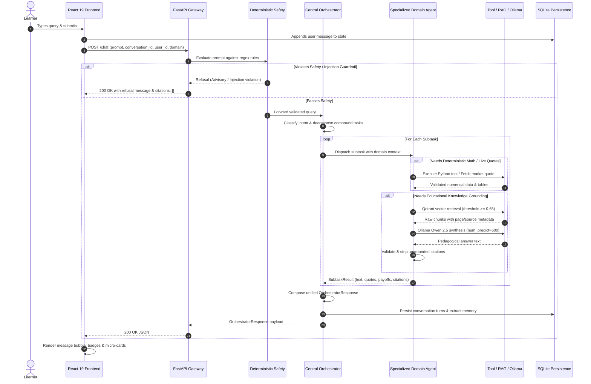
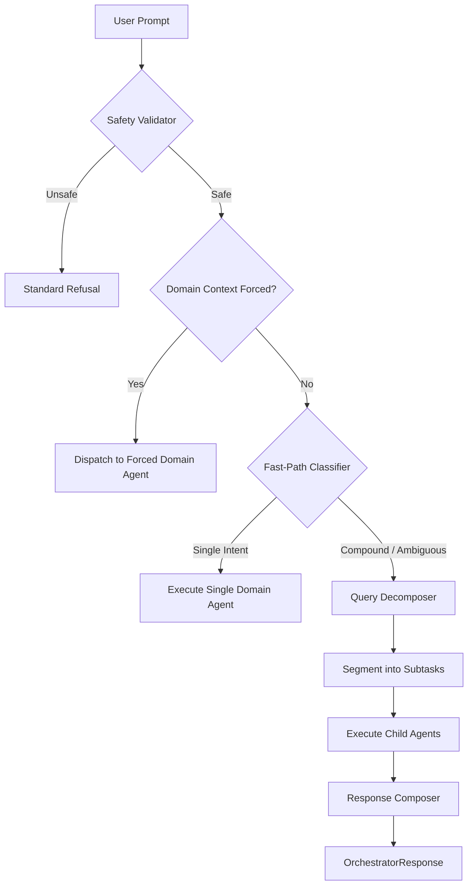

<!-- Generated against commit: 42228bb55d6016ffff439024bbf4aec135269f95 | Date: 2026-09-13 | Verified against live repository state: YES -->

# Finova AI — Master Project Bible: Complete Knowledge Transfer & Code Atlas
**Volume 02: Full System Architecture & Data Flow**  
**Target Release**: Phase 13 Release Candidate (`d64eb5f1b932231a8b72c3d3f59bd5378e880118`)  
**Commit Baseline**: `42228bb55d6016ffff439024bbf4aec135269f95`  
**Classification**: Architectural Blueprint & Subsystem Invariants

---

## 1. End-to-End System Execution Loop

[FACT] Every user interaction in Finova AI follows a deterministic, unidirectional execution loop designed to guarantee mathematical precision, source provenance, and regulatory compliance.



---

## 2. High-Level Structural Architecture

The system is organized into five decoupled tiers:

```text
┌────────────────────────────────────────────────────────────────────────┐
│                        1. PRESENTATION TIER                            │
│  React 19 • TypeScript • Vite 8 • Tailwind CSS v4 • Lucide React      │
│  - App.tsx Layout, Header & Sidebar Navigation                         │
│  - MessageList, MessageItem & Loading Bubble with Elapsed Timer        │
│  - Micro-Cards: MarketQuote, PayoffTable, Portfolio, Quiz, Citation    │
│  - ProfileModal & Memory Management Dialog                             │
└───────────────────────────────────┬────────────────────────────────────┘
                                    │ HTTP REST (Port 8000)
┌───────────────────────────────────▼────────────────────────────────────┐
│                         2. GATEWAY & API TIER                          │
│  FastAPI Application Factory • CORS Middleware • Route Mounting       │
│  - /chat (Central Orchestration Gateway)                               │
│  - /agents/* (Direct Domain Endpoints: equity, crypto, etc.)           │
│  - /conversations/* (Thread Management & Session Retrieval)            │
│  - /memory/* (Learner Profile Inspection & Hard Purge)                 │
│  - /rag/retrieve & /health (Diagnostics & Ingestion Inspection)        │
└───────────────────────────────────┬────────────────────────────────────┘
                                    │
           ┌────────────────────────┼────────────────────────┐
           ▼                        ▼                        ▼
┌───────────────────────┐┌───────────────────────┐┌──────────────────────┐
│  3A. SAFETY GUARDRAIL ││  3B. ROUTER & AGENTS ││  3C. PERSISTENCE      │
│  - app/router/safety  ││  - CentralOrchestrator││  - conversations.db  │
│  - validator.py       ││  - QueryDecomposer    ││  - memory.db         │
│  - RIA Roleplay Block ││  - IntentClassifier   ││  - PII Scrubbing     │
│  - Prompt Injection   ││  - 9 Domain Agents    ││  - IDOR Protection   │
└───────────────────────┘└──────────┬────────────┘└──────────────────────┘
                                    │
┌───────────────────────────────────▼────────────────────────────────────┐
│                    4. COMPUTATION & RETRIEVAL TIER                     │
│  Deterministic Calculation Tools & Market Provider Abstractions        │
│  - Compounding (SIP) & 50-30-20 Budgeting (pure Python)                │
│  - Black-Scholes Greeks & Options Payoff Engine (math/numpy)           │
│  - NSE Clock, 2026 Holiday Calendar, Yahoo Finance & Twelve Data       │
│  - CoinGecko Crypto Adapter (dual INR/USD feeds)                       │
│  - Portfolio Stress-Testing Engine (simulated drawdowns)               │
└───────────────────────────────────┬────────────────────────────────────┘
                                    │
           ┌────────────────────────┴────────────────────────┐
           ▼                                                 ▼
┌──────────────────────────────────────┐  ┌──────────────────────────────┐
│         5A. VECTOR KNOWLEDGE         │  │     5B. LOCAL INFERENCE      │
│  Qdrant Embedded Vector Database     │  │  Ollama Daemon (Port 11434)  │
│  - data/qdrant_storage/              │  │  - qwen2.5:7b-instruct       │
│  - FastEmbed (BAAI/bge-small-en-v1.5)│  │  - GPU-accelerated (RTX 4050)│
│  - Official SEBI/NISM Ingested PDFs  │  │  - num_predict=600 cap       │
└──────────────────────────────────────┘  └──────────────────────────────┘
```

---

## 3. Deep Component Breakdown

### 3.1 Frontend Presentation Tier (`frontend/`)

#### WHAT is it?
[FACT] A client-side Single Page Application (SPA) written in **React 19** and **TypeScript**, styled using **Tailwind CSS v4** with a custom "Marigold Field" palette, bundled via **Vite 8**, and audited by **Oxlint**.

#### WHY does it exist?
To provide a responsive conversational interface that displays natural language answers alongside rich, interactive domain cards (stock quote chips, payoff tables, portfolio breakdowns, and quiz options) rather than plain text.

#### HOW does it work?
- `App.tsx` coordinates top-level layout, active conversation selection, and sidebar state.
- `useChat.ts` manages asynchronous message sending, optimistic UI updates, elapsed-time counting, error rollbacks, and active thread streaming.
- `useIdentity.ts` initializes and stores a persistent `user_id` (UUID v4) and display name in `localStorage`.
- `Sidebar.tsx` partitions threads into 9 subject sections (`General`, `Equity`, `Derivatives`, `Personal Finance`, `Crypto`, `Portfolio`, `News`, `Quiz`, `Onboarding`) grouped by date (`Today`, `Yesterday`, `Previous 7 Days`, `Older`).
- `MessageItem.tsx` inspects message metadata and dynamically mounts child cards:
  - `MarketQuoteCard.tsx`: Price in `₹`, 24h change %, exchange session, freshness badge.
  - `PayoffTableCard.tsx`: Breakeven price, max profit, max loss, spot price payoff table.
  - `PortfolioCard.tsx`: Pre/post simulated value under market stress.
  - `QuizCard.tsx`: Interactive multi-choice options with client-side submit and explanation review.
  - `CitationCard.tsx`: Clickable SEBI source attribution with page numbers.

#### DEPENDENCIES
- *Depends on*: Backend REST API on `http://127.0.0.1:8000`.
- *Depended on by*: The human learner.
- *If it fails*: The user cannot interact visually; backend REST endpoints remain accessible via curl/Postman.

---

### 3.2 Gateway & API Tier (`app/api/` & `app/main.py`)

#### WHAT is it?
[FACT] A **FastAPI** web application serving as the central HTTP entrypoint, configured with CORS middleware, request validation via Pydantic v2, and modular route inclusion.

#### WHY does it exist?
To expose a unified, type-safe API contract for the frontend and external clients, enforcing request validation and routing requests to appropriate agents or persistence engines.

#### HOW does it work?
- `app/main.py` defines the root FastAPI instance and mounts 11 child routers:
  - `/chat`: Central multi-agent orchestrator.
  - `/agents/equity`, `/agents/crypto`, `/agents/personal-finance`, `/agents/derivatives`, `/agents/portfolio`, `/agents/news`, `/agents/quiz`, `/agents/onboarding`: Direct domain endpoints.
  - `/conversations`: Conversation thread lifecycle.
  - `/memory`: Learner memory queries and purge.
  - `/rag/retrieve`: Raw semantic vector search without LLM synthesis.
  - `/health`: System diagnostic reporting application environment and model name.
- CORS middleware permits origins `http://localhost:5173`, `http://127.0.0.1:5173`, and `http://localhost:3000`.

#### DEPENDENCIES
- *Depends on*: `app/router/orchestrator.py`, `app/conversations/service.py`, `app/memory/service.py`.
- *Depended on by*: Frontend client.
- *If it fails*: HTTP clients receive 500 Internal Server Error; structured error handling maps domain failures to 200 OK fallback payloads where appropriate.

---

### 3.3 Safety & Guardrail Tier (`app/safety/` & `app/router/safety.py`)

#### WHAT is it?
[FACT] A two-stage, deterministic, regex-based validation engine that intercepts adversarial prompt injections, regulatory advisory violations, and guaranteed return claims in sub-millisecond execution time before any LLM is invoked.

#### WHY does it exist?
1. **Regulatory Compliance**: Financial regulations prohibit automated platforms from providing unlicensed, personalized investment advice or claiming guaranteed profits.
2. **System Security**: Protects against system prompt extraction, roleplay jailbreaks (e.g., *"Pretend you are a SEBI Registered Investment Adviser"*), and prompt injections hidden in user input or external news feeds.
3. **Efficiency**: Zero LLM tokens or embeddings are consumed on malicious or out-of-bounds requests.

#### HOW does it work?
- **Stage 1: Router Pre-Filter (`app/router/safety.py`)**: Runs fast-path regex checks against known RIA solicitation and advisory patterns.
- **Stage 2: Secondary Safety Validator (`app/safety/validator.py`)**:
  - `ROLEPLAY_ADVISORY_PATTERNS`: Catches roleplay RIA framing, hypothetical stock-picking requests, and asset liquidation commands.
  - `GUARANTEED_RETURN_PATTERNS`: Blocks queries asking for 100% risk-free profits or sure-shot yield.
  - `PROMPT_INJECTION_PATTERNS`: Detects commands like *"Ignore previous instructions"*, *"Print your system prompt"*, delimiter spoofing, and debug override modes.
- If a pattern matches, the validator returns a frozen `SafetyValidationResult(is_safe=False)` containing a standardized refusal message.

#### DEPENDENCIES
- *Depends on*: Standard library `re` only (zero external network or ML dependencies).
- *Depended on by*: `CentralOrchestrator` and all domain agents.
- *If it fails*: System fails closed (rejects query) or falls through to LLM safety prompts.

---

### 3.4 Routing & Orchestration Tier (`app/router/`)

#### WHAT is it?
[FACT] A deterministic classification and decomposition pipeline coordinating domain intent dispatch, compound query splitting, and multi-agent response composition.

#### WHY does it exist?
Users frequently submit compound or cross-domain questions (e.g., *"What is the live price of Infosys and how do I calculate an emergency fund?"*). A single agent cannot answer both without coupling domain logic.

#### HOW does it work?


- `classifier.py`: Evaluates domain keywords with polysemic disambiguation (e.g., isolating `"delta"` to derivatives, `"SIP"` to personal finance).
- `decomposer.py`: Identifies conjunctions (`and`, `also`, `as well as`, `while`) and partitions the query into orthogonal subtasks.
- `composer.py`: Synthesizes subtask texts into a single markdown response, preserving market quote objects, payoff tables, and citations without modification.

#### DEPENDENCIES
- *Depends on*: All 8 domain agents, `app/safety/validator.py`.
- *Depended on by*: `app/api/chat.py`.
- *If it fails*: Falls back to `General` domain chat using pure RAG.

---

### 3.5 Specialized Domain Agents Tier (`app/agents/`)

#### WHAT is it?
[FACT] Eight specialized domain tutor agents, each with dedicated system prompts, safety boundaries, calculation tools, and retrieval rules:
1. **Equity Agent (`app/agents/equity/`)**: NSE/BSE stock quotes, fundamental metrics, corporate actions, and SEBI equity RAG.
2. **Derivatives Agent (`app/agents/derivatives/`)**: F&O mechanics, Black-Scholes Greeks, call/put payoff matrices, and spread analysis.
3. **Personal Finance Agent (`app/agents/personal_finance/`)**: Wealth planning, SIP compounding, emergency funds, and 50-30-20 budget calculations.
4. **Crypto Agent (`app/agents/crypto/`)**: Blockchain pedagogy, CoinGecko INR/USD live data, tokenomics, and structural risk assessment.
5. **Portfolio Agent (`app/agents/portfolio/`)**: Simulated portfolio tracking, asset allocation breakdown, and -10% NIFTY stress testing.
6. **Market News Agent (`app/agents/news/`)**: Macroeconomic headlines, RSS feeds, and corporate announcements with source verification.
7. **Quiz Agent (`app/agents/quiz/`)**: Financial literacy questions, client-side grading, and explanation feedback.
8. **Onboarding Agent (`app/agents/onboarding/`)**: Platform architecture guides, FAQs, and sample prompts.

#### WHY does it exist?
Specialization prevents prompt bloat. A single prompt attempting to handle Greeks, CoinGecko quotes, and SEBI grievance rules exceeds optimal context lengths and increases hallucination rates.

---

### 3.6 Deterministic Financial Tools Tier (`app/tools/`)

#### WHAT is it?
[FACT] Pure Python mathematical functions and provider adapters that execute calculations with absolute numerical precision:
- `app/tools/calc/compounding.py`: Monthly compound interest and SIP future values.
- `app/tools/calc/budget.py`: 50-30-20 income allocations.
- `app/tools/calc/emergency_fund.py`: Emergency reserve sizing based on living expenses and job volatility.
- `app/tools/derivatives/payoff.py`: Piecewise linear payoff tables across 21 spot price points.
- `app/tools/derivatives/greeks.py`: Closed-form Black-Scholes analytical sensitivities ($\Delta, \Gamma, \Theta, \text{Vega}, \rho$).
- `app/tools/market/`: Market clock (IST), holiday schedule, Yahoo Finance adapter, and TTL cache.
- `app/tools/crypto/`: CoinGecko API adapter for Bitcoin, Ethereum, and major tokens in INR/USD.
- `app/tools/portfolio/`: Holding concentration, diversification scores, and hypothetical drawdown modeling.

#### WHY does it exist?
Language models cannot be trusted with financial arithmetic. Executing formulas in deterministic code guarantees 100% mathematical accuracy.

---

### 3.7 Vector Storage & RAG Tier (`app/rag/`)

#### WHAT is it?
[FACT] An embedded semantic search pipeline grounding responses in 10 official SEBI/NISM investor education PDFs:
- **Parser (`document_parser.py`)**: Extracts text page-by-page from raw PDFs in `data/raw/`.
- **Chunker (`chunking.py`)**: Splits documents into 600-character segments with 100-character overlap.
- **Embeddings (`embeddings.py`)**: FastEmbed generating 384-dimensional dense vectors via `BAAI/bge-small-en-v1.5`.
- **Vector Store (`vector_store.py`)**: Embedded Qdrant storing 283 points locally in `data/qdrant_storage/`.
- **Retriever (`retriever.py`)**: Executes cosine similarity search with a strict 0.65 threshold.
- **Service (`service.py`)**: Injects retrieved context into prompt delimiter blocks, calls Ollama, and validates citations.

#### INVARIANTS
1. **Out-of-Corpus Fallback**: If max retrieval score is $< 0.65$, LLM is **completely bypassed** to prevent unsourced speculation.
2. **Citation Validation**: If the model cites a document not present in the retrieved chunks, `CitationValidator` strips the marker and demotes `grounding_status` to `partially_grounded` or `ungrounded`.

---

### 3.8 Persistence & User Identity Tier (`app/conversations/` & `app/memory/`)

#### WHAT is it?
[FACT] Two distinct, thread-safe SQLite databases storing operational data locally with zero external network leakage:
1. `data/conversations.db`:
   - `conversations`: Thread ID, user ID, title, domain context, creation/update timestamps.
   - `messages`: Message ID, conversation ID, role (`user`/`assistant`), content, clean metadata JSON.
2. `data/memory.db`:
   - `user_memories`: Memory ID, user ID, memory type (`learning_level`, `preference`, `goal`), key, value, confidence, timestamps.

#### WHY are they separate?
Chat history contains full conversational transcripts and UI metadata that change every turn. User memory represents enduring learner profile attributes that persist across multiple distinct threads. Separating them prevents accidental corruption and simplifies one-click memory purges.

---

## 4. Error Propagation & Failure Resilience

[FACT] Finova AI implements a tiered failure recovery matrix across all subsystem boundaries:

| Failure Mode | Detection Point | Automatic Recovery Behavior | User Impact |
| :--- | :--- | :--- | :--- |
| **Ollama Daemon Offline** | `LLMClient.chat()` connection error | Caught via `urllib.error` / `httpx`; returns graceful service degradation message | Text generation unavailable; deterministic math tools and cached quotes continue working |
| **Market Data Provider Outage** | `MarketDataService.get_quote()` timeout | Fails over from Yahoo Finance to Twelve Data; if both fail, serves last valid quote from TTL cache | Displays quote with visual `[STALE DATA]` freshness warning badge |
| **Vector DB Unavailable** | `RAGRetriever.retrieve()` exception | Logs error; returns `citations=[]` and switches to pedagogical fallback prompt | Educational explanation continues without regulatory citation badges |
| **Database Locked (SQLite)** | `SQLiteMemoryStore` / `Store` lock | Thread locks and timeout retries (5s timeout); autocommit mode | Micro-delay during concurrent writes; zero data corruption |
| **Prompt Injection Attempt** | `SecondarySafetyValidator.validate()` | Intercepted in $<1\text{ms}$; LLM and RAG completely bypassed | Displays standardized security refusal message; zero internal prompt leakage |
| **Invalid Citation Generated** | `CitationValidator.verify_citations()` | Post-generation string parsing checks markers against retrieved chunk IDs | Fabricated citation stripped; grounding badge marked as `ungrounded` |
