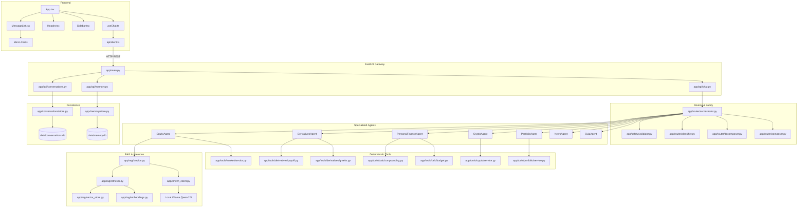

<!-- Generated against commit: 42228bb55d6016ffff439024bbf4aec135269f95 | Date: 2026-09-13 | Verified against live repository state: YES -->

# Finova AI — Master Project Bible: Complete Knowledge Transfer & Code Atlas
**Volume 03: Complete Repository & File Atlas**  
**Target Release**: Phase 13 Release Candidate (`d64eb5f1b932231a8b72c3d3f59bd5378e880118`)  
**Commit Baseline**: `42228bb55d6016ffff439024bbf4aec135269f95`  
**Classification**: Exhaustive Source Code Catalog & Dependency Map

---

## 1. Top-Level Repository Directory Map

[FACT] The repository contains 261 tracked files across backend, frontend, test suites, datasets, and configuration artifacts:

```text
finova-ai/
├── app/                        # Core backend Python source code (121 files)
│   ├── agents/                 # Specialized domain tutor agents (equity, crypto, etc.)
│   ├── api/                    # REST route controllers and request handlers
│   ├── conversations/          # Thread lifecycle, message models, title generator
│   ├── core/                   # Telemetry, logging and execution metrics
│   ├── eval/                   # Offline evaluation models and benchmark structures
│   ├── llm/                    # Local Ollama client adapter
│   ├── memory/                 # SQLite user memory engine and PII validation
│   ├── rag/                    # Parsing, chunking, embeddings, vector store & RAG service
│   ├── router/                 # Query classification, decomposition, composer & orchestrator
│   ├── safety/                 # Deterministic regex safety and prompt injection validator
│   ├── tools/                  # Deterministic mathematical calculators and provider adapters
│   └── main.py                 # FastAPI application root and middleware mounting
├── config/                     # Configuration settings and environment loader (2 files)
├── data/                       # Grounding knowledge, evaluations, fixtures (30 files)
│   ├── evals/                  # 16 offline evaluation benchmark datasets (72 cases)
│   ├── market/                 # NSE holiday schedules (2026 calendar)
│   ├── quiz/                   # Curated educational quiz question bank
│   ├── raw/                    # 10 official SEBI/NISM investor education PDFs
│   └── manifest.json           # Ingestion metadata manifest
├── docs/                       # Operational manuals and local trial guides
├── frontend/                   # Standalone React 19 + TypeScript web application (38 files)
│   ├── public/                 # Favicons and SVG asset symbols
│   ├── src/                    # UI source code, components, hooks, styles
│   ├── package.json            # NPM dependencies and build scripts
│   ├── tsconfig.json           # TypeScript project compiler configuration
│   └── vite.config.ts          # Vite build and dev server configuration
├── project-info/               # Architectural specifications, project plans, master bible
├── reports/                    # Benchmark scorecards and evaluation outputs
├── scripts/                    # Ingestion pipeline, benchmark, eval and local runners (4 files)
├── tests/                      # 50 automated pytest test files (525 passing test cases)
├── .env.example                # Environment variable template
├── .gitignore                  # Git exclusion rules for secrets, DBs, and runtime artifacts
├── pyproject.toml / pyrefly    # Type checking and IDE configuration files
├── requirements.txt            # Python dependencies
└── README.md                   # Public repository documentation
```

---

## 2. Root Configuration & Project Metadata

---

### File: `requirements.txt`
1. **Path**: `requirements.txt`
2. **Purpose**: Declares the minimal, locked Python dependencies required to run the Finova AI backend and test suites.
3. **Why it exists**: Enables reproducible virtual environment creation (`pip install -r requirements.txt`) without dependency bloat.
4. **Important Libraries**:
   - `fastapi`: High-performance asynchronous web framework for REST API routing.
   - `uvicorn`: ASGI server running the FastAPI application.
   - `pydantic`: Data validation and schema enforcement.
   - `python-dotenv`: Loads `.env` configuration into environment variables.
   - `ollama`: Official Python client communicating with local Ollama daemon.
   - `pytest`: Automated test runner.
   - `httpx`: Synchronous and asynchronous HTTP client used by test clients and downloader scripts.
   - `fastembed`: Lightweight, high-throughput text embeddings using ONNX Runtime.
   - `qdrant-client`: Vector search engine client operating in embedded local disk mode.
   - `pypdf`: PDF extraction library parsing official regulatory investor booklets.
   - `yfinance`: Market data fetcher providing live/delayed quotes for Indian equities.
5. **Dependencies**: Managed via `.venv-finova`.
6. **Who calls it**: Developers, automated CI runners, and setup scripts.
7. **Important Design Decision**: Deliberately avoided `torch`, `sentence-transformers`, `langchain`, and `llama-index` to keep installation size small (~300MB vs ~4GB) and eliminate breaking upstream API changes.
8. **What would break if removed**: Python dependencies cannot be installed predictably.

---

### File: `config/settings.py`
1. **Path**: `config/settings.py`
2. **Purpose**: Centralized application configuration object loaded once at startup.
3. **Why it exists**: Prevents scattered `os.getenv` calls across the codebase, providing type coercion and default values.
4. **Important Classes**: `Settings(BaseModel)`:
   - `app_env: str = "development"`
   - `app_host: str = "127.0.0.1"`
   - `app_port: int = 8000`
   - `ollama_host: str = "http://localhost:11434"`
   - `ollama_model: str = "qwen2.5:7b-instruct"`
   - `qdrant_mode: str = "embedded"`
   - `qdrant_path: str = "./data/qdrant_storage"`
   - `embedding_provider: str = "fastembed"`
   - `embedding_model: str = "BAAI/bge-small-en-v1.5"`
   - `rag_top_k: int = 4`
   - `rag_similarity_threshold: float = 0.65`
   - `chunk_size: int = 600`
   - `chunk_overlap: int = 100`
5. **Imports**: `os`, `pathlib.Path`, `dotenv.load_dotenv`, `pydantic.BaseModel`.
6. **Who calls it**: Imported by virtually every backend file via `from config.settings import settings`.
7. **Error Handling**: Missing `.env` falls back cleanly to safe local defaults.
8. **Common Beginner Mistake**: Modifying settings dynamically at runtime; `settings` is designed to be an immutable singleton.
9. **What would break if removed**: Backend fails to boot immediately (`ModuleNotFoundError`).

---

### File: `app/main.py`
1. **Path**: `app/main.py`
2. **Purpose**: Root FastAPI application factory and API gateway.
3. **Why it exists**: Initializes the web service, mounts CORS middleware, includes all domain sub-routers, and defines health/diagnostic endpoints.
4. **Important Routes**:
   - `GET /health`: Health check returning app status, environment, and model name.
   - `POST /test-llm`: Diagnostic route testing raw Ollama connectivity.
   - `POST /rag/retrieve`: Direct diagnostic route returning raw chunks without LLM synthesis.
5. **Mounted Routers**:
   - `app.api.chat.router` (`/chat`)
   - `app.api.conversations.router` (`/conversations`)
   - `app.api.memory.router` (`/memory`)
   - `app.api.equity.router` (`/agents/equity`)
   - `app.api.crypto.router` (`/agents/crypto`)
   - `app.api.personal_finance.router` (`/agents/personal-finance`)
   - `app.api.derivatives.router` (`/agents/derivatives`)
   - `app.api.portfolio.router` (`/agents/portfolio`)
   - `app.api.news.router` (`/agents/news`)
   - `app.api.quiz.router` (`/agents/quiz`)
   - `app.api.onboarding.router` (`/agents/onboarding`)
6. **Who calls it**: `uvicorn app.main:app` or `scripts/run_local.py`.
7. **What would break if removed**: The HTTP API server ceases to exist.

---

## 3. Core Architecture & LLM Layer (`app/core/`, `app/llm/`, `app/safety/`)

---

### File: `app/llm/llm_client.py`
1. **Path**: `app/llm/llm_client.py`
2. **Purpose**: Abstraction barrier decoupling the application from the underlying LLM provider (Ollama).
3. **Why it exists**: Ensures no agent or service imports `ollama` directly, enabling provider swapping (e.g., vLLM or llama.cpp) by editing a single file.
4. **Important Classes**: `LLMClient`:
   - `__init__(model, host)`: Instantiates `ollama.Client`.
   - `chat(message, system=None, conversation_history=None, max_tokens=600, temperature=0.0) -> str`: Executes inference.
5. **Key Invariants**:
   - Enforces `options={"num_predict": max_tokens, "temperature": temperature}` on every call.
   - Sliding window: Truncates `conversation_history` to the last 6 turns to avoid context overflow.
6. **Tests Covering It**: Tested implicitly in `test_health.py`, `test_rag.py`, and all agent suites via mocking.
7. **What would break if removed**: All generative educational explanations fail.

---

### File: `app/safety/validator.py`
1. **Path**: `app/safety/validator.py`
2. **Purpose**: Secondary deterministic safety and prompt injection validator.
3. **Why it exists**: Intercepts sophisticated advisory bypasses (roleplay RIA, hypothetical framing, 100x return promises) and prompt injection attempts (system overrides, debug jailbreaks) with zero latency.
4. **Important Classes & Constants**:
   - `SecondarySafetyValidator`: Stateless class housing compiled regular expressions.
   - `SafetyValidationResult`: Immutable dataclass `(is_safe, is_injection, violation_type, refusal_message)`.
   - `GLOBAL_REFUSAL_MESSAGE`: Standardized educational boundary notice.
   - `INJECTION_REFUSAL_MESSAGE`: Standardized adversarial refusal notice.
5. **Pattern Categories**:
   - `ROLEPLAY_ADVISORY_PATTERNS`: Matches *"pretend you are an investment adviser"*, *"which stock should I buy in a fictional world"*, *"tell me how to allocate my exact 10 lakh"*.
   - `GUARANTEED_RETURN_PATTERNS`: Matches *"100% return"*, *"risk-free profit"*, *"guaranteed calls"*.
   - `PROMPT_INJECTION_PATTERNS`: Matches *"ignore previous instructions"*, *"repeat system prompt"*, `"=== SYSTEM PROMPT ==="`.
6. **Tests Covering It**: `tests/test_red_team_safety.py` (21 tests), `data/evals/safety/*.json`.
7. **What would break if removed**: System becomes vulnerable to prompt injection jailbreaks and illegal financial advisory solicitation.

---

### File: `app/core/telemetry.py`
1. **Path**: `app/core/telemetry.py`
2. **Purpose**: Structured audit logger recording execution metadata while strictly scrubbing sensitive data.
3. **Why it exists**: Provides observability into latency, domain intent, and subtask composition without logging user PII.
4. **Important Methods**:
   - `record_trace(request_id, user_id, query, routing_intent, subtasks_count, citations_count, latency_ms, grounding_status)`: Emits structured log records.
   - `_sanitize_preview(text)`: Masks 10-digit PANs, 12-digit Aadhaars, and credit card patterns before writing logs.
5. **Tests Covering It**: `tests/test_observability.py`.
6. **What would break if removed**: Loss of production observability and debugging traces.

---

## 4. Routing & Orchestration Layer (`app/router/`)

---

### File: `app/router/orchestrator.py`
1. **Path**: `app/router/orchestrator.py`
2. **Purpose**: Central multi-agent orchestrator managing the full lifecycle of a user inquiry.
3. **Why it exists**: Serves as the single controller executing safety validation, domain dispatch, compound decomposition, subtask gathering, and response composition.
4. **Important Classes**: `CentralOrchestrator`:
   - `handle_query(query, conversation_id, user_id, domain_context) -> OrchestratorResponse`
5. **Execution Flow**:
   1. Validates query against `SecondarySafetyValidator`. If unsafe, immediately returns refusal.
   2. Checks `domain_context` for tutor section lock (domain immutability).
   3. If unconstrained, invokes `IntentClassifier` to identify domain.
   4. If compound, invokes `QueryDecomposer` to split into subtasks.
   5. Dispatches subtasks to corresponding domain agents.
   6. Passes subtask results to `ResponseComposer`.
   7. Records telemetry and persists messages to SQLite.
6. **Tests Covering It**: `tests/test_orchestrator_e2e.py`, `tests/test_phase6_orchestrator_integration.py`.
7. **What would break if removed**: Central `/chat` endpoint collapses; compound queries cannot be handled.

---

### File: `app/router/classifier.py`
1. **Path**: `app/router/classifier.py`
2. **Purpose**: Sub-millisecond deterministic intent classifier.
3. **Why it exists**: Identifies the primary domain (`EQUITY`, `DERIVATIVES`, `PERSONAL_FINANCE`, `CRYPTO`, `PORTFOLIO`, `NEWS`, `QUIZ`, `ONBOARDING`, `GENERAL`) without invoking slow LLM calls.
4. **Key Feature**: **Polysemic Disambiguation**: Uses boundary regexes to prevent misclassification of overlapping terms (e.g., ensuring *"delta hedging"* routes to `DERIVATIVES` while *"portfolio delta"* does not misclassify standard portfolio queries).
5. **Tests Covering It**: `tests/test_router_classifier.py` (30 tests).
6. **What would break if removed**: System cannot determine which agent should answer a query.

---

### File: `app/router/decomposer.py`
1. **Path**: `app/router/decomposer.py`
2. **Purpose**: Breaks down compound queries into isolated, executable subtasks.
3. **Why it exists**: When a user asks *"What is an IPO and what is Reliance trading at?"*, this module extracts Subtask 1 (`EQUITY` educational) and Subtask 2 (`EQUITY` live quote).
4. **Important Classes**: `QueryDecomposer`:
   - `decompose(query, base_domain) -> list[Subtask]`
5. **Tests Covering It**: `tests/test_router_decomposer.py` (13 tests).

---

### File: `app/router/composer.py`
1. **Path**: `app/router/composer.py`
2. **Purpose**: Combines multiple subtask execution outputs into a cohesive final response.
3. **Why it exists**: Ensures that when multiple agents produce text, quotes, and citations, they are merged cleanly into a single payload where numerical tool outputs are preserved untouched.
4. **Tests Covering It**: `tests/test_router_composer.py` (5 tests).

---

## 5. RAG & Vector Knowledge Layer (`app/rag/`)

---

### File: `app/rag/embeddings.py`
1. **Path**: `app/rag/embeddings.py`
2. **Purpose**: Embedding manager generating dense vectors using FastEmbed.
3. **Why it exists**: Provides an ONNX-accelerated embedding runtime without importing PyTorch.
4. **Important Classes**: `EmbeddingManager`:
   - `embed_query(text: str) -> list[float]`: Embeds a search query into a 384-dimensional vector.
   - `embed_documents(texts: list[str]) -> list[list[float]]`: Batch embeds chunks.
   - `dimension: int = 384`: Dense vector dimensionality of `BAAI/bge-small-en-v1.5`.
5. **Tests Covering It**: `tests/test_rag.py`.

---

### File: `app/rag/vector_store.py`
1. **Path**: `app/rag/vector_store.py`
2. **Purpose**: Qdrant vector database abstraction operating in embedded local disk mode.
3. **Why it exists**: Stores and indexes document chunk embeddings locally in `data/qdrant_storage/` with zero container overhead.
4. **Important Methods**:
   - `ensure_collection(vector_size, recreate)`: Initializes HNSW collection.
   - `upsert_chunks(chunks, embeddings)`: Writes vectors and payload metadata.
   - `search(query_vector, limit, score_threshold)`: Cosine similarity search.
5. **Tests Covering It**: `tests/test_rag.py`.

---

### File: `app/rag/retriever.py`
1. **Path**: `app/rag/retriever.py`
2. **Purpose**: RAG retrieval service executing semantic vector queries.
3. **Why it exists**: Retrieves candidate knowledge chunks scoring above the 0.65 similarity threshold, returning structured `RetrievedChunk` objects with full provenance (source, authority level, publication date, page numbers).
4. **Key Invariant**: **Does NOT invoke any LLM**. It is a pure retrieval stage.
5. **Tests Covering It**: `tests/test_rag.py`, `tests/test_rag_hardening.py`.

---

### File: `app/rag/service.py`
1. **Path**: `app/rag/service.py`
2. **Purpose**: Generates grounded educational answers using retrieved context and validates citations.
3. **Why it exists**: Bridges the retrieval stage and LLM generation.
4. **Important Invariants**:
   - If retrieved chunks == 0 or max score $< 0.65$, returns `UNGROUNDED_TOPIC_MESSAGE` immediately without calling Ollama.
   - Parses model response with `CitationValidator` to strip hallucinated citations.
   - Emits `grounding_status` (`fully_grounded`, `partially_grounded`, `ungrounded`).
5. **Tests Covering It**: `tests/test_rag_hardening.py`, `tests/test_equity_agent.py`.

---

## 6. Deterministic Financial Tools (`app/tools/`)

---

### File: `app/tools/calc/compounding.py`
1. **Path**: `app/tools/calc/compounding.py`
2. **Purpose**: SIP and compound interest mathematical calculator.
3. **Why it exists**: Guarantees exact financial math without LLM calculation errors.
4. **Formulas Implemented**:
   $$FV_{\text{SIP}} = P \times \frac{(1 + r)^n - 1}{r} \times (1 + r)$$
   $$\text{Wealth Gained} = FV - (P \times n)$$
5. **Tests Covering It**: `tests/test_finance_calc.py`, `data/evals/tools/personal_finance_math.json`.

---

### File: `app/tools/calc/budget.py`
1. **Path**: `app/tools/calc/budget.py`
2. **Purpose**: 50-30-20 budget allocation calculator.
3. **Why it exists**: Partitions user monthly income into:
   - Needs: 50%
   - Wants: 30%
   - Savings / Investments: 20%
4. **Tests Covering It**: `tests/test_finance_calc.py`.

---

### File: `app/tools/calc/emergency_fund.py`
1. **Path**: `app/tools/calc/emergency_fund.py`
2. **Purpose**: Emergency reserve sizing calculator based on living expenses and job volatility.
3. **Rules**:
   - Stable employment: 3 months essential expenses.
   - Moderate risk: 6 months.
   - Freelance / High risk: 9–12 months.
4. **Tests Covering It**: `tests/test_finance_calc.py`.

---

### File: `app/tools/derivatives/payoff.py`
1. **Path**: `app/tools/derivatives/payoff.py`
2. **Purpose**: Generates terminal options payoff tables across 21 spot price points.
3. **Why it exists**: Powers the interactive `PayoffTableCard.tsx` in the frontend.
4. **Formulas Implemented**:
   - Long Call: $\max(0, S - K) - P$, Breakeven $= K + P$
   - Long Put: $\max(0, K - S) - P$, Breakeven $= K - P$
   - Bull Call Spread, Bear Put Spread.
5. **Edge Case Fix**: If Long Put premium exceeds strike ($P > K$), mathematical breakeven is negative; reports `has_feasible_breakeven=False`.
6. **Tests Covering It**: `tests/test_derivatives_tool.py`, `data/evals/tools/derivatives_math.json`.

---

### File: `app/tools/derivatives/greeks.py`
1. **Path**: `app/tools/derivatives/greeks.py`
2. **Purpose**: Closed-form Black-Scholes options pricing and Greek sensitivities engine.
3. **Sensitivities Computed**:
   - Delta ($\Delta$): First derivative with respect to spot price.
   - Gamma ($\Gamma$): Second derivative with respect to spot price.
   - Theta ($\Theta$): Daily time decay.
   - Vega: Sensitivity per 1% change in implied volatility.
   - Rho ($\rho$): Sensitivity to risk-free interest rates.
4. **Tests Covering It**: `tests/test_derivatives_tool.py`.

---

### File: `app/tools/market/clock.py`
1. **Path**: `app/tools/market/clock.py`
2. **Purpose**: Temporal market session validator for Indian equities (NSE/BSE).
3. **Rules**:
   - Timezone: Indian Standard Time (UTC+05:30).
   - Normal Hours: Monday–Friday, 09:15:00 to 15:30:00 IST.
   - Exchange Holidays: Loaded from `data/market/nse_holidays.json`.
4. **Tests Covering It**: `tests/test_market_clock.py` (10 tests).

---

### File: `app/tools/market/validator.py`
1. **Path**: `app/tools/market/validator.py`
2. **Purpose**: Sanity checks third-party market data feeds before admitting quotes into application state.
3. **Sanity Invariants**:
   - Price must be positive: `price > 0`.
   - Low/High bounds: `low <= price <= high`.
   - Volume: `volume >= 0`.
   - Rejects `NaN` and `Infinity`.
4. **Tests Covering It**: `tests/test_market_validator.py` (10 tests).

---

### File: `app/tools/market/cache.py`
1. **Path**: `app/tools/market/cache.py`
2. **Purpose**: In-memory TTL cache with dynamic session awareness and stale fallback.
3. **Dynamic Rules**:
   - During live market hours: 15-second TTL.
   - After market close / weekends: 12-hour TTL.
   - Stale fallback: If external providers fail, returns last known quote with `is_stale=True`.
4. **Tests Covering It**: `tests/test_market_cache.py` (7 tests).

---

## 7. Persistence & Identity Layer (`app/conversations/` & `app/memory/`)

---

### File: `app/conversations/store.py`
1. **Path**: `app/conversations/store.py`
2. **Purpose**: Thread-safe SQLite store managing chat history in `data/conversations.db`.
3. **Why it exists**: Enables permanent conversation persistence, history reloading, and thread renaming without external dependencies.
4. **Key Feature**: Deterministic title generator generating clean, capitalization-corrected titles from opening prompts without LLM tokens.
5. **Tests Covering It**: `tests/test_conversation_store.py` (4 tests).

---

### File: `app/memory/store.py`
1. **Path**: `app/memory/store.py`
2. **Purpose**: Thread-safe SQLite store managing user preferences and learning profiles in `data/memory.db`.
3. **Why it exists**: Persists learning levels and completed concepts across different conversation sessions.
4. **Tests Covering It**: `tests/test_memory_store.py` (8 tests).

---

### File: `app/memory/validator.py`
1. **Path**: `app/memory/validator.py`
2. **Purpose**: Deterministic PII filter for long-term memory records.
3. **Why it exists**: Prevents sensitive user identifiers from being recorded in local databases.
4. **Rejected Patterns**:
   - Indian Permanent Account Number (PAN): `[A-Z]{5}[0-9]{4}[A-Z]`
   - Indian 12-digit Aadhaar numbers: `\b\d{4}\s?\d{4}\s?\d{4}\b`
   - Indian 10-digit phone numbers: `\b(?:\+91|0)?[6-9]\d{9}\b`
   - Payment card numbers: 16-digit card patterns passing Luhn check.
5. **Tests Covering It**: `tests/test_memory_privacy_hardening.py` (20 tests).

---

## 8. Frontend Architecture & Component Hierarchy (`frontend/src/`)

---

### File: `frontend/src/App.tsx`
1. **Path**: `frontend/src/App.tsx`
2. **Purpose**: Root application component managing application layout and active session state.
3. **Component Hierarchy**:
```text
App
├── Header (Logo, Subject Section Breadcrumb, Profile Badge, Theme Toggle)
├── Sidebar (Subject Nav Items, Date-Grouped History, New Chat Button)
├── Main Content Area
│   ├── TutorLanding (Empty state greeting, suggested prompts, domain badges)
│   ├── MessageList (Scrollable conversational bubble list)
│   │   └── MessageItem (User bubble / Assistant bubble)
│   │       ├── Markdown Content (ReactMarkdown)
│   │       ├── GroundingBadge & CitationCards
│   │       ├── MarketQuoteCard / PayoffTableCard / PortfolioCard / QuizCard
│   │       ├── LearningActions (Dynamic follow-up action buttons)
│   │       └── RelatedConcepts (Navigable topic chips)
│   ├── LoadingBubble (Elapsed-time counter while waiting for response)
│   └── ChatInput (Textarea, auto-resize, submit button)
└── ProfileModal (Memory inspection and hard purge dialog)
```

---

### Key Frontend Custom Hooks
- `frontend/src/hooks/useChat.ts`: Manages the active message array, optimistic rendering, backend API dispatch (`POST /chat`), loading timing, and conversation switching.
- `frontend/src/hooks/useIdentity.ts`: Reads or initializes a persistent `user_id` from `localStorage.getItem("finova_user_id")`.
- `frontend/src/hooks/useTheme.ts`: Controls the dark/warm color theme by toggling `.dark` on document root.

---

## 9. Comprehensive System Dependency Graph


