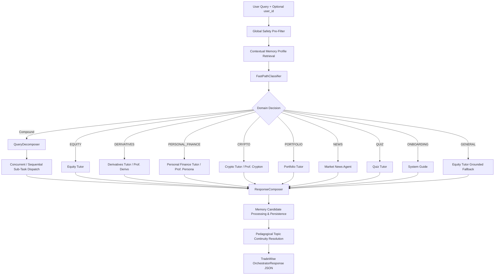

<!-- Generated against commit: 42228bb55d6016ffff439024bbf4aec135269f95 | Date: 2026-09-13 | Verified against live repository state: YES -->

# Volume 12: Domain Agents & Multi-Agent Architecture

## 1. Architectural Philosophy of Finova Agents

[FACT]
Finova AI structures its intelligence not as a single monolithic prompt, but as a federation of specialized domain agents coordinated by the `CentralOrchestrator` (`app/router/orchestrator.py`). Each domain represents a distinct financial pillar governed by unique regulatory boundaries, calculation engines, grounding requirements, and persona guidelines.



### Agent Invariants Across the Entire System
1. **Separation of Determinism and Generative Text** `[FACT]`: Numerical quotes, P&L calculations, payoff schedules, and metrics are never delegated to LLM generation. They originate in pure Python tool code and are preserved without modification.
2. **Deterministic Safety Pre-Evaluation** `[FACT]`: Every agent evaluates regex safety guardrails before invoking any tool, RAG pipeline, or LLM inference. Unsafe queries abort in `<1ms` with a regulatory refusal.
3. **Pydantic Response Contracts** `[FACT]`: Every agent returns a strictly typed result schema detailing `query`, `answer`, `grounding_status`, `citations`, domain data payloads, `grounding_sources`, and regulatory disclaimers.

---

## 2. Exhaustive Domain Agent Deep Dives

---

### Domain 1: Equity Agent (Equity Tutor)

- **Implementation Status**: `[IMPLEMENTED]`
- **Primary Source Code**: [`app/agents/equity/agent.py`](file:///c:/Users/prana/OneDrive/Desktop/finova-ai/app/agents/equity/agent.py), [`app/agents/equity/safety.py`](file:///c:/Users/prana/OneDrive/Desktop/finova-ai/app/agents/equity/safety.py), [`app/agents/equity/prompts.py`](file:///c:/Users/prana/OneDrive/Desktop/finova-ai/app/agents/equity/prompts.py)

#### 1. Purpose & Educational Mandate
Educates retail investors on Indian equities (NSE/BSE), fundamental corporate structures, ratios (P/E, market cap, dividend yield), trading mechanics, and SEBI regulations. Operates under strict SEBI Research Analyst / Investment Adviser boundaries: never recommends buying, selling, or price targets.

#### 2. Input Contract
```python
def ask(
    query: str,
    conversation_history: list[dict[str, str]] | None = None,
    top_k: int | None = None,
    score_threshold: float | None = None,
    personalization: Any | None = None,
) -> EquityAgentResult
```

#### 3. Internal Routing & Flow
1. **Safety Pre-Check**: Evaluates `EquitySafetyGuardrail.evaluate(query)`. If unsafe, immediately returns `EquityAgentResult(grounding_status="ungrounded", answer=refusal_message)`.
2. **Intent Classification**: Evaluates `MarketIntentClassifier.classify(query)`:
   - `market_status`: Queries `MarketDataService.get_market_status()`. Returns session times, open/closed state, and holiday details.
   - `quote`: Calls `MarketDataService.get_quote(symbol, exchange)`. Validates via `MarketDataValidator.create_provenance(quote)`.
   - `historical`: Calls `MarketDataService.get_historical_summary(symbol, exchange)`. Formats 1-month high, low, net change, and 52-week range.
   - `overview`: Calls `MarketDataService.get_company_overview(symbol, exchange)`. Returns sector, industry, market cap, P/E ratio, and corporate summary.
3. **SEBI RAG Synthesis**: For conceptual, regulatory, or educational inquiries, routes to `RAGService.generate_answer(query, system_prompt=...)` using `EQUITY_TUTOR_SYSTEM_PROMPT` personalized by user profile.

#### 4. Tools Employed
- `MarketDataService` (Yahoo Finance primary, Twelve Data fallback, in-memory TTL cache, `MarketClock`).
- `MarketDataValidator` (sanity bounds, change calculation, freshness tagging).

#### 5. RAG Integration
Queries Qdrant collection `finova_sebi_knowledge` (384 dimensions, cosine distance, BGE-small). Retrieves SEBI investor education chunks. Validates citations and returns `grounding_sources=["sebi_rag"]`.

#### 6. LLM Integration
Model: `qwen2.5:7b-instruct` via local Ollama. Generates pedagogical explanations only for conceptual queries. For quotes and status, `model_used="deterministic_tools"` and zero LLM calls occur.

#### 7. Safety & Regulatory Boundaries
Blocks:
- "Should I buy Reliance?" -> Blocked.
- "Give me intraday calls for NIFTY" -> Blocked.
- "Target price for Tata Motors" -> Blocked.
Disclaimer appended: `EQUITY_DISCLAIMER` (SEBI non-advisory disclaimer).

#### 8. Output Schema (`EquityAgentResult`)
```python
class EquityAgentResult(BaseModel):
    query: str
    answer: str
    grounding_status: Literal["fully_grounded", "partially_grounded", "ungrounded"]
    citations: list[Citation]
    market_data: MarketDataProvenance | None
    grounding_sources: list[Literal["sebi_rag", "live_market_data"]]
    agent_name: str = "Equity Tutor"
    disclaimer: str = EQUITY_DISCLAIMER
    model_used: str
    latency_ms: float
```

#### 9. Persistence
If `user_id` is supplied to orchestrator, query and answer entities are analyzed by `MemoryService.process_and_save_candidates()` to persist learning level and topics.

#### 10. Frontend Rendering
Rendered in `frontend/src/components/chat/`:
- `ChatMessage.tsx`: Markdown text with collapsible SEBI citations.
- `MarketCard.tsx`: Dedicated live stock widget displaying price, currency symbol (₹), positive/negative color tags, 24h change, day range bar, and provider badge.

---

### Domain 2: Derivatives Agent (Derivatives Tutor / Prof. Derivo)

- **Implementation Status**: `[IMPLEMENTED]`
- **Primary Source Code**: [`app/agents/derivatives/agent.py`](file:///c:/Users/prana/OneDrive/Desktop/finova-ai/app/agents/derivatives/agent.py), [`app/agents/derivatives/safety.py`](file:///c:/Users/prana/OneDrive/Desktop/finova-ai/app/agents/derivatives/safety.py), [`app/tools/derivatives/payoff.py`](file:///c:/Users/prana/OneDrive/Desktop/finova-ai/app/tools/derivatives/payoff.py), [`app/tools/derivatives/greeks.py`](file:///c:/Users/prana/OneDrive/Desktop/finova-ai/app/tools/derivatives/greeks.py)

#### 1. Purpose & Educational Mandate
Demystifies complex derivative contracts: Long/Short Calls, Long/Short Puts, and Futures. Teaches risk management, intrinsic vs time value, breakeven thresholds, expiration mechanics, and Option Greeks. Implements SEBI’s mandate highlighting retail losses in F&O.

#### 2. Input Contract
```python
def ask(
    query: str,
    conversation_history: list[dict[str, str]] | None = None,
    personalization: PersonalizationProfile | None = None,
    user_id: str | None = None,
) -> DerivativesAgentResult
```

#### 3. Internal Routing & Flow
1. **Safety Pre-Check**: Evaluates `DerivativesSafetyGuardrail.evaluate(query)`. Blocks expiry gambling, leverage speculation, zero-loss option schemes.
2. **Deterministic Calculation Dispatch**:
   - Detects `calculate`, `payoff`, `pnl`, `breakeven`.
   - If futures: extracts `(position, entry_price, lot_size)` -> `calculate_futures_pnl()`.
   - If options: extracts `(option_type, position, strike, premium)` -> `calculate_option_payoff()`.
   - If parameters are missing: prompts deterministically for missing variables without guessing.
3. **Greeks Dispatch**:
   - Detects mentions of `delta`, `gamma`, `theta`, `vega`, `rho`.
   - Retrieves exact definition and bound from `get_greek_info(name)` (`app/tools/derivatives/greeks.py`).
   - Prompts LLM with `DERIVATIVES_TUTOR_SYSTEM_PROMPT` to synthesize pedagogical explanation.
4. **Tier 1 SEBI RAG Retrieval**:
   - For regulatory rules (e.g. SEBI circulars on index derivative position limits), queries Qdrant with `DERIVATIVES_TUTOR_SYSTEM_PROMPT`.

#### 4. Tools Employed
- `app/tools/derivatives/payoff.py`: `calculate_option_payoff`, `calculate_futures_pnl`.
- `app/tools/derivatives/greeks.py`: `GREEKS_CATALOG`, `get_greek_info`.

#### 5. RAG Integration
Uses `finova_sebi_knowledge` containing SEBI study papers on retail F&O trading and regulatory circulars.

#### 6. LLM Integration
Ollama `qwen2.5:7b-instruct` used for conceptual exposition and Option Greeks intuition. Mathematical payoff generation completely bypasses LLM (`model_used="deterministic_derivatives_tool"`).

#### 7. Safety & Regulatory Boundaries
Rejects questions like:
- "Which strike option will double by Thursday expiry?" -> Blocked.
- "Suggest hero or zero option call for NIFTY" -> Blocked.
Disclaimer: `DERIVATIVES_DISCLAIMER` emphasizing that derivatives are leveraged instruments carrying substantial loss potential.

#### 8. Output Schema (`DerivativesAgentResult`)
```python
class DerivativesAgentResult(BaseModel):
    query: str
    answer: str
    grounding_status: Literal["fully_grounded", "partially_grounded", "ungrounded"]
    citations: list[Citation]
    derivatives_data: dict[str, Any] | None
    grounding_sources: list[str]
    agent_name: str = "Derivatives Tutor (Prof. Derivo)"
    disclaimer: str = DERIVATIVES_DISCLAIMER
    model_used: str
    latency_ms: float
```

#### 9. Persistence
User questions are logged; learning profile updated with derivatives terminology mastery.

#### 10. Frontend Rendering
- `DerivativesCard.tsx`: Renders structured payoff tables showing spot price vs gross payoff vs net P&L with color coding, alongside summary badges for strike, premium, breakeven, max profit, and max loss.

---

### Domain 3: Personal Finance Agent (Prof. Persona)

- **Implementation Status**: `[IMPLEMENTED]`
- **Primary Source Code**: [`app/agents/personal_finance/agent.py`](file:///c:/Users/prana/OneDrive/Desktop/finova-ai/app/agents/personal_finance/agent.py), [`app/tools/calc/budget.py`](file:///c:/Users/prana/OneDrive/Desktop/finova-ai/app/tools/calc/budget.py), [`app/tools/calc/compounding.py`](file:///c:/Users/prana/OneDrive/Desktop/finova-ai/app/tools/calc/compounding.py), [`app/tools/calc/emergency_fund.py`](file:///c:/Users/prana/OneDrive/Desktop/finova-ai/app/tools/calc/emergency_fund.py)

#### 1. Purpose & Educational Mandate
Teaches foundational money management, disciplined saving, compounding power, budgeting rules, and emergency resilience. Focuses on actionable numerical models without prescribing individualized debt or tax legal advice.

#### 2. Input Contract
```python
def ask(
    query: str,
    conversation_history: list[dict[str, str]] | None = None,
    personalization: Any | None = None,
) -> PersonalFinanceAgentResult
```

#### 3. Internal Routing & Flow
1. **Safety Pre-Check**: Evaluates `PersonalFinanceSafetyGuardrail.evaluate(query)`. Blocks requests for specific loan approval advice or aggressive debt evasion.
2. **Regex Calculation Parameter Extraction**:
   - 50/30/20 Budget: Regex extracts income. Dispatches `calculate_50_30_20(income)`.
   - SIP: Regex extracts monthly deposit, expected return rate, tenure years. Dispatches `calculate_sip(monthly, rate, years)`.
   - Compound Interest: Extracts principal, annual rate, tenure, frequency. Dispatches `calculate_compound_interest()`.
   - Emergency Fund: Extracts monthly expenses, current savings, target months. Dispatches `calculate_emergency_fund()`.
   - Incomplete parameters trigger structured prompt asking for missing inputs.
3. **Generative Pedagogical Synthesis**: Purely conceptual inquiries (e.g. "What is an emergency fund?") route to `llm.chat(query, system=PF_TUTOR_SYSTEM_PROMPT)`.

#### 4. Tools Employed
- `calculate_50_30_20` (`app/tools/calc/budget.py`)
- `calculate_sip` & `calculate_compound_interest` (`app/tools/calc/compounding.py`)
- `calculate_emergency_fund` (`app/tools/calc/emergency_fund.py`)

#### 5. RAG Integration
Does not query Qdrant; personal finance calculations and frameworks are self-contained in deterministic tools and system prompts. Grounding source tagged as `["calc_tool"]`.

#### 6. LLM Integration
Ollama `qwen2.5:7b-instruct` used strictly for conceptual explanations when no calculation is triggered. Calculation results return pure formatted Markdown with `model_used="deterministic_tools"`.

#### 7. Safety & Regulatory Boundaries
Blocks directives on how to evade loan repayments or personalized tax avoidance schemes.
Disclaimer: `PF_DISCLAIMER` stating calculations are educational simulations.

#### 8. Output Schema (`PersonalFinanceAgentResult`)
```python
class PersonalFinanceAgentResult(BaseModel):
    query: str
    answer: str
    grounding_status: Literal["fully_grounded", "partially_grounded", "ungrounded"]
    calc_data: dict[str, Any] | None
    grounding_sources: list[Literal["sebi_rag", "live_market_data", "crypto_data", "calc_tool"]]
    agent_name: str = "Personal Finance Tutor (Prof. Persona)"
    disclaimer: str = PF_DISCLAIMER
    model_used: str
    latency_ms: float
```

#### 9. Persistence
Calculation interactions update user's profile with financial planning learning milestones.

#### 10. Frontend Rendering
- `CalcCard.tsx`: Visual breakdown card featuring interactive progress bars (50% Needs, 30% Wants, 20% Savings), SIP wealth accumulation metrics (invested vs wealth gain), or emergency fund gap meters.

---

### Domain 4: Crypto Agent (Prof. Crypton)

- **Implementation Status**: `[IMPLEMENTED]`
- **Primary Source Code**: [`app/agents/crypto/agent.py`](file:///c:/Users/prana/OneDrive/Desktop/finova-ai/app/agents/crypto/agent.py), [`app/agents/crypto/safety.py`](file:///c:/Users/prana/OneDrive/Desktop/finova-ai/app/agents/crypto/safety.py), [`app/tools/crypto/service.py`](file:///c:/Users/prana/OneDrive/Desktop/finova-ai/app/tools/crypto/service.py), [`app/tools/crypto/providers/coingecko_provider.py`](file:///c:/Users/prana/OneDrive/Desktop/finova-ai/app/tools/crypto/providers/coingecko_provider.py)

#### 1. Purpose & Educational Mandate
Provides objective, non-promotional education on blockchain technology, consensus mechanisms (PoW, PoS), smart contracts, decentralized ledgers, and digital asset volatility. Provides real-time quotes for major cryptocurrencies in both USD and INR.

#### 2. Input Contract
```python
def ask(
    query: str,
    conversation_history: list[dict[str, str]] | None = None,
    personalization: Any | None = None,
) -> CryptoAgentResult
```

#### 3. Internal Routing & Flow
1. **Safety Check**: Evaluates `CryptoSafetyGuardrail.evaluate(query)`. Blocks shilling, 100x return promises, meme coin pumps, and token purchase directives.
2. **Canonical Symbol Extraction**: Scans `CRYPTO_ALIASES` (e.g. Bitcoin, BTC, Ether, ETH, Solana, SOL).
3. **Live Quote Branch**: If price intent detected, calls `CryptoDataService.get_quote(symbol)`. Normalizes dual USD/INR prices and 24h delta.
4. **Provider Error Handling**: If upstream CoinGecko is rate-limited or unavailable, returns an explicit warning stating real-time data is unavailable. Never fabricates live prices.
5. **Conceptual Fallback**: Invokes `llm.chat(query, system=CRYPTO_TUTOR_SYSTEM_PROMPT)` at temperature 0.1 for balanced educational exposition.

#### 4. Tools Employed
- `CryptoDataService`: In-memory thread-safe 60s TTL cache.
- `CoinGeckoProvider`: HTTP client calling `api.coingecko.com/api/v3/simple/price`.

#### 5. RAG Integration
`[FACT]` Deferred. SEBI investor documents in `data/sebi_corpus/` do not cover cryptocurrencies because virtual digital assets (VDAs) are outside SEBI's regulatory purview in India. Conceptual answers are marked `grounding_status="ungrounded"` and live quotes are marked `grounding_sources=["crypto_data"]`.

#### 6. LLM Integration
Ollama `qwen2.5:7b-instruct` synthesizes conceptual answers. Live quotes are completely deterministic.

#### 7. Safety & Regulatory Boundaries
Prohibits:
- "Which altcoin will 10x next week?" -> Blocked.
- "Should I buy Bitcoin now?" -> Blocked.
Disclaimer: `CRYPTO_DISCLAIMER` highlighting severe volatility and regulatory risk.

#### 8. Output Schema (`CryptoAgentResult`)
```python
class CryptoAgentResult(BaseModel):
    query: str
    answer: str
    grounding_status: Literal["fully_grounded", "partially_grounded", "ungrounded"]
    crypto_data: dict[str, Any] | None
    grounding_sources: list[Literal["sebi_rag", "live_market_data", "crypto_data", "calc_tool"]]
    agent_name: str = "Crypto Tutor (Prof. Crypton)"
    disclaimer: str = CRYPTO_DISCLAIMER
    model_used: str
    latency_ms: float
```

#### 9. Persistence
User curiosity in crypto topics is tracked in `user_profile.topics_explored`.

#### 10. Frontend Rendering
- `CryptoCard.tsx`: Specialized crypto asset widget displaying asset name, symbol, USD price, formatted INR equivalent (₹), 24h percentage badge, and data freshness timestamp.

---

### Domain 5: Portfolio Agent (Portfolio Tutor)

- **Implementation Status**: `[IMPLEMENTED]`
- **Primary Source Code**: [`app/agents/portfolio/agent.py`](file:///c:/Users/prana/OneDrive/Desktop/finova-ai/app/agents/portfolio/agent.py), [`app/tools/portfolio/service.py`](file:///c:/Users/prana/OneDrive/Desktop/finova-ai/app/tools/portfolio/service.py), [`app/tools/portfolio/providers/mock.py`](file:///c:/Users/prana/OneDrive/Desktop/finova-ai/app/tools/portfolio/providers/mock.py)

#### 1. Purpose & Educational Mandate
Educates users on portfolio construction, asset allocation (Equity, Debt, Cash, Gold), sector concentration, diversification benefits, and systemic vs unsystematic risk. Enables interactive "What-If" market stress tests without executing actual live brokerage trades.

#### 2. Input Contract
```python
def ask(
    query: str,
    user_id: str | None = None,
    conversation_history: list[dict[str, str]] | None = None,
    personalization: PersonalizationProfile | None = None,
) -> PortfolioAgentResult
```

#### 3. Internal Routing & Flow
1. **Safety Guardrail**: Blocks rebalancing orders, stock allocation instructions, or real money execution.
2. **Portfolio Retrieval**: Retrieves user's simulated portfolio via `PortfolioService.get_portfolio(user_id)`. If none exists, initializes an educational demo portfolio via `create_demo_portfolio()`.
3. **What-If Simulation Check**: Regex extracts target asset/index and percentage movement (e.g. "What if NIFTY drops 10%?" or "What if TCS falls 5%?"):
   - Dispatches `PortfolioService.simulate_what_if()`.
   - Computes exact mathematical delta on affected holdings and total portfolio value.
4. **Deterministic Accounting Metrics**: If not what-if, calculates:
   - Total Portfolio Value = Securities Market Value + Cash Balance
   - Unrealized Gain/Loss = Market Value - Cost Basis
   - Asset and Sector allocation percentages.
   - Qualitative diversification score.

#### 4. Tools Employed
- `PortfolioService` (`app/tools/portfolio/service.py`): Pure accounting logic for portfolio metrics and stress testing.

#### 5. RAG Integration
Does not query Qdrant directly. Grounding tagged as `["portfolio_tool"]`.

#### 6. LLM Integration
All analytics and simulation results are formatted deterministically via Markdown templates (`model_used="deterministic_portfolio_tool"`). LLM is only called if conceptual theory on Modern Portfolio Theory (MPT) is explicitly requested.

#### 7. Safety & Regulatory Boundaries
Blocks:
- "Rebalance my portfolio to buy more banking stocks" -> Blocked.
- "Sell my Reliance holdings" -> Blocked.
Disclaimer: `PORTFOLIO_DISCLAIMER` confirming that portfolio figures are simulated educational examples.

#### 8. Output Schema (`PortfolioAgentResult`)
```python
class PortfolioAgentResult(BaseModel):
    query: str
    answer: str
    grounding_status: Literal["fully_grounded", "partially_grounded", "ungrounded"]
    portfolio_data: dict[str, Any] | None
    grounding_sources: list[str]
    agent_name: str = "Portfolio Tutor"
    disclaimer: str = PORTFOLIO_DISCLAIMER
    model_used: str
    latency_ms: float
```

#### 9. Persistence
Portfolio state stored in isolated user databases (`data/portfolio.db` or in-memory repository).

#### 10. Frontend Rendering
- `PortfolioCard.tsx`: Visual dashboard showing Total Portfolio Value, Cash Liquidity, P&L badge, Asset Allocation pie/bar distribution, and stress-test impact table.

---

### Domain 6: Market News Agent

- **Implementation Status**: `[IMPLEMENTED]`
- **Primary Source Code**: [`app/agents/news/agent.py`](file:///c:/Users/prana/OneDrive/Desktop/finova-ai/app/agents/news/agent.py), [`app/tools/news/service.py`](file:///c:/Users/prana/OneDrive/Desktop/finova-ai/app/tools/news/service.py)

#### 1. Purpose & Educational Mandate
Delivers verified, non-hallucinated financial news, macroeconomic updates, and regulatory announcements (SEBI circulars, RBI MPC rate decisions). Never allows an LLM to hallucinate or speculate on breaking market news.

#### 2. Input Contract
```python
def ask(query: str, user_id: str | None = None) -> NewsAgentResult
```

#### 3. Internal Routing & Flow
1. **Safety Guardrail**: Evaluates `NewsSafetyGuardrail`. Blocks unverified rumors, market manipulation claims, or leaked insider information requests.
2. **Entity Extraction**: Matches known Indian tickers (e.g. `RELIANCE.NS`, `TCS.NS`, `^NSEI`).
3. **News Service Dispatch**:
   - If ticker detected: `NewsService.get_ticker_news(symbol, limit=4)`.
   - If general/macro: `NewsService.get_macro_news(limit=4)`.
4. **Provenance & Freshness Validation**: Checks timestamps against freshness policies (`REALTIME`, `DELAYED`, `ARCHIVAL`).
5. **Truthful No-Article Handling**: If no articles exist, explicitly states that no verified news was found; never generates fictitious headlines.

#### 4. Tools Employed
- `NewsService` (`app/tools/news/service.py`): RSS feeds and financial news provider abstraction.

#### 5. RAG Integration
Integrates with regulatory circular archives where applicable. Grounding source tagged as `["news_service", provider_name]`.

#### 6. LLM Integration
None for headline retrieval. All summaries are composed from upstream verified headlines and descriptions (`model_used="news_service"`).

#### 7. Safety & Regulatory Boundaries
Refuses to summarize anonymous social media tips or speculative gossip.
Disclaimer: `NEWS_DISCLAIMER` stating news is informational and not investment advice.

#### 8. Output Schema (`NewsAgentResult`)
```python
@dataclass(frozen=True)
class NewsAgentResult:
    query: str
    answer: str
    articles: list[dict[str, Any]]
    freshness: str
    grounding_status: str
    grounding_sources: list[str]
    disclaimer: str
```

#### 9. Persistence
User topics of interest are updated based on queried news entities.

#### 10. Frontend Rendering
- `NewsCard.tsx`: Visual cards showing headline, publishing source, formatted date, summary snippet, and external canonical source link.

---

### Domain 7: Quiz Agent (Quiz Tutor)

- **Implementation Status**: `[IMPLEMENTED]`
- **Primary Source Code**: [`app/agents/quiz/agent.py`](file:///c:/Users/prana/OneDrive/Desktop/finova-ai/app/agents/quiz/agent.py), [`app/tools/quiz/service.py`](file:///c:/Users/prana/OneDrive/Desktop/finova-ai/app/tools/quiz/service.py)

#### 1. Purpose & Educational Mandate
Administers pedagogical assessments and financial literacy challenges across all domains. Evaluates retail investor understanding, provides instant deterministic grading, explains correct answers referencing SEBI/NISM curricula, and identifies weak knowledge areas.

#### 2. Input Contract
```python
def ask(query: str, user_id: str | None = None) -> QuizAgentResult
```

#### 3. Internal Routing & Flow
1. **Submission Parsing**: Scans query for answer patterns (e.g. `eq_beg_1=A`, `Answer: B for deriv_int_2`).
2. **Evaluation Mode**: If answers are parsed:
   - Calls `QuizService.evaluate_answers(submissions, user_id, memory_service)`.
   - Computes score percentage, correct/incorrect status, authoritative explanation, and weak areas.
   - Stores quiz scores and updates user mastery level via `MemoryService`.
3. **Presentation Mode**: If not answering:
   - Detects requested topic (`equity`, `derivatives`, `personal_finance`, `crypto`, `portfolio`, `regulations`) and difficulty (`beginner`, `intermediate`, `advanced`).
   - Retrieves questions from verified repository via `QuizService.get_questions(topic, difficulty, limit=3)`.

#### 4. Tools Employed
- `QuizService` (`app/tools/quiz/service.py`): Question bank loader, deterministic grader, and weak area analyzer.

#### 5. RAG Integration
Explanations cite specific SEBI and NISM curriculum references embedded in the verified question bank (`grounding_sources=["quiz_service", "sebi_nism_curriculum"]`).

#### 6. LLM Integration
None required. Grading, score computation, and question formatting are 100% deterministic (`model_used="deterministic_grading"`).

#### 7. Safety & Regulatory Boundaries
No speculative content. All questions adhere strictly to investor education standards.
Disclaimer: `QUIZ_DISCLAIMER`.

#### 8. Output Schema (`QuizAgentResult`)
```python
@dataclass(frozen=True)
class QuizAgentResult:
    query: str
    answer: str
    mode: str  # "presentation" or "evaluation"
    grounding_status: str
    grounding_sources: list[str]
    disclaimer: str
    questions: list[dict[str, Any]] | None = None
    evaluation: dict[str, Any] | None = None
```

#### 9. Persistence
Persists quiz history, scores, and weak topics into `data/finova_memory.db` (`learning_progress` and `quiz_records`).

#### 10. Frontend Rendering
- `QuizCard.tsx`: Interactive multi-choice challenge card allowing users to select options, submit answers, view score summaries, and read detailed curriculum explanations.

---

### Domain 8: Onboarding Agent (System Guide)

- **Implementation Status**: `[IMPLEMENTED]`
- **Primary Source Code**: [`app/agents/onboarding/agent.py`](file:///c:/Users/prana/OneDrive/Desktop/finova-ai/app/agents/onboarding/agent.py), [`app/tools/onboarding/repository.py`](file:///c:/Users/prana/OneDrive/Desktop/finova-ai/app/tools/onboarding/repository.py)

#### 1. Purpose & Educational Mandate
Guides first-time users through Finova’s capabilities, domain tutors, calculation tools, and compliance boundaries. Explains data privacy, session memory policies, and the Right to be Forgotten.

#### 2. Input Contract
```python
def ask(query: str, user_id: str | None = None) -> OnboardingAgentResult
```

#### 3. Internal Routing & Flow
1. **Memory Deletion / Privacy Policy**: Detects "delete memory", "forget me", "privacy policy". Explicitly clarifies that memory deletion is an authenticated API action (`DELETE /memory?user_id=...`) to prevent accidental deletion via chat.
2. **Specific Capability Discovery**: Matches queries asking about specific features (e.g. "Can you calculate options payoff?"). Returns feature description and example prompts.
3. **General Orientation**: Returns complete catalog of all 8 specialized tutors, disclaimer standards, and sample inquiries.

#### 4. Tools Employed
- `OnboardingRepository` (`app/tools/onboarding/repository.py`): Structured static capability catalog and FAQ items.

#### 5. RAG Integration
Static system architecture grounding (`grounding_sources=["system_architecture", "api_specification"]`).

#### 6. LLM Integration
None (`model_used="system_catalog"`). Answers are built deterministically from the repository.

#### 7. Safety & Regulatory Boundaries
Explains SEBI non-adviser status and security architecture.
Disclaimer: `ONBOARDING_DISCLAIMER`.

#### 8. Output Schema (`OnboardingAgentResult`)
```python
@dataclass(frozen=True)
class OnboardingAgentResult:
    query: str
    answer: str
    topic: str
    grounding_status: str
    grounding_sources: list[str]
    disclaimer: str
    capabilities: list[dict[str, Any]] | None
    faqs: list[dict[str, Any]] | None
```

#### 9. Persistence
Zero personal data persisted.

#### 10. Frontend Rendering
- `OnboardingCard.tsx`: Interactive onboarding guide showing capability tiles, example prompt chips, and privacy FAQ accordions.

---

### Domain 9: General Domain (Fallback & Cross-Domain RAG)

- **Implementation Status**: `[IMPLEMENTED]`
- **Primary Source Code**: [`app/router/orchestrator.py`](file:///c:/Users/prana/OneDrive/Desktop/finova-ai/app/router/orchestrator.py) (Lines 535–567)

#### 1. Purpose & Educational Mandate
Handles general financial inquiries, macroeconomic concepts (e.g. Inflation, GDP, RBI functions, Repo Rate), and questions spanning multiple domains that do not map to a single specialized tutor.

#### 2. Input Contract
Invoked internally by `CentralOrchestrator.ask()` when `decision.domain == "GENERAL"` or when unclassified.

#### 3. Internal Routing & Flow
1. Evaluates query against `GlobalSafetyGuardrail`.
2. Dispatches to `EquityAgent.ask(query, conversation_history, top_k, score_threshold, personalization)`.
3. Overrides reported domain to `"GENERAL"` and agent name to `"Finova Orchestrator"`.
4. Passes answer through `resolve_learning_context()` for topic continuity.

#### 4. Tools Employed
Uses SEBI RAG retrieval pipeline and `FastPathClassifier`.

#### 5. RAG Integration
Searches Qdrant `finova_sebi_knowledge`. If cosine similarity exceeds 0.65 threshold, generates citation-grounded response. If out-of-corpus, provides safe educational framing.

#### 6. LLM Integration
Ollama `qwen2.5:7b-instruct` synthesizes grounded educational text.

#### 7. Safety & Regulatory Boundaries
Applies `DEFAULT_DISCLAIMER`. Refuses financial advice or return guarantees.

#### 8. Output Schema (`OrchestratorResponse`)
Unified orchestrator contract with `domain_detected="GENERAL"`.

#### 9. Persistence
Extracts and persists learning profile topics if `user_id` is present.

#### 10. Frontend Rendering
Standard `ChatMessage.tsx` with citations and concept exploration chips.

---

## 3. Comparative Agent Architecture Matrix

| Domain | Agent Name | Primary Tool / Engine | RAG Grounding Source | LLM Model Role | Deterministic Guarantee |
| :--- | :--- | :--- | :--- | :--- | :--- |
| **EQUITY** | Equity Tutor | `MarketDataService` | `finova_sebi_knowledge` | Conceptual RAG only | Quotes, Status, Fundamentals 100% deterministic |
| **DERIVATIVES** | Prof. Derivo | `calculate_option_payoff`, `calculate_futures_pnl` | `finova_sebi_knowledge` (SEBI F&O Study) | Greeks & concept intuition | Payoffs, breakeven, P&L 100% deterministic |
| **PERSONAL FINANCE** | Prof. Persona | `calculate_50_30_20`, `calculate_sip`, `calculate_emergency_fund` | None (Tool grounded) | Budgeting philosophy | Mathematical calculations 100% deterministic |
| **CRYPTO** | Prof. Crypton | `CryptoDataService` (CoinGecko) | None (RAG Deferred) | Blockchain concept education | Quotes, INR conversion 100% deterministic |
| **PORTFOLIO** | Portfolio Tutor | `PortfolioService` | None (Tool grounded) | Theory explanations | Value, P&L, What-If stress test 100% deterministic |
| **NEWS** | Market News Agent | `NewsService` (RSS/Verified APIs) | None (News feed grounded) | None (Pure feed summarization) | Headlines, provenance, timestamps 100% deterministic |
| **QUIZ** | Quiz Tutor | `QuizService` | SEBI/NISM Curriculum | None | Grading, scores, evaluations 100% deterministic |
| **ONBOARDING** | System Guide | `OnboardingRepository` | System Specification | None | Capability discovery, FAQs 100% deterministic |
| **GENERAL** | Finova Orchestrator | `CentralOrchestrator` fallback | `finova_sebi_knowledge` | General financial pedagogy | Safety filtering & domain routing 100% deterministic |
