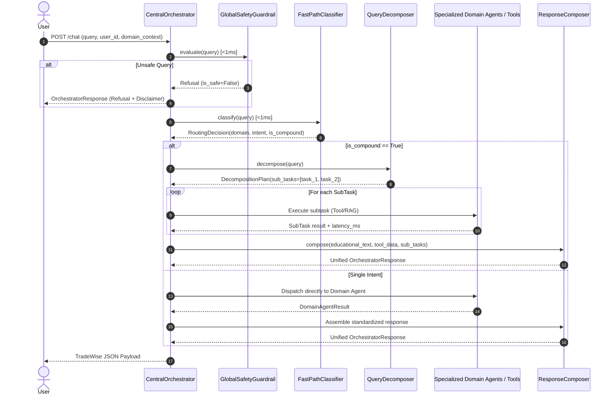
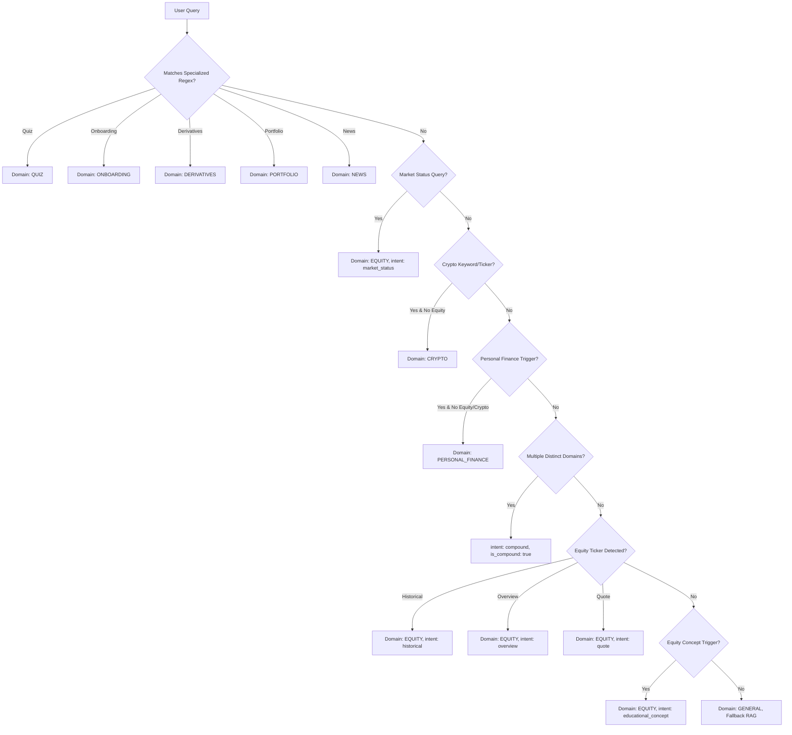

<!-- Generated against commit: 42228bb55d6016ffff439024bbf4aec135269f95 | Date: 2026-09-13 | Verified against live repository state: YES -->

# Volume 13: Central Router, Fast-Path Classification & Multi-Intent Orchestration

## 1. Architectural Mandate & The Sub-Millisecond Routing Principle

[FACT]
In production AI systems, routing user inquiries using large language model prompts introduces 500ms to 2000ms of unnecessary latency, consumes GPU/VRAM resources, and introduces probabilistic non-determinism into fundamental dispatch decisions.

Finova AI solves this with a **Deterministic Fast-Path Routing Engine**:
- **Execution Target**: `<1.0ms` decision latency.
- **Inference Requirement**: 0 LLM calls for classification and query decomposition.
- **Primary Modules**:
  1. [`app/router/classifier.py`](file:///c:/Users/prana/OneDrive/Desktop/finova-ai/app/router/classifier.py): `FastPathClassifier`
  2. [`app/router/decomposer.py`](file:///c:/Users/prana/OneDrive/Desktop/finova-ai/app/router/decomposer.py): `QueryDecomposer`
  3. [`app/router/orchestrator.py`](file:///c:/Users/prana/OneDrive/Desktop/finova-ai/app/router/orchestrator.py): `CentralOrchestrator`
  4. [`app/router/composer.py`](file:///c:/Users/prana/OneDrive/Desktop/finova-ai/app/router/composer.py): `ResponseComposer`



---

## 2. Fast-Path Domain Classification

### 2.1 The Classification Pipeline
The classification engine evaluates user text through a strictly ordered waterfall in `FastPathClassifier.classify(query: str) -> RoutingDecision`:

```python
# app/router/models.py
Domain = Literal[
    "EQUITY",
    "CRYPTO",
    "PERSONAL_FINANCE",
    "DERIVATIVES",
    "PORTFOLIO",
    "NEWS",
    "QUIZ",
    "ONBOARDING",
    "GENERAL",
]
```

### 2.2 Waterfall Evaluation Hierarchy



#### Step 1: High-Priority Specialized Domains
1. **Quiz Pattern** (`QUIZ_PATTERN`): Detects explicit test commands or answer submissions (`eq_beg_1=A`, `Answer: B`).
2. **Onboarding & Privacy** (`ONBOARDING_PATTERN`): Detects capability inquiries, help requests, privacy policies, or memory management.
3. **Derivatives** (`DERIVATIVES_PATTERN`): Matches options, futures, calls, puts, strikes, Greeks, ITM/OTM, payoff, or breakeven.
4. **Portfolio** (`PORTFOLIO_PATTERN`): Matches holdings, asset allocation, diversification, or What-If stress test questions.
5. **Market News** (`NEWS_PATTERN`): Matches breaking news, corporate announcements, SEBI circulars, or RBI MPC decisions.

#### Step 2: Indian Equity Market Status
Evaluates `MARKET_STATUS_PATTERN` (e.g. "Is the market open right now?", "NSE trading hours"). Routes to `EQUITY` with intent `market_status`.

#### Step 3: Pure Crypto Asset Inquiries
Evaluates `CRYPTO_ALIASES` (BTC, ETH, SOL, etc.) and `CRYPTO_CONCEPT_PATTERN`. If no equity or personal finance triggers are present, routes to `CRYPTO`.

#### Step 4: Pure Personal Finance Inquiries
Evaluates `PERSONAL_FINANCE_PATTERN` (budgeting, 50/30/20, SIP, emergency fund, compounding). Categorizes into `calculation` if numbers/salary are present, or `educational_concept` if purely definitional.

#### Step 5: Multi-Domain Compound Inquiries
Scans the character start positions of all domain keyword matches in the query. If matches span two or more distinct domains, flags `intent="compound"`, `is_compound=True`, and sets the primary domain to the earliest appearing domain.

#### Step 6: Equity Single-Intent Resolution
If equity symbols are extracted:
- If matches `HISTORICAL_PATTERN` -> `intent="historical"`
- If matches `OVERVIEW_PATTERN` -> `intent="overview"`
- Otherwise -> `intent="quote"`

#### Step 7: Conceptual Equity RAG Pattern
Matches regulatory, capital market, or share terminology (`EQUITY_CONCEPT_PATTERN`) -> `domain="EQUITY"`, `intent="educational_concept"`.

#### Step 8: General Fallback
Any query that does not trigger specific domain keywords defaults to:
```python
RoutingDecision(
    query=trimmed,
    domain="GENERAL",
    intent="educational_concept",
    confidence=0.60,
    entities=[],
    is_compound=False,
    reason="Unclassified generic financial query",
)
```

---

## 3. Multi-Intent Decomposition (`QueryDecomposer`)

### 3.1 The Multi-Intent Problem
Real users often submit questions with multiple distinct objectives:
- **Archetype A (Comparative Multi-Entity)**: `"Compare Reliance and TCS price"`
- **Archetype B (Hybrid Concept + Live Data)**: `"What is an IPO and what is Reliance trading at?"`
- **Archetype C (Cross-Domain Multi-Task)**: `"What is Bitcoin trading at and how should I budget a 50,000 salary?"`

Attempting to answer these with a single tool or prompt results in missing data, hallucinated numbers, or ignored clauses.

### 3.2 Clause Splitting Mechanics
`QueryDecomposer.decompose()` employs deterministic regex syntactic splitting:

```python
# app/router/decomposer.py
CONJUNCTION_SPLIT_REGEX = re.compile(
    r"\s*(?:\band\s+also\b|\bas\s+well\s+as\b|\balong\s+with\b|\bwhile\s+also\b|,\s*and\b|\b\?\s*and\b|\band\b|\balso\b|\bwhile\b|[;,?])\s*",
    re.IGNORECASE,
)
```

### 3.3 Decomposition Workflow
1. **Comparative Query Detection**:
   - Matches `COMPARATIVE_PATTERN` (`compare`, `versus`, `vs.`, `difference between`).
   - If multiple entities are extracted (e.g. Reliance, TCS) without educational interrogatives ("what is"), generates parallel `quote` sub-tasks for each entity.
2. **Syntactic Splitting**:
   - Splits query along conjunction boundaries.
   - Cleans leading conjunctions (`and`, `also`, `what about`).
   - Filters out clauses shorter than 3 characters.
3. **Independent Clause Classification**:
   - Each clause is passed to `FastPathClassifier.classify()`.
   - Generates an isolated `SubTask`:
     ```python
     class SubTask(BaseModel):
         task_id: str          # "task_1", "task_2"
         domain: Domain        # "EQUITY", "CRYPTO", "PERSONAL_FINANCE"
         intent: IntentType    # "quote", "educational_concept", "calculation"
         query_slice: str      # Exact text segment
         target_entity: str | None
         status: Literal["pending", "success", "fallback", "filtered", "error", "failed"] = "pending"
     ```
4. **Deduplication**: Identical domain/intent/entity tuples are pruned to prevent redundant execution.

---

## 4. Sub-Task Execution in `CentralOrchestrator`

[FACT]
When `decision.is_compound == True`, `CentralOrchestrator._execute_compound_plan()` iterates through the sub-tasks, dispatching each to its dedicated deterministic service:

```python
for task in plan.sub_tasks:
    t_sub = time.perf_counter()
    if task.domain == "EQUITY":
        if task.intent == "quote":
            quote = self.market_service.get_quote(task.target_entity)
            market_quotes.append(quote)
        elif task.intent == "historical":
            historical_data = self.market_service.get_historical_summary(task.target_entity)
        elif task.intent == "overview":
            overview_data = self.market_service.get_company_overview(task.target_entity)
        else:
            rag_ans = self.rag_service.generate_answer(query=task.query_slice, ...)
            educational_texts.append(rag_ans.answer)
            all_citations.extend(rag_ans.citations)

    elif task.domain == "CRYPTO":
        if task.intent == "quote":
            c_quote = self.crypto_service.get_quote(task.target_entity)
            crypto_data = self.crypto_service.create_provenance(c_quote).model_dump()
        else:
            c_res = self.crypto_agent.ask(task.query_slice)
            educational_texts.append(c_res.answer)

    elif task.domain == "PERSONAL_FINANCE":
        pf_res = self.personal_finance_agent.ask(task.query_slice)
        if pf_res.calc_data:
            calc_data = pf_res.calc_data
        else:
            educational_texts.append(pf_res.answer)

    elif task.domain == "DERIVATIVES":
        d_res = self.derivatives_agent.ask(task.query_slice)
        if d_res.derivatives_data:
            derivatives_data = d_res.derivatives_data
        educational_texts.append(d_res.answer)
```

### Fault-Tolerant Partial Execution
If one subtask fails (e.g. Twelve Data rate limit or invalid symbol), it does **NOT** crash the entire request.
- The failed sub-task is logged with `status="failed"`.
- Remaining sub-tasks continue executing.
- `ResponseComposer` stitches available results into a truthful, partial response.

---

## 5. Deterministic Response Composition (`ResponseComposer`)

### 5.1 The Numerical Output Invariant
```
"Numerical outputs originate from validated deterministic tools and are not modified
by the response composer."
```
The response composer never parses numbers back into an LLM prompt to "summarize" them. Doing so would risk hallucination (e.g. turning ₹2,945.10 into ₹2,950). Instead, the composer builds structured Markdown widgets directly from Python dataclasses.

### 5.2 Card Generation Methods
- `format_quote_card(quote)`: Price, previous close, day range, volume, session state, timestamp, provider.
- `format_historical_card(hist)`: 1-month performance schedule, net period change, 52-week bounds.
- `format_overview_card(ov)`: Sector, market cap, P/E ratio, business description.
- `format_crypto_card(crypto_data)`: Dual USD/INR prices, 24h change, freshness badge.
- `format_calc_card(calc_data)`: 50/30/20 breakdown tables, SIP wealth gains, emergency fund adequacy.
- `format_derivatives_card(derivatives_data)`: Payoff tables, breakevens, Option Greek definitions.
- `format_portfolio_card(portfolio_data)`: Holdings valuation, asset allocation, What-If stress test tables.
- `format_news_card(news_data)`: Verified headlines, sources, publication dates, and URLs.

### 5.3 Grounding Status Resolution
The composer resolves the overall grounding state across all sub-tasks:
1. **`fully_grounded`**: Every executed sub-task was grounded in verified live tools, SEBI RAG citations, or calculation math.
2. **`partially_grounded`**: Query contained a mixture of grounded tool/RAG outputs and ungrounded conceptual generative text.
3. **`ungrounded`**: Entire response was generated without citations or deterministic tool grounding (e.g. advisory refusals or out-of-corpus conceptual text).

---

## 6. Tutor-Selected Routing & Domain Immutability

### 6.1 The Problem of Polysemic Domain Ambiguity
Certain financial terms are polysemic across domains:
- `"How do I calculate payoff?"`: Could be Personal Finance (loan payoff) or Derivatives (option payoff).
- `"What is risk and allocation?"`: Could be Equity, Portfolio, or Derivatives.
- `"Test my knowledge"`: Could be any domain quiz.

### 6.2 The `domain_context` Invariant
When a user navigates to a specific Tutor tab in the Finova UI (e.g. `/derivatives` or `/crypto`), the frontend explicitly passes `domain_context="DERIVATIVES"` in the JSON payload:

```python
# app/router/orchestrator.py (lines 214-253)
normalized_domain_ctx: Domain | None = None
if domain_context:
    clean_ctx = str(domain_context).strip().upper()
    if clean_ctx in (
        "EQUITY", "CRYPTO", "PERSONAL_FINANCE", "DERIVATIVES",
        "PORTFOLIO", "NEWS", "QUIZ", "ONBOARDING", "GENERAL"
    ):
        normalized_domain_ctx = clean_ctx

# Check for quiz actions inside tutor sections
is_quiz_query = ...

if is_quiz_query:
    decision = RoutingDecision(
        query=query,
        domain="QUIZ",
        intent="educational_concept",
        is_compound=False,
        entities=decision.entities,
    )
elif normalized_domain_ctx and normalized_domain_ctx != "GENERAL":
    decision = RoutingDecision(
        query=query,
        domain=normalized_domain_ctx,
        intent=decision.intent,
        is_compound=False,
        entities=decision.entities,
    )
```

### 6.3 Rules of Domain Immutability
1. **Tutor Section Bias**: If `domain_context` is explicitly non-general (e.g. `DERIVATIVES`), queries bypass cross-domain decomposition and route directly to that domain's tutor agent.
2. **Quiz Context Preservation**: If a quiz is triggered inside a tutor section (e.g. "Quiz me on options"), the router executes the `QUIZ` engine, but sets `domain_detected` to the active tutor section and formats `agent_name = f"{domain_context.title()} Tutor (Quiz)"`.
3. **Immutability of Active Domain**: The active tutor's specialized safety guardrails, prompt personas, and tool registries cannot be hijacked by ambiguous keywords belonging to other domains.

---

## 7. Real Traced Execution Walkthroughs

---

### Walkthrough 1: Pure Single-Intent Equity Quote
**User Query**: `"What is the current price of Reliance?"`

1. **Safety**: Evaluates `GlobalSafetyGuardrail.evaluate()`. No buy/sell recommendations detected -> `is_safe=True`.
2. **FastPathClassifier**:
   - Detects `RELIANCE` in `EQUITY_ALIASES` -> canonical ticker `RELIANCE.NS`.
   - Detects `QUOTE_PATTERN` (`price of`).
   - Returns `RoutingDecision(domain="EQUITY", intent="quote", entities=["RELIANCE.NS"], is_compound=False)`.
3. **Orchestrator Execution**:
   - `decision.is_compound` is `False`.
   - Dispatches to `EquityAgent.ask()`.
   - `EquityAgent` calls `MarketDataService.get_quote("RELIANCE.NS")`.
   - Cache check: fresh cache hit or fetched from Yahoo Finance in ~120ms.
   - `MarketDataValidator` validates price bounds and formats `MarketDataProvenance`.
4. **Response Assembly**:
   - Returns formatted quote card: `₹2,985.40 (+15.20, +0.51%)`.
   - `grounding_status="fully_grounded"`.
   - `grounding_sources=["live_market_data"]`.
   - Total latency: ~125ms. Zero LLM inference.

---

### Walkthrough 2: Hybrid Single-Domain (Quote + Concept)
**User Query**: `"What is an IPO and what is Reliance trading at?"`

1. **Safety**: Safe.
2. **FastPathClassifier**:
   - Detects `IPO` (`EQUITY_CONCEPT_PATTERN`).
   - Detects `RELIANCE` (`EQUITY_ALIASES`) and `trading at` (`QUOTE_PATTERN`).
   - Same-domain match (EQUITY + EQUITY) -> flags `is_compound=True`.
3. **QueryDecomposer**:
   - Splits on `and what is`.
   - Clause 1: `"What is an IPO"` -> `SubTask(domain="EQUITY", intent="educational_concept")`.
   - Clause 2: `"Reliance trading at"` -> `SubTask(domain="EQUITY", intent="quote", target_entity="RELIANCE.NS")`.
4. **Compound Execution**:
   - SubTask 1: Invokes `RAGService.generate_answer("What is an IPO")` -> queries Qdrant -> retrieves SEBI IPO guidelines -> generates grounded explanation with citations.
   - SubTask 2: Invokes `MarketDataService.get_quote("RELIANCE.NS")` -> retrieves validated market quote.
5. **ResponseComposer**:
   - Prepend SEBI-grounded explanation of IPOs with citations `[1]`.
   - Append formatted live quote card for Reliance.
   - Set `grounding_status="fully_grounded"`.
   - Total latency: ~980ms (RAG retrieval + LLM synthesis + tool quote).

---

### Walkthrough 3: Cross-Domain Compound Query
**User Query**: `"What is Bitcoin trading at and how should I budget a 50000 salary?"`

1. **Safety**: Safe.
2. **FastPathClassifier**:
   - Detects `Bitcoin` -> `CRYPTO` domain.
   - Detects `budget a 50000 salary` -> `PERSONAL_FINANCE` domain.
   - Multiple distinct domains detected -> flags `is_compound=True`, `primary_domain="CRYPTO"`.
3. **QueryDecomposer**:
   - Clause 1: `"What is Bitcoin trading at"` -> `SubTask(domain="CRYPTO", intent="quote", target_entity="BTC")`.
   - Clause 2: `"how should I budget a 50000 salary"` -> `SubTask(domain="PERSONAL_FINANCE", intent="calculation")`.
4. **Compound Execution**:
   - SubTask 1: Calls `CryptoDataService.get_quote("BTC")` -> CoinGecko API -> returns USD $68,450.00 and INR ₹5,745,000.00.
   - SubTask 2: Calls `PersonalFinanceAgent.ask("how should I budget a 50000 salary")` -> regex extracts 50,000 -> dispatches `calculate_50_30_20(50000)` -> Returns Needs ₹25,000, Wants ₹15,000, Savings ₹10,000.
5. **ResponseComposer**:
   - Stitches Crypto Card and 50/30/20 Budget Card.
   - Subtasks execution metadata logged.
   - Overall domain marked `GENERAL` (cross-domain compound).
   - `grounding_status="fully_grounded"`.
   - Total latency: ~140ms. Zero LLM hallucination of prices or budget math.

---

### Walkthrough 4: Tutor-Selected Section Routing
**User Query**: `"How do I calculate payoff?"` with payload `{"domain_context": "DERIVATIVES"}`

1. **Context Normalization**: Router identifies `normalized_domain_ctx = "DERIVATIVES"`.
2. **FastPathClassifier Override**:
   - Query without context might be ambiguous.
   - Active section bias overrides generic routing: sets `decision.domain = "DERIVATIVES"`.
3. **Execution**:
   - Dispatches directly to `DerivativesAgent.ask()`.
   - `DerivativesAgent` detects missing parameters (option type, strike, premium).
   - Generates deterministic prompt asking user for required variables with examples:
     `"To calculate your exact deterministic option payoff and breakeven, please supply: Option Type, Strike Price, and Premium."`
4. **Response**: Delivered as `Prof. Derivo` with `DERIVATIVES_DISCLAIMER`.
