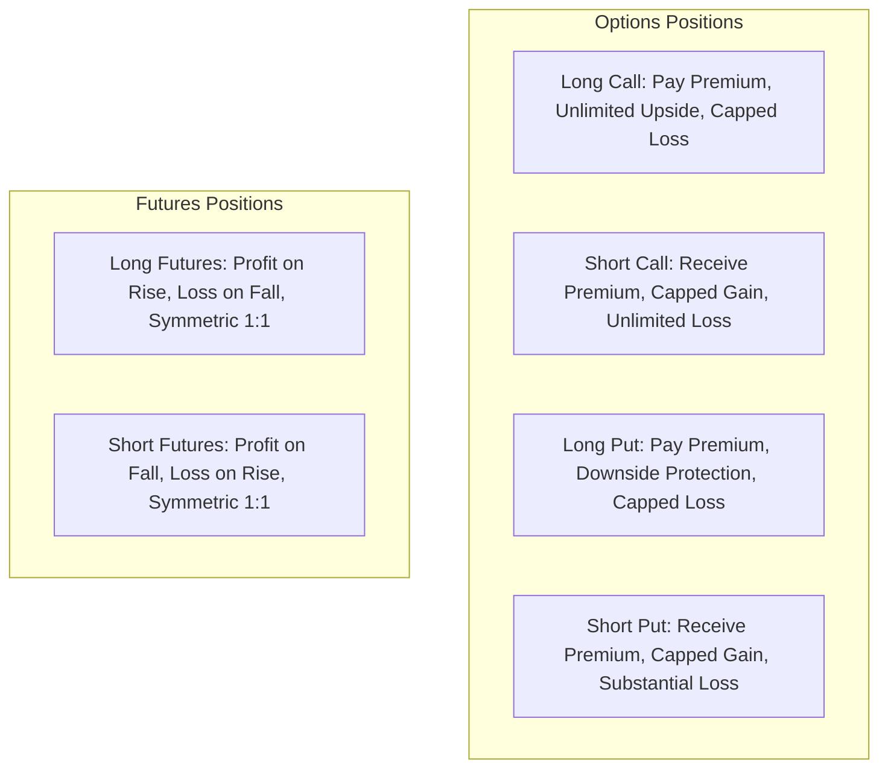

<!-- Generated against commit: 42228bb55d6016ffff439024bbf4aec135269f95 | Date: 2026-09-13 | Verified against live repository state: YES -->

# Volume 15: Derivatives Trading Concepts & Payoff Engine

## 1. Scope & Implementation Boundaries

[FACT]
Derivatives education in Finova AI is anchored in a critical regulatory truth: **SEBI’s retail trading study revealed that over 90% of individual traders incur net losses in the Indian Equity F&O (Futures & Options) segment.**

To protect and educate retail learners, Finova’s Derivatives Layer (led by `DerivativesAgent` / "Prof. Derivo") strictly enforces:
1. **Zero Gambling / Intraday Tips**: Any request for "hero-or-zero" expiry calls, option strikes to buy, or leverage tips is deterministically blocked.
2. **Deterministic Payoff & Breakeven Modeling**: Exact payoff curves for Long/Short Calls, Long/Short Puts, and Futures.
3. **Rigorous Differentiation Between Math and Theory**:
   - **Implemented as Pure Math** `[IMPLEMENTED]`: Payoff functions, breakeven formulas, P&L schedules, max profit/loss bounds, and futures unit multiplication.
   - **Implemented as Static Educational Catalog** `[IMPLEMENTED]`: Option Greeks (Delta, Gamma, Theta, Vega, Rho) definitions, bounds, and practical intuition in [`app/tools/derivatives/greeks.py`](file:///c:/Users/prana/OneDrive/Desktop/finova-ai/app/tools/derivatives/greeks.py).
   - **NOT Implemented** `[REJECTED / DEFERRED]`: Continuous Black-Scholes differential pricing models, live implied volatility (IV) surface solvers, and automated multi-leg options combinations (Iron Condors, Straddles).

---

## 2. Core Concepts: Mathematical vs. Pedagogical Implementation

---

### 1. Call Options (CE)
- **Status**: `[IMPLEMENTED]` in [`app/tools/derivatives/payoff.py`](file:///c:/Users/prana/OneDrive/Desktop/finova-ai/app/tools/derivatives/payoff.py)
- **Financial Concept**: A contract granting the buyer the right (but not the obligation) to purchase an underlying asset at a specified strike price ($K$) on or before expiration ($T$).
- **Mathematical Formula**:
  $$\text{Gross Payoff}(S_T) = \max(0.0, S_T - K)$$
  - If $S_T > K$, the call expires **In-The-Money (ITM)**.
  - If $S_T = K$, the call is **At-The-Money (ATM)**.
  - If $S_T < K$, the call expires worthless **Out-Of-The-Money (OTM)** ($\text{Payoff} = 0$).

---

### 2. Put Options (PE)
- **Status**: `[IMPLEMENTED]` in [`app/tools/derivatives/payoff.py`](file:///c:/Users/prana/OneDrive/Desktop/finova-ai/app/tools/derivatives/payoff.py)
- **Financial Concept**: A contract granting the buyer the right (but not the obligation) to sell an underlying asset at strike price $K$ on or before expiration.
- **Mathematical Formula**:
  $$\text{Gross Payoff}(S_T) = \max(0.0, K - S_T)$$
  - If $S_T < K$, the put expires **In-The-Money (ITM)**.
  - If $S_T = K$, the put is **At-The-Money (ATM)**.
  - If $S_T > K$, the put expires worthless **Out-Of-The-Money (OTM)** ($\text{Payoff} = 0$).

---

### 3. Strike Price ($K$) & Option Premium ($P$)
- **Status**: `[IMPLEMENTED]` as input parameters to `calculate_option_payoff`
- **Strike Price ($K$)**: The pre-determined price at which the contract holder can buy (Call) or sell (Put) the underlying stock/index ($K > 0$).
- **Option Premium ($P$)**: The cash price per share paid by the buyer to the seller (writer) at trade initiation ($P \ge 0$).
- **Boundary Guards**: Enforces $0 < K \le 10^{12}$ and $0 \le P \le 10^{12}$ to protect against floating-point overflow.

---

### 4. Intrinsic Value vs. Time Value (Extrinsic Value)
- **Status**: `[PEDAGOGICALLY GROUNDED]` in `DERIVATIVES_TUTOR_SYSTEM_PROMPT` and SEBI RAG
- **Total Premium Equation**:
  $$\text{Premium} = \text{Intrinsic Value} + \text{Time Value}$$
- **Intrinsic Value**:
  - Call: $\max(0.0, S - K)$
  - Put: $\max(0.0, K - S)$
  - Represents the real immediate cash value if exercised right now.
- **Time Value (Extrinsic Value)**:
  - $\text{Time Value} = \text{Premium} - \text{Intrinsic Value}$.
  - Reflects market expectation of favorable price volatility before expiry.
  - Decays non-linearly to exactly ₹0.00 at contract expiration (Theta decay).

---

### 5. Long Position vs. Short Position
- **Status**: `[IMPLEMENTED]` in `calculate_option_payoff` and `calculate_futures_pnl`



#### Detailed P&L Functions:
1. **Long Call**:
   $$\text{Net P\&L} = \max(0.0, S_T - K) - P$$
   $$\text{Breakeven} = K + P, \quad \text{Max Profit} = \text{"Unlimited"}, \quad \text{Max Loss} = P$$
2. **Short Call** (Option Writer):
   $$\text{Net P\&L} = P - \max(0.0, S_T - K)$$
   $$\text{Breakeven} = K + P, \quad \text{Max Profit} = P, \quad \text{Max Loss} = \text{"Unlimited"}$$
3. **Long Put**:
   $$\text{Net P\&L} = \max(0.0, K - S_T) - P$$
   $$\text{Breakeven} = K - P, \quad \text{Max Profit} = K - P, \quad \text{Max Loss} = P$$
4. **Short Put** (Option Writer):
   $$\text{Net P\&L} = P - \max(0.0, K - S_T)$$
   $$\text{Breakeven} = K - P, \quad \text{Max Profit} = P, \quad \text{Max Loss} = K - P$$

---

### 6. The Long Put Breakeven & The Unclamped Negative Invariant

[FACT]
A frequent point of mathematical failure in options calculators is the handling of deeply in-the-money or high-premium Put options where the premium exceeds the strike ($P > K$).

#### The Mathematical Proof:
For a Put option, breakeven is reached when net profit is exactly zero:
$$\text{Net P\&L} = (K - S_T) - P = 0 \implies S_T = K - P$$

If an investor buys a strike $K = 100$ Put for a premium $P = 150$:
$$S_{\text{breakeven}} = 100 - 150 = -50$$

Because stock prices are non-negative ($S_T \ge 0.0$ in equity markets), the stock can never fall to $-₹50.00$. Even if the underlying company declares bankruptcy and the stock drops to ₹0.00:
$$\text{Max Payoff} = 100 - 0 = 100$$
$$\text{Net P\&L} = 100 - 150 = -50 \quad (\text{A permanent net loss of } ₹50)$$

#### Architectural Implementation in Finova AI:
[`app/tools/derivatives/payoff.py`](file:///c:/Users/prana/OneDrive/Desktop/finova-ai/app/tools/derivatives/payoff.py) implements the following strict invariant:
```python
if opt_type_clean == "call":
    breakeven = round(strike + prem, 2)
    has_feasible_be = True
else:  # put
    breakeven = round(strike - prem, 2)
    has_feasible_be = breakeven >= 0.0  # False if premium > strike!
```
- The breakeven price is **NOT clamped to zero**. It accurately returns `-50.0`.
- The boolean flag `has_feasible_breakeven` is set to `False`.
- The UI and Markdown responses warn the learner that breakeven is mathematically unattainable.

---

### 7. Futures Contracts & P&L Mechanics
- **Status**: `[IMPLEMENTED]` in [`app/tools/derivatives/payoff.py::calculate_futures_pnl`](file:///c:/Users/prana/OneDrive/Desktop/finova-ai/app/tools/derivatives/payoff.py)
- **Financial Concept**: A binding legal agreement to buy or sell a standardized quantity of an asset at a pre-agreed price ($F_0$) on a future date.
- **Formulas**:
  $$\text{Unit P\&L}_{\text{Long}} = S_{\text{exit}} - F_0, \quad \text{Total P\&L}_{\text{Long}} = (S_{\text{exit}} - F_0) \times \text{Lot Size}$$
  $$\text{Unit P\&L}_{\text{Short}} = F_0 - S_{\text{exit}}, \quad \text{Total P\&L}_{\text{Short}} = (F_0 - S_{\text{exit}}) \times \text{Lot Size}$$
  $$\text{Breakeven} = F_0$$
- **Linear Leverage Characteristic**:
  Unlike options (which have asymmetric risk profiles), futures have symmetric 1:1 risk: every ₹1 move in the underlying changes contract value by exactly `1.0 * lot_size`.

---

### 8. Option Greeks Catalog
- **Status**: `[IMPLEMENTED AS STATIC CATALOG]` in [`app/tools/derivatives/greeks.py`](file:///c:/Users/prana/OneDrive/Desktop/finova-ai/app/tools/derivatives/greeks.py)

Finova AI maintains a pedagogical reference catalog for the five classical Option Greeks:

```python
# app/tools/derivatives/models.py
class GreeksInfo(BaseModel):
    name: str
    symbol: str
    definition: str
    range_or_bound: str
    primary_driver: str
    pedagogical_example: str
```

#### Exact Catalog Entries:

| Greek | Symbol | Formal Definition | Normal Range / Bound | Primary Driver | Pedagogical Example in Finova |
| :--- | :---: | :--- | :--- | :--- | :--- |
| **Delta** | $\Delta$ | Expected change in option price for a ₹1 change in underlying stock price. | `0.0 to +1.0` (Calls)<br>`-1.0 to 0.0` (Puts)<br>`1.0` (Futures) | Underlying asset price movement | If NIFTY Call has $\Delta = 0.50$ and NIFTY rises by ₹10, option premium increases by $\approx ₹5$. |
| **Gamma** | $\Gamma$ | Rate of change of Delta for a ₹1 change in underlying stock price (curvature / acceleration). | Always positive for Long options; highest for ATM options near expiry. | Underlying asset price sensitivity relative to strike | If $\Delta = 0.50$ and $\Gamma = 0.05$, when stock rises ₹1, new Delta becomes $\approx 0.55$. |
| **Theta** | $\Theta$ | Rate of decay in option premium per calendar day, all else held constant (Time Decay). | Typically negative for Long options; positive for Option Sellers. | Time to expiration ($T$) | If $\Theta = -₹2.50$, holding the contract for 1 full calendar day without stock movement erodes roughly ₹2.50. |
| **Vega** | $\nu$ | Sensitivity of option price to a 1% change in Implied Volatility (IV). | Always positive for Long options; highest for ATM options with longer tenure. | Implied Volatility (IV) | If Vega $= ₹1.20$ and IV spikes from 15% to 17% (+2%), premium increases by $\approx ₹2.40$ even if stock is flat. |
| **Rho** | $\rho$ | Expected change in option premium for a 1% change in risk-free interest rate (e.g. RBI repo rate). | Positive for Calls; negative for Puts; small impact on short-dated contracts. | Risk-free interest rate ($r$) | Call options increase slightly when interest rates rise due to cost of carry. |

#### Truthfulness Note on Black-Scholes Formula:
[FACT]
The analytical Black-Scholes partial differential equation:
$$C(S, t) = S \cdot N(d_1) - K e^{-r(T-t)} N(d_2)$$
$$d_1 = \frac{\ln(S/K) + (r + \sigma^2/2)(T-t)}{\sigma \sqrt{T-t}}, \quad d_2 = d_1 - \sigma \sqrt{T-t}$$
is **NOT** implemented as a continuous numerical solver in Finova AI. The codebase does not compute live Black-Scholes pricing or dynamic Greeks matrices. Greeks are taught through the static catalog and pedagogical LLM synthesis.

---

## 3. Payoff Table Schedule Generation

[FACT]
When calculating option or futures payoffs, if an explicit list of spot prices is not provided by the caller, `calculate_option_payoff()` deterministically generates a 9-point percentage schedule spanning $-20\%$ to $+20\%$ around the strike price, and injects the exact breakeven price:

```python
# app/tools/derivatives/payoff.py
multipliers = [0.80, 0.85, 0.90, 0.95, 1.00, 1.05, 1.10, 1.15, 1.20]
spots = sorted(set([round(strike * m, 2) for m in multipliers] + [breakeven]))
```

This guarantees that:
1. The table always includes deep out-of-the-money, at-the-money, and deep in-the-money scenarios.
2. The exact breakeven point is always present in the schedule, displaying `Net P&L = ₹0.00`.

---

## 4. Safety Guardrails in the Derivatives Agent

[`app/agents/derivatives/safety.py`](file:///c:/Users/prana/OneDrive/Desktop/finova-ai/app/agents/derivatives/safety.py) intercepts unsafe queries before any tool execution or LLM call:

```python
FORBIDDEN_DERIVATIVES_PATTERNS = [
    # Option recommendations / tips
    r"\b(?:which|what)\s+(?:call|put|strike|option|f&o)\s+(?:to\s+buy|should\s+i\s+buy|will\s+give\s+profit)\b",
    r"\b(?:give\s+me|suggest)\s+(?:a\s+)?(?:call|put|strike|option\s+strategy|zero\s+loss)\b",
    r"\b(?:hero\s+or\s+zero|jackpot|expiry\s+special|100%\s+profit)\b",
    # Trading advice / calls
    r"\b(?:buy|sell|trade)\s+(?:nifty|banknifty|finnifty)\s+\d+\s+(?:ce|pe|call|put)\b",
    r"\b(?:target|stoploss)\s+for\s+(?:nifty|banknifty|[A-Za-z]+)\s+(?:call|put|option)\b",
]
```

When triggered, the agent immediately halts in `<1ms` and issues:
```
"Disclaimer: Finova AI is an educational platform and cannot provide options tips, 
strike recommendations, or directional trading calls. Options trading carries substantial risk."
```
