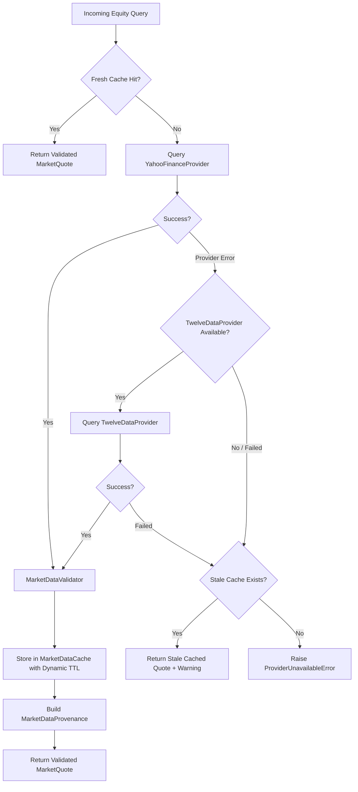

<!-- Generated against commit: 42228bb55d6016ffff439024bbf4aec135269f95 | Date: 2026-09-13 | Verified against live repository state: YES -->

# Volume 16: Live Market Data Architecture & Provider Orchestration

## 1. Architectural Philosophy: The Separation of Truth

[FACT]
Finova AI operates under a foundational system invariant:
```
"LLMs are never the source of truth for live market numbers."
```
Stock prices, index levels, day ranges, trading volumes, and company financials are strictly retrieved via deterministic external provider adapters, passed through a multi-stage validation pipeline, cached with session-aware expiration, and presented directly in structured response contracts.



---

## 2. Provider Inventory: Active, Secondary, and Rejected

[FACT]
The table below documents every market data provider evaluated or implemented in Finova AI, verifying its exact repository status:

| Provider | Status in Repository | File / Implementation | Rationale & Trade-offs |
| :--- | :--- | :--- | :--- |
| **Yahoo Finance (`yfinance`)** | `[IMPLEMENTED - PRIMARY]` | [`app/tools/market/providers/yfinance_provider.py`](file:///c:/Users/prana/OneDrive/Desktop/finova-ai/app/tools/market/providers/yfinance_provider.py) | Comprehensive coverage of NSE/BSE tickers, indices (`^NSEI`, `^BSESN`), 1-month historical candles, and company fundamentals without paid API keys. |
| **Twelve Data** | `[IMPLEMENTED - SECONDARY]` | [`app/tools/market/providers/twelve_data_provider.py`](file:///c:/Users/prana/OneDrive/Desktop/finova-ai/app/tools/market/providers/twelve_data_provider.py) | Official REST API adapter. Active when `TWELVE_DATA_API_KEY` is present in environment; gracefully disabled (`is_available=False`) if key is absent. |
| **Mock Provider** | `[IMPLEMENTED - TEST ONLY]` | `tests/test_market_service.py` | In-memory mock implementing `BaseMarketDataProvider` for deterministic unit testing and CI test hermeticity. |
| **Direct NSE Web Scraping** | `[REJECTED]` | Not implemented | Scraping `nseindia.com` violates NSE Terms of Service, triggers aggressive Akamai IP bans, and introduces brittle HTML parser fragility. |
| **Broker Trading APIs (Zerodha Kite, Upstox)** | `[REJECTED]` | Not implemented | Requires paid API subscriptions, daily active user OAuth login tokens, and direct trading account credentials. Violates educational, read-only design principles. |
| **Alpha Vantage** | `[DEFERRED]` | Not implemented | Highly restrictive free tier (25 requests/day), high latency (>1.5s), and inconsistent real-time quote accuracy for Indian equities. |

---

## 3. Abstract Provider Architecture (`BaseMarketDataProvider`)

All market data providers inherit from `BaseMarketDataProvider` in [`app/tools/market/interfaces.py`](file:///c:/Users/prana/OneDrive/Desktop/finova-ai/app/tools/market/interfaces.py):

```python
class BaseMarketDataProvider(ABC):
    @property
    @abstractmethod
    def name(self) -> str:
        """Human-readable provider identifier."""
        pass

    @property
    @abstractmethod
    def is_available(self) -> bool:
        """True if provider is currently reachable and configured."""
        pass

    @abstractmethod
    def get_quote(self, symbol: str, exchange: Literal["NSE", "BSE"] = "NSE") -> MarketQuote:
        """Fetch standardized real-time or closing market quote."""
        pass

    @abstractmethod
    def get_historical_summary(
        self, symbol: str, period: str = "1mo", interval: str = "1d", exchange: Literal["NSE", "BSE"] = "NSE"
    ) -> HistoricalPrices:
        """Fetch aggregated historical daily price schedule."""
        pass

    @abstractmethod
    def get_company_overview(self, symbol: str, exchange: Literal["NSE", "BSE"] = "NSE") -> CompanyOverview:
        """Fetch fundamental company metrics, sector, and business profile."""
        pass
```

### Typed Error Hierarchy
- `MarketDataError`: Base exception for all market data errors.
- `SymbolNotFoundError`: Raised when a ticker does not exist on NSE/BSE. Re-raised immediately without provider failover.
- `ProviderUnavailableError`: Raised on upstream network timeout, HTTP 500, or DNS failure. Triggers secondary failover or stale cache retrieval.
- `RateLimitExceededError`: Raised on HTTP 429 rate limit. Triggers immediate failover to secondary provider or stale cache.
- `DataValidationError`: Raised when provider data fails sanity checks (negative price, NaN, inverted bounds).

---

## 4. Primary Provider: `YahooFinanceProvider`

[`app/tools/market/providers/yfinance_provider.py`](file:///c:/Users/prana/OneDrive/Desktop/finova-ai/app/tools/market/providers/yfinance_provider.py) implements the primary adapter:

### 1. Symbol & Ticker Normalization
Indian exchanges require exchange-specific suffixes for Yahoo Finance:
```python
def _normalize_ticker(self, symbol: str, exchange: str = "NSE") -> str:
    clean = symbol.strip().upper()
    # Map index aliases to Yahoo index tickers
    if clean in ("NIFTY", "NIFTY50", "NIFTY 50"):
        return "^NSEI"
    if clean in ("SENSEX", "BSE SENSEX"):
        return "^BSESN"
    if clean in ("BANKNIFTY", "BANK NIFTY"):
        return "^NSEBANK"
    
    if "." in clean or clean.startswith("^"):
        return clean
    return f"{clean}.NS" if exchange.upper() == "NSE" else f"{clean}.BO"
```

### 2. Fast-Info Extraction Pipeline
The provider attempts extraction via `ticker.fast_info` first (sub-100ms latency), falling back to `ticker.info`:
- `last_price`: Extracted from `last_price`, `regularMarketPrice`, or latest daily close.
- `previous_close`: Extracted from `previous_close` or `regularMarketPreviousClose`.
- `change` & `change_percent`: Calculated deterministically if omitted:
  $$\text{Change} = \text{Price} - \text{Previous Close}$$
  $$\text{Change \%} = \frac{\text{Change}}{\text{Previous Close}} \times 100$$
- `day_high` & `day_low`: Extracted from `day_high` / `day_low` or historical candle bounds.
- `volume`: Total traded shares.

---

## 5. Indian Market Clock & NSE Holiday Calendar

### 5.1 Timezone Localization
All market hours are evaluated strictly in **Indian Standard Time (IST, UTC+05:30)** using `ZoneInfo("Asia/Kolkata")` in [`app/tools/market/clock.py`](file:///c:/Users/prana/OneDrive/Desktop/finova-ai/app/tools/market/clock.py).

### 5.2 Session Schedule Boundaries

```mermaid
timeline
    title Indian Equity Trading Sessions (IST)
    09:00 : Pre-Open Session Starts (Order entry & equilibrium price discovery)
    09:15 : Regular Continuous Trading Starts (Continuous automated matching)
    15:30 : Regular Continuous Trading Closes
    16:00 : Post-Close Session Ends (Weighted average closing price calculation)
    Night / Weekend : Market Closed
```

- **Pre-Open Session**: `09:00 AM – 09:15 AM IST`
- **Regular Trading Session**: `09:15 AM – 03:30 PM IST` (Monday to Friday)
- **Post-Close Session**: `03:30 PM – 04:00 PM IST`
- **Closed**: Weekends (Saturday, Sunday) and official NSE Trading Holidays.

### 5.3 NSE Trading Holiday Calendar
The `MarketClock` loads official holidays from [`data/market/nse_holidays.json`](file:///c:/Users/prana/OneDrive/Desktop/finova-ai/data/market/nse_holidays.json). If the current date matches a listed holiday (e.g. Republic Day, Diwali, Independence Day), `clock.is_trading_holiday()` returns `(True, "Holiday Name")` and marks the market closed regardless of the clock time.

---

## 6. Dynamic TTL Caching & Stale Fallback

[`app/tools/market/cache.py`](file:///c:/Users/prana/OneDrive/Desktop/finova-ai/app/tools/market/cache.py) manages a thread-safe, in-memory TTL cache with dynamic session awareness:

### 6.1 Dynamic TTL Calculation Rules
```python
def calculate_quote_ttl(self, dt: datetime | None = None) -> float:
    now = dt or self.clock.get_ist_now()
    session = self.clock.get_session(now)

    if session == "regular_trading":
        return 60.0  # 60 seconds during live market

    # Market is closed, pre-open, or post-close
    next_open = self.clock.get_next_open(now)
    seconds_to_open = (next_open - now).total_seconds()
    if seconds_to_open > 0:
        return min(seconds_to_open, 43200.0)  # Max 12 hours
    return 60.0
```

1. **Regular Trading Session (Live)**: TTL is strictly **60.0 seconds**. Every 60s, fresh bids/asks and traded prices are re-fetched.
2. **Market Closed / Weekend / Holiday**: Because the market is not trading, prices cannot change until the next session open. The cache dynamic TTL is set to **the exact seconds remaining until next market open (capped at 12 hours / 43,200 seconds)**. This prevents thousands of redundant network queries for identical closing prices.
3. **Historical Data TTL**: **3,600.0 seconds (1 hour)**.
4. **Company Fundamentals TTL**: **86,400.0 seconds (24 hours)**.

### 6.2 Stale Cache Fallback
If upstream providers experience network outages or rate limiting:
1. `MarketDataService` attempts to fetch fresh data.
2. Upon catching `ProviderUnavailableError` or `RateLimitExceededError`, it calls `cache.get_quote(symbol, exchange, allow_stale=True)`.
3. If an expired cache entry exists:
   - Sets `freshness_status = "stale_cached_fallback"`.
   - Logs a warning with the underlying error.
   - Returns the cached quote to the user rather than failing.
4. If no cache entry exists, raises `ProviderUnavailableError`.

---

## 7. Market Data Validation & Normalization

[`app/tools/market/validator.py`](file:///c:/Users/prana/OneDrive/Desktop/finova-ai/app/tools/market/validator.py) subjects every quote to rigorous structural integrity checks before storing it in cache or passing it to agents:

### 1. Numerical Sanity Checks
- **Positive Price**: $P > 0.0$.
- **Finite Price**: Reject `math.isnan(price)` and `math.isinf(price)`.
- **Reasonable Range**: $0.01 \le P \le 10,000,000.00$.
- **Bounds Consistency**: $\text{Day High} \ge \text{Day Low}$. If provider returns inverted high/low, validator normalizes:
  $$\text{Day High} = \max(\text{High}, \text{Low}), \quad \text{Day Low} = \min(\text{High}, \text{Low})$$
- **Previous Close**: Must be positive and finite.

### 2. Freshness Status Tagging
The validator labels quotes with an accurate lifecycle tag:
- `"realtime"`: Live quote during active regular trading hours.
- `"last_close"`: Final traded price during overnight closed hours.
- `"weekend_closed"`: Closing price over Saturday / Sunday.
- `"holiday_closed"`: Closing price during an NSE official holiday.
- `"stale_cached_fallback"`: Outdated quote served during provider outage.

### 3. Provenance Assembly (`MarketDataProvenance`)
```python
class MarketDataProvenance(BaseModel):
    symbol: str
    exchange: Literal["NSE", "BSE"]
    price: float
    change: float
    change_percent: float
    previous_close: float | None = None
    high: float | None = None
    low: float | None = None
    volume: int | None = None
    currency: str = "INR"
    market_status: Literal["pre_open", "regular_trading", "post_close", "closed"]
    freshness_status: MarketDataFreshness
    market_timestamp: str
    retrieved_at: str
    provider: str
    company_name: str | None = None
```

---

## 8. Frontend Rendering & Markdown Formatting

Market quotes are formatted deterministically:
- In Markdown: Built by `ResponseComposer.format_quote_card()`:
  ```markdown
  ### 📊 Market Quote: **Reliance Industries Limited (RELIANCE) on NSE**
  - **Current / Last Traded Price:** ₹2,985.40 (+15.20, +0.51%)
  - **Previous Close:** ₹2,970.20
  - **Day Range:** ₹2,965.00 - ₹2,998.00
  - **Volume:** 4,120,530 shares
  - **Market Session:** Regular Trading
  - **Data Freshness:** Realtime (as of 2026-09-13T11:45:00+05:30)
  - **Provider:** Yahoo Finance
  ```
- In React: `frontend/src/components/chat/MarketCard.tsx` renders an interactive card showing price badges, green/red gain/loss pills, day range slider, and timestamp.


---

## 9. Phase 4 Reliability Enhancements & Data Freshness Invariants

### 1. Incomplete / NaN Historical Bar Filtering
In historical 1-month daily summaries (`get_historical_summary`), external providers (such as Yahoo Finance) can intermittently append an unfinalized intraday bar with `NaN` values for `Close`, `High`, or `Low`.
- **Filtering Rule**: Prior to calculating period metrics, all price bars are checked for finite positive values and valid high/low bounds ($Close > 0$, $High > 0$, $Low > 0$, $High \ge Low$). Non-finite or incomplete bars are discarded.
- **Empty Guard**: If no valid bars remain after filtering, a typed `MarketDataError` is raised rather than manufacturing metrics.

### 2. Stale Cache Freshness & Timestamp Invariants
- When transient network outages or rate limits occur, expired cache entries may be served if `allow_stale=True`.
- **Status Stamping**: Any quote returned via the stale fallback path is explicitly marked with `freshness_status = "stale_cached_fallback"`.
- **Timestamp Integrity**: The original `retrieved_at` timestamp recorded at provider retrieval time is preserved, truthfully exposing the true age of the data. FinTrack never fabricates current timestamps for stale market quotes.

### 3. Hermetic Provider Testing
- Providers are covered by deterministic, mock-based unit tests (`test_market_providers.py`) using `unittest.mock` fixtures for quotes, rate limiting (429), symbol not found (404), and historical bar filtering, eliminating reliance on external network availability during automated testing.
