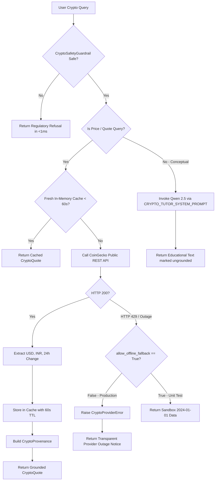

<!-- Generated against commit: 42228bb55d6016ffff439024bbf4aec135269f95 | Date: 2026-09-13 | Verified against live repository state: YES -->

# Volume 17: Cryptocurrency Layer, CoinGecko Integration & Grounding Isolation

## 1. Architectural Role & Domain Isolation

[FACT]
The Cryptocurrency Layer in Finova AI provides non-speculative, objective education on distributed ledger technology, consensus mechanisms, smart contracts, and decentralized finance, alongside real-time market data quotes for canonical digital assets.

Unlike traditional equities and mutual funds (which operate under formal SEBI regulatory frameworks in India), virtual digital assets (VDAs) exist outside SEBI's regulatory purview. Consequently, Finova AI enforces a strict architectural boundary:
1. **Zero Crypto Recommendations**: No token shilling, price predictions, pump warnings, or yield-farming directives.
2. **Dual USD/INR Currency Normalization**: Real-time prices normalized simultaneously in US Dollars ($) and Indian Rupees (₹).
3. **Strict Production Fallback Isolation**: The system never presents synthetic, simulated, or offline sandbox prices as live market quotes.
4. **Deferred Crypto RAG**: The SEBI RAG knowledge base contains no crypto documents; conceptual explanations are isolated and tagged `grounding_status="ungrounded"`.



---

## 2. Abstract Provider Interface (`BaseCryptoProvider`)

[`app/tools/crypto/interfaces.py`](file:///c:/Users/prana/OneDrive/Desktop/finova-ai/app/tools/crypto/interfaces.py) defines the contract governing all cryptocurrency data access:

```python
class BaseCryptoProvider(ABC):
    """Abstract interface for all cryptocurrency data providers.
    
    The Crypto Agent and Crypto Data Service interact strictly through this interface,
    ensuring providers can be swapped or failed-over without modifying agent logic.
    """

    @property
    @abstractmethod
    def name(self) -> str:
        """Human-readable provider name."""
        pass

    @property
    @abstractmethod
    def is_available(self) -> bool:
        """True if provider is operational and reachable."""
        pass

    @abstractmethod
    def get_quote(self, symbol: str) -> CryptoQuote:
        """Fetch standardized crypto quote for the given canonical symbol (e.g. 'BTC')."""
        pass
```

### Exception Hierarchy
- `CryptoProviderError`: Base exception for upstream HTTP timeouts, 5xx server errors, or 429 rate limits.
- `CryptoAssetNotFoundError`: Raised when an unmapped or invalid ticker is requested.

---

## 3. Primary Provider: `CoinGeckoProvider`

[`app/tools/crypto/providers/coingecko_provider.py`](file:///c:/Users/prana/OneDrive/Desktop/finova-ai/app/tools/crypto/providers/coingecko_provider.py) implements the public CoinGecko API adapter:

### 3.1 Endpoint & Query Parameters
- **Base URL**: `https://api.coingecko.com/api/v3/simple/price`
- **HTTP Client**: `httpx.Client(timeout=5.0)`
- **Query Parameters**:
  ```python
  params = {
      "ids": cg_id,
      "vs_currencies": "usd,inr",
      "include_24hr_change": "true",
  }
  ```

### 3.2 Canonical Asset Mapping (`COINGECKO_ASSET_MAP`)
CoinGecko indexes assets by unique slug identifiers rather than ticker symbols. The provider maps canonical tickers deterministically:

```python
COINGECKO_ASSET_MAP: dict[str, tuple[str, str]] = {
    "BTC": ("bitcoin", "Bitcoin"),
    "ETH": ("ethereum", "Ethereum"),
    "SOL": ("solana", "Solana"),
    "USDT": ("tether", "Tether"),
    "DOGE": ("dogecoin", "Dogecoin"),
    "XRP": ("ripple", "XRP"),
    "ADA": ("cardano", "Cardano"),
    "BNB": ("binancecoin", "BNB"),
}
```

### 3.3 Dual USD / INR Normalization
A single API request simultaneously returns valuations in both fiat currencies:
- `price_usd`: Primary international valuation.
- `price_inr`: Converted Indian Rupee equivalent, formatted as `₹X,XX,XXX.XX`.
- `change_24h`: 24-hour rolling percentage change (`usd_24h_change`), rounded to 2 decimal places.

---

## 4. In-Memory Caching & Rate-Limit Mitigation

[`app/tools/crypto/service.py`](file:///c:/Users/prana/OneDrive/Desktop/finova-ai/app/tools/crypto/service.py) coordinates quote requests via `CryptoDataService`:

### 4.1 Thread-Safe TTL Cache
- **Storage**: In-memory dictionary `_cache: dict[str, tuple[CryptoQuote, float]]`.
- **Locking**: Guarded by `threading.Lock()` to prevent race conditions across concurrent asynchronous worker requests.
- **TTL Window**: Strictly **60.0 seconds**.
- **Rate-Limit Defense**: Because CoinGecko’s free public tier limits requests (typically 10–30 calls/min per IP), the 60s cache ensures that repeated inquiries for popular assets (e.g. Bitcoin or Ethereum) hit memory rather than exhausting API quotas.

---

## 5. Outages, Stale Data & The Historical Fallback Sandbox

### 5.1 The Truthfulness Invariant: Never Disguise Test Data as Real-Time Prices
[FACT]
A critical failure mode in API integrations is silently falling back to hardcoded mock data when an external network service fails, while stamping the mock data with `datetime.now()` to make it appear fresh.

In Finova AI, this is strictly prevented by code and architectural policy:

```python
# app/tools/crypto/providers/coingecko_provider.py (lines 47-50, 98-115)
def __init__(self, timeout: float = 5.0, allow_offline_fallback: bool = False) -> None:
    self._timeout = timeout
    self._allow_offline_fallback = allow_offline_fallback
    self._client = httpx.Client(timeout=self._timeout)

...

# Fallback to local sandbox pricing ONLY if explicitly enabled via test injection
if self._allow_offline_fallback and clean_symbol in FALLBACK_PRICES:
    fb_usd, fb_inr, fb_chg = FALLBACK_PRICES[clean_symbol]
    # Use fixed historic sandbox timestamp; never disguise test data with datetime.now()
    sandbox_ts = "2024-01-01T00:00:00Z"
    return CryptoQuote(
        symbol=clean_symbol,
        name=asset_name,
        price_usd=fb_usd,
        price_inr=fb_inr,
        change_24h=fb_chg,
        market_timestamp=sandbox_ts,
        retrieved_at=sandbox_ts,
        provider="CoinGecko-Sandbox",
        freshness_status="cached_fallback",
    )

raise CryptoProviderError(f"CoinGecko service unavailable or rate-limited for crypto symbol '{clean_symbol}'")
```

### 5.2 The Historical Verification of Fallback Isolation
1. **Repository Evidence** `[FACT]`:
   - In [`app/tools/crypto/providers/coingecko_provider.py`](file:///c:/Users/prana/OneDrive/Desktop/finova-ai/app/tools/crypto/providers/coingecko_provider.py), `allow_offline_fallback` defaults to `False`.
   - In git commit `70d4982` ("feat(phase-4): Central Router, Crypto Agent, and Personal Finance Tutor"), the commit log explicitly documents:
     ```
     - Add Cryptocurrency tool layer with BaseCryptoProvider, CoinGeckoProvider, 
       CryptoDataService caching, strict production fallback isolation, and Crypto Tutor Agent
     ```
2. **Context on Discovery** `[UNKNOWN — External Review Discovery]`:
   Whether the requirement for a fixed historical timestamp (`"2024-01-01T00:00:00Z"`) and `"CoinGecko-Sandbox"` provider label was initiated during early Phase 4 specification or discovered during an external adversarial prompt review is not documented in the Git commit messages beyond the Phase 4 delivery commit.

### 5.3 Production Outage Behavior
When `allow_offline_fallback=False` (production default) and CoinGecko fails:
1. `CoinGeckoProvider` raises `CryptoProviderError`.
2. `CryptoAgent.ask()` catches the error and issues a transparent notice:
   ```markdown
   ### 🪙 Market Data Notice: **BTC**

   Real-time market data for **BTC** is temporarily unavailable due to upstream provider connectivity or rate-limiting.
   Finova AI does not estimate or simulate live cryptocurrency prices. Please try again shortly.
   ```
3. `grounding_status` is marked `"ungrounded"`.
4. `crypto_data` payload is set to `None`.
5. Zero false prices are delivered to the user.

---

## 6. Safety Boundaries in `CryptoSafetyGuardrail`

[`app/agents/crypto/safety.py`](file:///c:/Users/prana/OneDrive/Desktop/finova-ai/app/agents/crypto/safety.py) intercepts speculative inquiries before invoking the LLM or tools:

```python
FORBIDDEN_CRYPTO_PATTERNS = [
    # Coin shilling & recommendations
    r"\b(?:which|what)\s+(?:crypto|coin|token|altcoin)\s+(?:to\s+buy|should\s+i\s+buy|will\s+pump|will\s+100x)\b",
    r"\b(?:give\s+me|suggest)\s+(?:a\s+)?(?:crypto|coin|token)\s+(?:tip|call|recommendation)\b",
    r"\b(?:best|top)\s+(?:crypto|coin)\s+to\s+(?:invest|buy)\s+(?:in|now|today)\b",
    # Price predictions / speculative targets
    r"\b(?:will|can)\s+(?:bitcoin|btc|eth|solana|crypto)\s+(?:reach|hit)\s+(?:\$|\brs\.?\s*)?\d+\b",
    r"\b(?:predict|forecast)\s+(?:bitcoin|btc|eth|crypto)\s+price\b",
    # Direct investment instructions
    r"\b(?:how\s+to|where\s+to)\s+(?:buy|trade)\s+(?:crypto|bitcoin|ethereum)\s+for\s+(?:quick|fast|guaranteed)\s+profit\b",
]
```

When triggered, the guardrail aborts in `<1ms` with:
```
"Disclaimer: Finova AI is an educational platform and cannot provide cryptocurrency recommendations, 
price predictions, or trading advice. Digital assets carry severe market risk and volatility."
```

---

## 7. Why Crypto RAG was Deferred

[FACT]
Finova AI's vector retrieval system (Qdrant `finova_sebi_knowledge`) is populated exclusively with authoritative documents sourced from the Securities and Exchange Board of India (`data/sebi_corpus/`):
- Securities Market Primer
- Mutual Fund Regulations
- Retail F&O Trading Loss Study
- SCORES Grievance Redressal
- Depository & Demat Mechanics
- Investor Rights & Responsibilities

### The Regulatory Reason for Deferral:
In India, virtual digital assets (VDAs) and cryptocurrencies are **not regulated securities under SEBI**. The Reserve Bank of India (RBI) and SEBI have maintained public advisories clarifying that crypto assets are unregulated speculative instruments operating without statutory investor protections.

Consequently:
1. **Zero Authoritative SEBI Texts**: There are no SEBI investor education booklets teaching Bitcoin mining, smart contracts, or automated market makers (AMMs).
2. **Risk of Polluted Citations**: If synthetic or unofficial crypto articles were mixed into `finova_sebi_knowledge`, SEBI's regulatory seal and citations would be falsely applied to unregulated assets.
3. **Architectural Choice**: Crypto grounding is achieved **deterministically via CoinGecko live prices**, while conceptual education is driven by `CRYPTO_TUTOR_SYSTEM_PROMPT` running on local Qwen 2.5 with `grounding_status="ungrounded"`.

---

## 8. Frontend Rendering & Data Payloads

### 8.1 Data Contract (`CryptoProvenance`)
```python
class CryptoProvenance(BaseModel):
    symbol: str               # "BTC"
    name: str                 # "Bitcoin"
    price_usd: float          # 68450.00
    price_inr: float | None   # 5745000.00
    change_24h: float         # 2.15
    market_timestamp: str     # ISO 8601
    retrieved_at: str         # ISO 8601
    provider: str             # "CoinGecko"
    freshness_status: str     # "realtime"
```

### 8.2 React Component (`CryptoCard.tsx`)
In `frontend/src/components/chat/CryptoCard.tsx`:
- Renders an asset card with the coin icon and ticker badge.
- Displays large primary USD price and smaller INR equivalent.
- Displays 24-hour percentage pill in green (`+`) or red (`-`).
- Displays live provider badge: `"CoinGecko"` and UTC timestamp.
