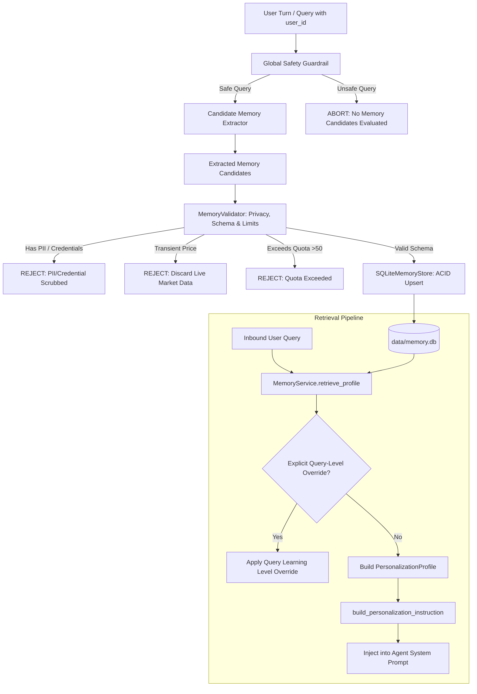

<!-- Generated against commit: 42228bb55d6016ffff439024bbf4aec135269f95 | Date: 2026-09-13 | Verified against live repository state: YES -->

# Volume 18: Persistent User Memory, Personalization & Privacy Isolation

## 1. Architectural Philosophy: The Bounded Memory Invariant

[FACT]
Finova AI’s long-term memory system (`app/memory/`) was introduced in Phase 5 to bridge stateless conversational turns and personalized financial pedagogy. However, unlike unconstrained agentic memory systems (which store arbitrary user statements or speculative LLM inferences), Finova enforces the **Bounded Memory Invariant**:

```
"Persistent memory stores only validated, structured educational attributes (learning level,
goals, instructional preferences) from explicit statements. It strictly forbids speculative
LLM inferences, PII (PAN, Aadhaar, cards), account credentials, and transient market quotes."
```



---

## 2. Memory Taxonomy & Schema Definitions

[`app/memory/models.py`](file:///c:/Users/prana/OneDrive/Desktop/finova-ai/app/memory/models.py) specifies the strict categorical domain for persistent memory:

### 2.1 Permitted Memory Types
```python
MemoryType = Literal[
    "USER_PREFERENCE",       # Instructional formatting (e.g. explanation_style: concise)
    "LEARNING_LEVEL",        # Beginner, Intermediate, Advanced
    "LEARNING_GOAL",         # Specific topics of interest (e.g. options_trading)
    "INTEREST",              # General domain interests (e.g. mutual_funds, crypto)
    "EDUCATIONAL_PROGRESS",  # Completed quiz modules, mastery scores
]
```

### 2.2 Memory Provenance
```python
MemorySource = Literal["explicit_user_statement", "system_default"]
```
[FACT]
Speculative sources (such as `inferred_by_llm` or `web_tracking`) are syntactically excluded from `MemorySource`. Memory records must trace directly to an unambiguous statement by the user or a curated platform default.

### 2.3 The `MemoryRecord` Data Contract
```python
class MemoryRecord(BaseModel):
    memory_id: str               # UUID4 identifier
    user_id: str                 # Mandatory application-level partition identifier
    memory_type: MemoryType      # Normalized uppercase category
    key: str                     # Unique attribute key within partition & type
    value: Any                   # Structured JSON or primitive payload
    source: MemorySource         # Provenance
    confidence: float            # Float in [0.0, 1.0] (default 1.0)
    created_at: str              # ISO 8601 UTC timestamp
    updated_at: str              # ISO 8601 UTC timestamp
    expires_at: str | None       # Optional TTL expiration timestamp
```

---

## 3. Storage Architecture: `SQLiteMemoryStore`

[`app/memory/store.py`](file:///c:/Users/prana/OneDrive/Desktop/finova-ai/app/memory/store.py) implements the storage layer using Python’s standard library `sqlite3`:

### 3.1 Relational Schema & Partitioning
```sql
CREATE TABLE IF NOT EXISTS user_memories (
    memory_id TEXT PRIMARY KEY,
    user_id TEXT NOT NULL,
    memory_type TEXT NOT NULL,
    key TEXT NOT NULL,
    value TEXT NOT NULL,
    source TEXT NOT NULL,
    confidence REAL NOT NULL,
    created_at TEXT NOT NULL,
    updated_at TEXT NOT NULL,
    expires_at TEXT,
    UNIQUE(user_id, memory_type, key)
);

CREATE INDEX IF NOT EXISTS idx_user_memories_user_type 
ON user_memories (user_id, memory_type);

CREATE INDEX IF NOT EXISTS idx_user_memories_user_expires 
ON user_memories (user_id, expires_at);
```

### 3.2 Key Architectural Properties
1. **Deterministic Upsert**: The composite constraint `UNIQUE(user_id, memory_type, key)` ensures that updating a preference (e.g. setting learning level to `advanced`) overwrites the previous value atomically, preserving the original `created_at` timestamp while updating `updated_at`.
2. **ACID Isolation & Thread Safety**: All database reads and writes pass through a Python `threading.Lock()`, ensuring thread-safety under asynchronous Uvicorn worker threads.
3. **Partition Boundary Integrity**: All queries are hard-parameterized by `user_id`. There are zero cross-user joins, zero shared global preference tables, and zero cross-tenant visibility.

---

## 4. Extraction & Validation Guardrails

### 4.1 Candidate Extraction (`app/memory/extractor.py`)
Memory candidates are identified through fast, deterministic regex rules without invoking an LLM:
- **Learning Level Statements**:
  - `"I am a beginner"` -> `key="level"`, `value="beginner"`, `confidence=1.0`
  - `"Explain to me like an expert / advanced"` -> `key="level"`, `value="advanced"`
  - `"I have intermediate knowledge"` -> `key="level"`, `value="intermediate"`
- **Instructional Preferences**:
  - `"Keep your answers concise"` -> `key="explanation_style"`, `value="concise"`
  - `"Provide deep dive explanations"` -> `key="explanation_style"`, `value="detailed"`
- **Learning Goals & Topics**:
  - `"I want to learn about options trading"` -> `key="goal_derivatives"`, `value="options_trading"`

### 4.2 Privacy & Security Validation (`app/memory/validator.py`)
Before any candidate record is persisted to `user_memories`, `MemoryValidator.validate_candidate()` subjects it to strict filtering:

```python
# app/memory/validator.py
MAX_KEY_LENGTH = 64
MAX_VALUE_LENGTH = 512
MAX_USER_MEMORIES = 50

CARD_REGEX = re.compile(r"\b(?:\d[ -]*?){13,19}\b")
PAN_REGEX = re.compile(r"\b[A-Z]{5}[0-9]{4}[A-Z]{1}\b", re.IGNORECASE)
AADHAAR_REGEX = re.compile(r"\b\d{4}\s?\d{4}\s?\d{4}\b")
PHONE_REGEX = re.compile(r"\b(?:\+91|91|0)?[6-9]\d{9}\b")
SECRET_KEYWORDS = re.compile(r"\b(?:password|passwd|secret|api[_-]?key|token|bearer|pin|cvv|otp|auth)\b", re.IGNORECASE)
ACCOUNT_KEYWORDS = re.compile(r"\b(?:account\s*(?:no|number)|a/c\s*(?:no|number)|bank\s*acc)\b", re.IGNORECASE)
TRANSIENT_MARKET_PATTERNS = re.compile(r"\b(?:trading\s+at|current\s+price|last\s+traded|bought\s+at|sold\s+at|portfolio\s+balance)\b", re.IGNORECASE)
```

#### Rejection Rules:
1. **PII Scrubbing**: If text matches Indian PAN, Aadhaar, phone numbers, or credit card numbers, it is rejected immediately with `MemoryValidationError`.
2. **Credential Protection**: Keywords matching passwords, tokens, API keys, or OTPs trigger rejection.
3. **No Transient Market Data**: If a candidate attempts to store stock prices ("Reliance is at 2950"), it is rejected; prices belong in the market cache, not long-term user memory.
4. **Partition Memory Quota**: A single user is limited to a maximum of **50 active memory records**, preventing denial-of-service memory bloat.

---

## 5. Personalization Profile Assembly & LLM Injection

### 5.1 Profile Construction
When an authenticated request (`user_id="user_123"`) arrives:
1. `MemoryService.retrieve_profile(user_id)` queries `user_memories` where `expires_at IS NULL OR expires_at > NOW()`.
2. It aggregates memories into `PersonalizationProfile`:
   - `learning_level`: Normalized level (`beginner`, `intermediate`, `advanced`).
   - `learning_goals`: List of target concepts.
   - `preferences`: Key-value styling directives.

### 5.2 Dynamic Query-Level Overrides
If a user with an `advanced` profile asks: `"Explain IPOs like I'm 5 / in simple terms"`, the orchestrator detects the local query modifier and temporarily overrides `profile.learning_level = "beginner"` for that single execution without mutating the database record.

### 5.3 Safe Prompt Injection
[`app/memory/models.py::build_personalization_instruction`](file:///c:/Users/prana/OneDrive/Desktop/finova-ai/app/memory/models.py) builds the prompt addendum appended to the tutor's system prompt:

```markdown
### Learner Personalization Guidelines (Educational Tone Only — Never Alter Financial Facts):
- **Learner Profile:** Beginner level. Explain concepts using clear intuitive intuition, simple relatable analogies, and define any technical jargon simply.
- **Declared Learning Objectives:** options_trading, mutual_funds.
- **Instructional Preferences:** explanation_style: concise.
```

#### The Educational-Only Invariant:
The system prompt strictly instructs the LLM that personalization applies **only to instructional tone, vocabulary, and analogies**. It explicitly forbids the LLM from altering calculations, regulations, risk disclosures, or SEBI citations to fit user preferences.

---

## 6. Privacy Rights & The Right to be Forgotten

[FACT]
Finova AI implements the statutory Right to be Forgotten through dedicated REST API endpoints in [`app/api/endpoints/memory.py`](file:///c:/Users/prana/OneDrive/Desktop/finova-ai/app/api/endpoints/memory.py):

| Endpoint | HTTP Method | Description | Privacy Guarantee |
| :--- | :---: | :--- | :--- |
| `/memory` | `GET` | Retrieve active user profile and raw memory records | Read-only; isolated by `user_id` |
| `/memory/{memory_id}` | `DELETE` | Delete a single specific memory record | Permanent deletion from disk |
| `/memory` | `DELETE` | Erase all stored records for `user_id` | Full Right to be Forgotten execution |

### API-Only Deletion Invariant:
Natural language chat commands like `"Delete my memory"` or `"Forget me"` are intentionally routed to `OnboardingAgent` (`app/agents/onboarding/agent.py`).
The agent explains that memory deletion requires calling the authenticated REST API (`DELETE /memory?user_id=...`). This prevents prompt injection attacks or malicious third parties from tricking the system into wiping user data through chat messages.
