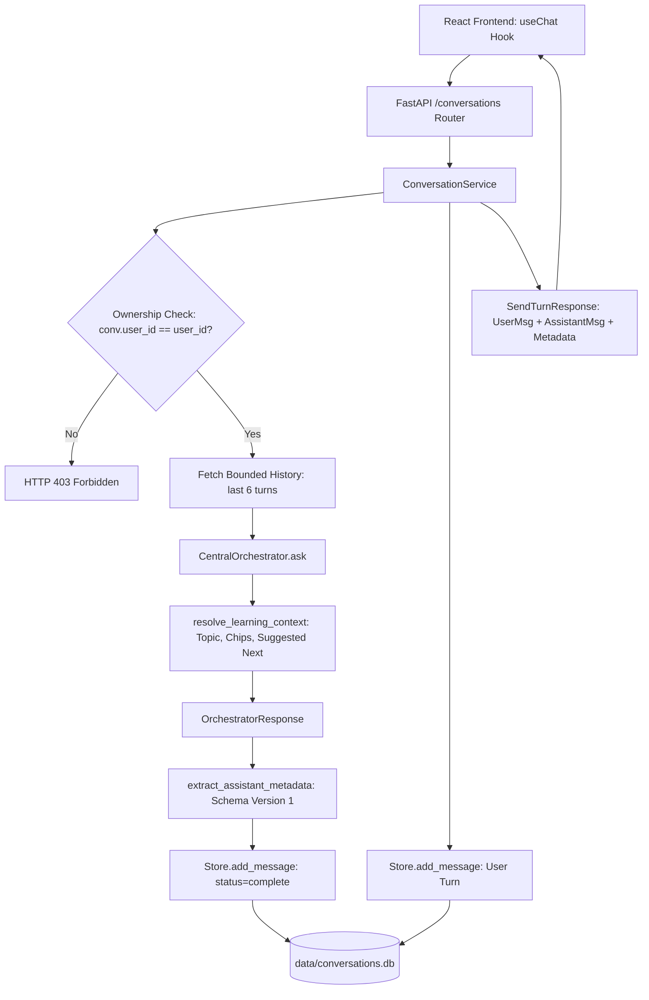
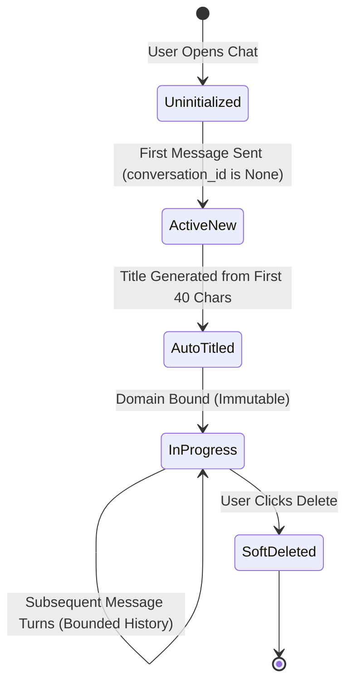

<!-- Generated against commit: 42228bb55d6016ffff439024bbf4aec135269f95 | Date: 2026-09-13 | Verified against live repository state: YES -->

# Volume 19: Persistent Conversations, Chat History & Learning Continuity

## 1. Architectural Mandate: Stateless Turn Execution vs. Stateful Memory

[FACT]
Finova AI’s core orchestration pipeline is fundamentally **stateless**: every execution of `CentralOrchestrator.ask()` takes an isolated query, an optional user identifier, an explicit sliding window of conversation history, and an optional domain context.

To provide consumer-grade chat continuity (persisting multi-turn dialogues across browser refreshes, providing a searchable conversation sidebar, and maintaining educational topic continuity), Finova introduces the **Conversation Layer** (`app/conversations/`).



---

## 2. Storage Architecture: `data/conversations.db`

[`app/conversations/store.py`](file:///c:/Users/prana/OneDrive/Desktop/finova-ai/app/conversations/store.py) manages a dedicated SQLite database located at `data/conversations.db`:

### 2.1 Relational Schema

```sql
CREATE TABLE IF NOT EXISTS conversations (
    conversation_id TEXT PRIMARY KEY,
    user_id TEXT NOT NULL,
    title TEXT NOT NULL,
    domain TEXT DEFAULT 'general',
    created_at TEXT NOT NULL,
    updated_at TEXT NOT NULL,
    is_deleted INTEGER DEFAULT 0
);

CREATE INDEX IF NOT EXISTS idx_conversations_user_updated
ON conversations (user_id, updated_at DESC);

CREATE INDEX IF NOT EXISTS idx_conversations_user_domain
ON conversations (user_id, domain);

CREATE TABLE IF NOT EXISTS messages (
    message_id TEXT PRIMARY KEY,
    conversation_id TEXT NOT NULL,
    role TEXT NOT NULL,
    content TEXT NOT NULL,
    timestamp TEXT NOT NULL,
    status TEXT DEFAULT 'complete',
    metadata TEXT,
    is_deleted INTEGER DEFAULT 0,
    FOREIGN KEY(conversation_id) REFERENCES conversations(conversation_id)
);

CREATE INDEX IF NOT EXISTS idx_messages_conversation_time
ON messages (conversation_id, timestamp ASC);
```

### 2.2 Invariants of the Relational Model
1. **User Partitioning & IDOR Protection**: Every conversation is strictly bound to `user_id`. `ConversationService.verify_ownership()` ensures that User A cannot read, append to, or delete conversations belonging to User B.
2. **Soft Deletion (`is_deleted`)**: Deleting a conversation sets `is_deleted = 1` rather than performing an irreversible hard delete, supporting audit logging and accidental recovery.
3. **Chronological Message Ordering**: Messages are indexed by `(conversation_id, timestamp ASC)`. Pagination or retrieval always yields true temporal order.

---

## 3. The Conversation Lifecycle



### 1. Initiation & Auto-Titling
- When a user sends a message without a `conversation_id`, the service creates a new conversation record.
- **Deterministic Auto-Titling**: `generate_conversation_title(query)` cleans punctuation, strips leading filler words ("What is", "Tell me about"), and extracts a capitalized title up to 40 characters (e.g. `"What is an IPO?"` -> `"An IPO"`).

### 2. Domain Immutability
- When a conversation is initiated within a specialized tutor section (e.g. Derivatives), the conversation record stores `domain="derivatives"`.
- **The Immutability Invariant**: Even if the user subsequently navigates to the Equity tab in the UI, resuming this conversation continues to route under `domain_context="derivatives"`. The stored conversation domain is permanent.

### 3. Bounded History Retrieval (`get_bounded_history`)
To prevent blowing out local LLM context windows (Qwen 2.5 7B has limited VRAM on consumer laptops):
- `get_bounded_history(conversation_id, max_turns=6)` selects only the **last 6 completed messages** (`status="complete"`).
- Failed messages and internal system alerts are omitted from the LLM context.

---

## 4. Assistant Message Metadata Schema (Version 1)

[FACT]
To avoid storing redundant duplicates of the entire assistant text in the database, [`app/conversations/models.py`](file:///c:/Users/prana/OneDrive/Desktop/finova-ai/app/conversations/models.py) defines a compact, versioned metadata contract:

```python
class AssistantMessageMetadata(BaseModel):
    schema_version: int = 1
    domain_detected: str
    grounding_status: str
    citations: list[dict[str, Any]] = Field(default_factory=list)
    market_data: dict[str, Any] | None = None
    market_data_list: list[dict[str, Any]] = Field(default_factory=list)
    crypto_data: dict[str, Any] | None = None
    calc_data: dict[str, Any] | None = None
    derivatives_data: dict[str, Any] | None = None
    portfolio_data: dict[str, Any] | None = None
    news_data: list[dict[str, Any]] | None = None
    quiz_data: dict[str, Any] | None = None
    onboarding_data: list[dict[str, Any]] | None = None
    topic: str | None = None
    related_concepts: list[str] = Field(default_factory=list)
    suggested_next: list[str] = Field(default_factory=list)
```

When a conversation is retrieved from `GET /conversations/{id}`, the frontend reconstructs rich UI cards (MarketCard, CryptoCard, CalcCard, QuizCard) directly from this serialized metadata JSON block without re-running any tools.

---

## 5. Learning Context Resolution & Topic Continuity

Phase 11 introduced [`app/conversations/learning_context.py`](file:///c:/Users/prana/OneDrive/Desktop/finova-ai/app/conversations/learning_context.py), an educational intelligence module that analyzes each conversational turn to maintain pedagogical continuity:

```python
def resolve_learning_context(
    query: str,
    domain: str,
    conversation_history: list[dict[str, str]] | None = None,
    orchestrator_response: Any = None,
) -> LearningContextResult:
    # 1. Resolve educational topic name
    # 2. Extract related pedagogical concepts
    # 3. Suggest logical next inquiries
```

### 1. Pedagogical Topic Classification
Maps queries to standardized curriculum units:
- `"What is an IPO?"` -> `topic = "Initial Public Offerings (IPO)"`
- `"Calculate option payoff for 25000 call"` -> `topic = "Call Option Payoffs & Breakevens"`
- `"50/30/20 budget for 60k salary"` -> `topic = "50/30/20 Budgeting Rule"`

### 2. Related Concept Chips
Generates 2–4 clickable exploration chips rendered in `frontend/src/components/chat/RelatedConcepts.tsx`:
- For an IPO query: `["Draft Red Herring Prospectus (DRHP)", "Book Building Process", "Anchor Investors"]`
- For a Long Put query: `["Option Premium Decay (Theta)", "Strike Selection", "Put-Call Ratio (PCR)"]`

### 3. Suggested Next Questions
Generates contextual pedagogical follow-ups:
- `"How are shares allocated during an oversubscribed IPO?"`
- `"What happens if my option expires Out-of-the-Money?"`
- Clicking a suggestion automatically submits it as the user's next conversational turn.

---

## 6. Failure Resilience & Transactional Turns

If an upstream exception occurs during turn processing (e.g. an unexpected Ollama crash or database timeout):
1. The user's query has already been safely persisted to `data/conversations.db` with `status="complete"`.
2. The exception is caught by `ConversationService.send_turn()`.
3. An assistant error record is generated with `status="failed"` and stored with `create_failed_metadata(exc)`.
4. The conversation remains structurally intact without desynchronizing message counts or leaving hanging state.
