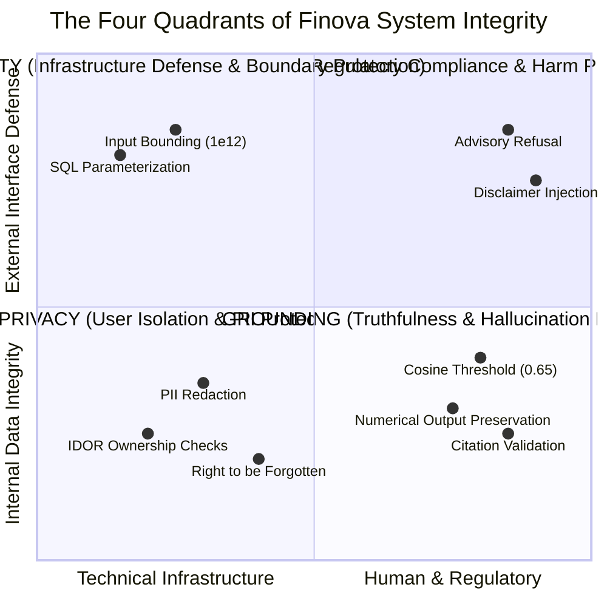

<!-- Generated against commit: 42228bb55d6016ffff439024bbf4aec135269f95 | Date: 2026-09-13 | Verified against live repository state: YES -->

# Volume 20: Safety, Security, Privacy & Grounding Architecture

## 1. The Four Quadrants of System Integrity

[FACT]
In production AI systems, terms like "safety" and "security" are frequently conflated. Finova AI enforces a clear, unambiguous architectural distinction across four distinct quadrants of system integrity:

---

## 2. Quadrant 1: SAFETY (Regulatory Compliance & Harm Prevention)

### 2.1 Mandate & Legal Boundary
Finova AI is an educational platform and is **not a SEBI-registered Investment Adviser (RIA) or Research Analyst (RA)**. Under Indian law (SEBI Regulations 2013/2014), providing personalized investment advice, recommending specific stock purchases, or promising returns without statutory licensing is a punishable violation.

### 2.2 Implemented Safety Defenses
1. **Global Safety Pre-Filtering** (`app/router/safety.py`):
   - Evaluates incoming queries in `<1.0ms` using pre-compiled regex patterns before any LLM inference, vector retrieval, or tool dispatch.
   - **Equity Rules**: Blocks queries like `"Should I buy Reliance?"`, `"Give me hot intraday stock tips"`, `"Target price for TCS"`.
   - **Crypto Rules**: Blocks `"Which coin will 100x?"`, `"Should I buy Bitcoin today?"`.
   - **Derivatives Rules**: Blocks `"Give me hero or zero option calls for Thursday expiry"`.
   - **Guaranteed Returns**: Rejects any request for `"100% risk-free investments with 20% return"`.
2. **Context-Aware Permissive Exceptions**:
   - Legitimate conceptual queries using the word "buy" or "sell" are preserved:
     - `"What is the difference between a buy order and a sell order?"` -> **ALLOWED (Educational)**.
     - `"How does an investor decide whether to buy or sell?"` -> **ALLOWED (Conceptual)**.
3. **Mandatory Disclaimer Appending**:
   - Every agent response attaches a prominent regulatory disclaimer (`EQUITY_DISCLAIMER`, `DERIVATIVES_DISCLAIMER`, `CRYPTO_DISCLAIMER`, `DEFAULT_DISCLAIMER`).

### 2.3 Safety Limitations
[FACT]
- **Adversarial Circumlocution**: Because the fast-path guardrail relies on deterministic regex, novel obfuscations, multilingual phonetic transliterations (e.g. Hinglish: *"Mujhe batao kaunsa share khareedna chahiye"*), or multi-layered hypothetical roleplay could theoretically bypass regex detection.
- **Secondary Defense**: When regex does not trigger, the system prompt strictly instructs Qwen 2.5 never to recommend stocks or forecast prices.

---

## 3. Quadrant 2: SECURITY (Infrastructure & Boundary Protection)

### 3.1 Mandate
Protects system availability, computational resources, and storage engines against technical attacks, input overflow, and injection.

### 3.2 Implemented Security Defenses
1. **Numerical Input Bounding**:
   - In [`app/tools/derivatives/payoff.py`](file:///c:/Users/prana/OneDrive/Desktop/finova-ai/app/tools/derivatives/payoff.py), strike price and premium inputs are bounded to $0 < K \le 10^{12}$ and $0 \le P \le 10^{12}$.
   - Prevents floating-point infinity or exponential calculation crashes.
2. **Strict SQL Parameterization**:
   - Both SQLite stores ([`app/memory/store.py`](file:///c:/Users/prana/OneDrive/Desktop/finova-ai/app/memory/store.py) and [`app/conversations/store.py`](file:///c:/Users/prana/OneDrive/Desktop/finova-ai/app/conversations/store.py)) strictly use parameterized queries (`?` placeholders).
   - Zero dynamic string formatting (`f"SELECT ... WHERE user_id = '{user_id}'"`) exists in the repository.
   - Verified resistant to SQL injection attacks like `'60000; DROP TABLE user_memories; --'`.
3. **Input Length Constraints**:
   - Query strings are stripped and bounded via Pydantic (`Field(max_length=...)`).
   - Memory keys are capped at 64 characters, values at 512 characters.
4. **Internal Error Shielding**:
   - Upstream exceptions (e.g. database disconnects or external API timeouts) are intercepted in service layers and returned as sanitized JSON error payloads, shielding raw stack traces from end users.

### 3.3 Security Limitations
[FACT]
- **No Distributed Rate Limiter**: Rate limiting is currently handled in application code and cache layers. In high-volume production, a reverse proxy (e.g. Cloudflare, NGINX) is required to mitigate volumetric DDoS attacks.

---

## 4. Quadrant 3: PRIVACY (User Data Isolation & PII Scrubbing)

### 4.1 Mandate
Guarantees user data confidentiality, protects Personally Identifiable Information (PII), and enforces the Right to be Forgotten.

### 4.2 Implemented Privacy Defenses
1. **Deterministic PII Scrubbing** (`app/memory/validator.py`):
   - Candidate memories are evaluated against pre-compiled regex filters before being written to disk:
     - Indian Permanent Account Number (PAN): `[A-Z]{5}[0-9]{4}[A-Z]{1}`
     - Aadhaar Number: `\d{4}\s?\d{4}\s?\d{4}`
     - Indian Mobile Numbers: `(?:\+91|91|0)?[6-9]\d{9}`
     - Payment Card Numbers: 13 to 19 digit sequences (`CARD_REGEX`).
     - Account credentials: passwords, tokens, API keys, CVVs, OTPs.
   - If any match is detected, the candidate memory is immediately rejected.
2. **Multi-Tenant User Isolation (IDOR Defense)**:
   - In [`app/conversations/service.py`](file:///c:/Users/prana/OneDrive/Desktop/finova-ai/app/conversations/service.py), `verify_ownership(conversation_id, user_id)` verifies ownership on every read, message append, title update, and deletion.
   - Attempting to access another user's conversation ID raises `HTTP 403 Forbidden`.
3. **Telemetry PII Redaction** (`app/core/telemetry.py`):
   - Production telemetry logs mask PII patterns in query previews before writing to log sinks.
4. **Right to be Forgotten & API-Only Deletion**:
   - `DELETE /memory?user_id=...` permanently deletes all user memories from disk.
   - Natural language commands in chat cannot trigger memory deletion, preventing accidental or injection-based data loss.

### 4.3 Privacy Limitations
[FACT]
- **Obfuscated / Written-Out Numbers**: A user typing their phone number in English words (*"nine eight four five..."*) will not trigger the numerical regex pattern.

---

## 5. Quadrant 4: GROUNDING (Truthfulness & Anti-Hallucination)

### 5.1 Mandate
Ensures that all educational text, market data, and financial figures delivered to users are verifiable, factually grounded, and cited.

### 5.2 Implemented Grounding Defenses
1. **The Deterministic Calculation Engine**:
   - Calculations (SIP, compound interest, 50/30/20 budget, emergency fund, option payoffs, futures P&L, portfolio metrics) are executed in pure Python code.
   - The LLM is never allowed to calculate or alter numbers.
2. **Response Composer Invariant**:
   - `ResponseComposer` stitches tool outputs directly into Markdown cards.
   - It never re-summarizes numerical tool outputs through an LLM prompt.
3. **Strict Qdrant Vector Retrieval Filter**:
   - Embeddings evaluated using cosine similarity in 384 dimensions.
   - Distance threshold: strictly `score_threshold = 0.65`.
   - Any query falling below 0.65 is marked out-of-corpus; LLM generation is bypassed to prevent hallucinated regulatory citations.
4. **Automated Citation Extraction & Validation**:
   - System prompts instruct Qwen to cite retrieved documents using bracketed indices (`[1]`, `[2]`).
   - `RAGService.validate_citations()` verifies each marker against the retrieved chunk list. Unverified markers are stripped.
5. **Strict Grounding Status Contract**:
   - Responses report an explicit triad: `fully_grounded`, `partially_grounded`, or `ungrounded`.
6. **Crypto Sandbox Isolation**:
   - In production, `allow_offline_fallback = False`.
   - When CoinGecko is down, the system raises an error and presents an honest outage notice rather than masquerading test prices as live quotes.

### 5.3 Grounding Limitations
[FACT]
- **Generative General Pedagogy**: Broad financial definitions that do not match specific SEBI corpus texts are marked `grounding_status="ungrounded"`. The user is informed via metadata that the answer is general generative knowledge rather than statutory citation.
