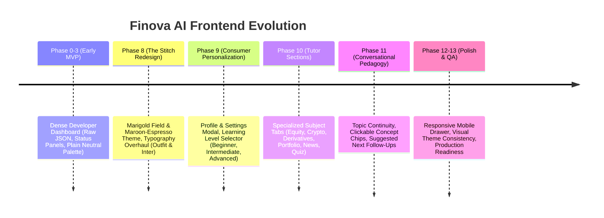
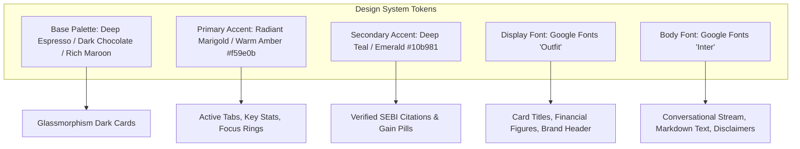

<!-- Generated against commit: 42228bb55d6016ffff439024bbf4aec135269f95 | Date: 2026-09-13 | Verified against live repository state: YES -->

# Volume 24: Frontend Evolution, Design System & Pedagogical UI/UX

## 1. The Visual Journey: From Developer Dashboard to Consumer Appliance

[FACT]
The user interface of Finova AI underwent a dramatic, multi-phase transformation across the project lifecycle:



---

## 2. Stage 1: The Initial Developer Dashboard (Phases 0–3)

### Characteristics & Limitations
- **Visual Feel**: Technical admin portal / developer debugging console.
- **Layout**: Fixed three-column grid with a prominent raw JSON telemetry inspect panel, manual slider controls for vector retrieval parameters (`top_k`, `score_threshold`), and a small central chat input.
- **Color Palette**: Browser default grays, plain blues, and uncalibrated white backgrounds.
- **Feedback**: While functional for backend engineering, it lacked emotional resonance, felt intimidating to retail financial beginners, and obscured pedagogical learning flows behind developer diagnostics.

---

## 3. Stage 2: The "Marigold Field" & "Maroon-Espresso" Redesign (Phase 8)

Delivered under commits `864df7d` and `c6f0dc9`, Phase 8 was a comprehensive design overhaul based on the curated **"Marigold Field" / "Maroon-Espresso"** aesthetic.



### 3.1 Color Palette Tokens
1. **Background & Surface Tones (Maroon-Espresso)**:
   - Deep canvas: `#0d0b0a` (Near-black espresso tone).
   - Card surfaces: `#1c1917` (Rich stone / chocolate) with subtle border borders (`border-stone-800/60`).
   - Prevents harsh pure-black eye fatigue while providing high contrast for text and visual cards.
2. **Primary Accent (Radiant Marigold / Warm Amber)**:
   - Tokens: `#f59e0b` (Amber-500) and `#d97706` (Amber-600).
   - Signifies financial optimism, focus, and intellectual warmth. Used for active navigation tabs, action buttons, prompt suggestion borders, and primary highlights.
3. **Secondary Accent (Deep Teal / Emerald)**:
   - Tokens: `#10b981` (Emerald-500) and `#14b8a6` (Teal-500).
   - Used for positive market gains (`+1.45%`), verified SEBI citation badges, and live market open indicators.

### 3.2 Typography System
- **Display & Headings**: **`Outfit`** (Google Fonts). Applied to brand identity, card headers, and large numerical price displays. Provides a modern, geometric, and authoritative aesthetic.
- **Body & Dialogue**: **`Inter`** (Google Fonts). Applied to user chat messages, educational explanations, disclaimers, and data tables. Engineered for maximum screen legibility at small sizes.

---

## 4. Stage 3: Conversation-First Layout & Specialized Cards

Phase 8 and 9 repositioned the application to be **Conversation-First**:
- **Clean Layout**: A flexible two-pane layout featuring a collapsible left history sidebar and an expansive central chat canvas.
- **No Monolithic Text Blocks**: When tools return data, the assistant does not dump raw tables or unformatted text. Instead, `ChatMessage.tsx` renders rich, interactive React components based on message metadata.

### The Specialized Card Suite:

| Card Component | Source File | Visual Elements |
| :--- | :--- | :--- |
| **`MarketCard.tsx`** | `frontend/src/components/chat/MarketCard.tsx` | Company name, NSE/BSE badge, live price in ₹, green/red change pill, day high/low range bar, volume, market session status, and source attribution. |
| **`CryptoCard.tsx`** | `frontend/src/components/chat/CryptoCard.tsx` | Asset logo/symbol, primary USD valuation ($), converted Indian Rupee equivalent (₹), 24h delta, and CoinGecko provenance badge. |
| **`CalcCard.tsx`** | `frontend/src/components/chat/CalcCard.tsx` | Visual progress breakdown meters (50% Needs, 30% Wants, 20% Savings), SIP total invested vs wealth gain bars, or emergency fund runway gauges. |
| **`DerivativesCard.tsx`** | `frontend/src/components/chat/DerivativesCard.tsx` | Option summary badges (Strike, Premium, Breakeven, Max Loss/Gain) and clean P&L schedules highlighting gross payoff vs net profit across spot prices. |
| **`PortfolioCard.tsx`** | `frontend/src/components/chat/PortfolioCard.tsx` | Total portfolio valuation, cash liquidity gauge, asset allocation breakdown bars, holdings table, and simulated what-if market stress test delta. |
| **`NewsCard.tsx`** | `frontend/src/components/chat/NewsCard.tsx` | Verified headlines, publishing source tags, relative timestamp badges, summary snippets, and external canonical source links. |
| **`QuizCard.tsx`** | `frontend/src/components/chat/QuizCard.tsx` | Multi-choice interactive challenge questions with selectable option pills, instant submit grading, score percentage meters, and curriculum review links. |

---

## 5. Stage 4: Consumer Profile & Personalization Settings (Phase 9)

Delivered under commit `e063300`, Phase 9 introduced the **Profile & Settings Modal** ([`frontend/src/components/profile/ProfileSettingsModal.tsx`](file:///c:/Users/prana/OneDrive/Desktop/finova-ai/frontend/src/components/profile/ProfileSettingsModal.tsx)):

```mermaid
graph LR
    User[User Clicks Profile Avatar] --> Modal[ProfileSettingsModal.tsx]
    Modal --> LevelSelector[Learning Level: Beginner | Intermediate | Advanced]
    Modal --> StyleSelector[Explanation Style: Concise | Detailed | Practical]
    Modal --> InterestPills[Declared Topics: Equities, Derivatives, Crypto, Mutual Funds]
    Modal --> MemoryTable[Active Saved Memories Table with Individual Delete]
    Modal --> ClearAll[Danger Zone: Clear All Memories - Right to be Forgotten]
    
    LevelSelector --> API[PUT /profile]
    StyleSelector --> API
    InterestPills --> API
    MemoryTable --> API_Del[DELETE /memory/id]
    ClearAll --> API_Clear[DELETE /memory]
```

### Key UI Invariants:
1. **Visual Level Calibration**: Users can switch between Beginner, Intermediate, and Advanced at any time. The UI immediately reflects this in active conversation instructions.
2. **Transparent Memory Inspection**: The modal displays every raw memory record currently stored in `data/memory.db`, giving the user total visibility into what the system remembers.
3. **One-Click Deletion**: Each memory record has a discrete trash icon for granular deletion; a red "Danger Zone" button executes the full statutory Right to be Forgotten (`DELETE /memory`).

---

## 6. Stage 5: Domain Tutor Sections & Section Bias (Phase 10)

Delivered under commit `92cae10`, Phase 10 introduced specialized subject sections:
- **Navigation Tabs**: The top header features quick navigation between **General**, **Equity**, **Derivatives**, **Personal Finance**, **Crypto**, **Portfolio**, **News**, and **Quiz**.
- **Section Bias**: Selecting a tutor section automatically injects `domain_context` into subsequent queries, ensuring domain immutability.
- **Tutor Personas**: The assistant dynamically adopts specialized pedagogical identities:
  - *Equity Tutor*
  - *Prof. Derivo (Derivatives Tutor)*
  - *Prof. Persona (Personal Finance Tutor)*
  - *Prof. Crypton (Crypto Tutor)*
  - *Portfolio Tutor*
  - *Market News Agent*
  - *Quiz Tutor*

---

## 7. Stage 6: Learning Actions & Topic Continuity (Phase 11)

Delivered under commit `460d8ab`, Phase 11 elevated Finova from a reactive question-answering tool into an active educational tutor:

1. **Pedagogical Topic Banner**: The top of the chat displays the active learning topic resolved by `resolve_learning_context()` (e.g. *"Topic: Initial Public Offerings (IPO)"*).
2. **Related Concept Chips** (`frontend/src/components/chat/RelatedConcepts.tsx`):
   - Clickable interactive pills rendered beneath assistant responses.
   - Example: After learning about Call Options, the assistant suggests chips for `[Theta Time Decay]`, `[Implied Volatility]`, and `[Put-Call Ratio]`.
   - Clicking a chip immediately submits it as the next query.
3. **Suggested Next Questions**:
   - Curated follow-ups encouraging learners to explore deeper mechanics.
4. **Interactive Quiz Triggers**:
   - A `"Quiz Me on this Topic"` action button allows users to immediately test their understanding of the topic just discussed.

---

## 8. Stage 7: Responsive Behavior & Mobile Optimization (Phases 12–13)

- **Mobile Drawer Sidebar**: On screens `<768px`, the left history sidebar gracefully collapses into a touch-friendly slide-over drawer toggled by a hamburger menu.
- **Card Horizontal Scrolling**: Dense financial data tables and payoff schedules support horizontal scrolling with sticky headers on mobile displays, preventing layout breakage.
- **Safe Tap Targets**: All buttons, chips, and option pills enforce minimum $44 \times 44\text{px}$ touch targets meeting WCAG AA mobile accessibility standards.
- **Local State Persistence**: The active conversation ID, sidebar collapse state, and user identity are persisted in browser `localStorage`, ensuring seamless continuity across page refreshes.
